# MISC-签个到吧-招新入门

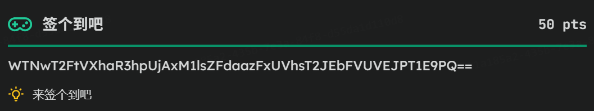

知base64用cyberchef，还需了解学习其原理

WTNwT2FtVXhaR3hpUjAxM1lsZFdaazFxUVhsT2JEbFVUVEJPT1E9PQ==

czNje1dlbGMwbWVfMjAyNl9TM0N9    ？这也是base64，标志之一是末尾补充等号

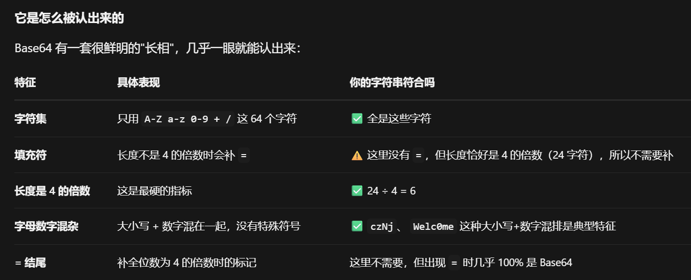

s3c{Welc0me_2026_S3C}

# CRYPTO-古典密码-招新入门

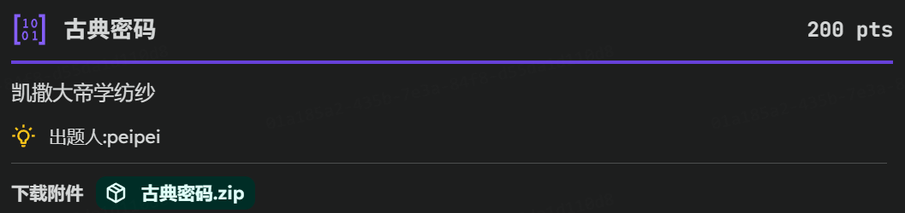

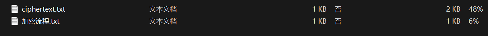

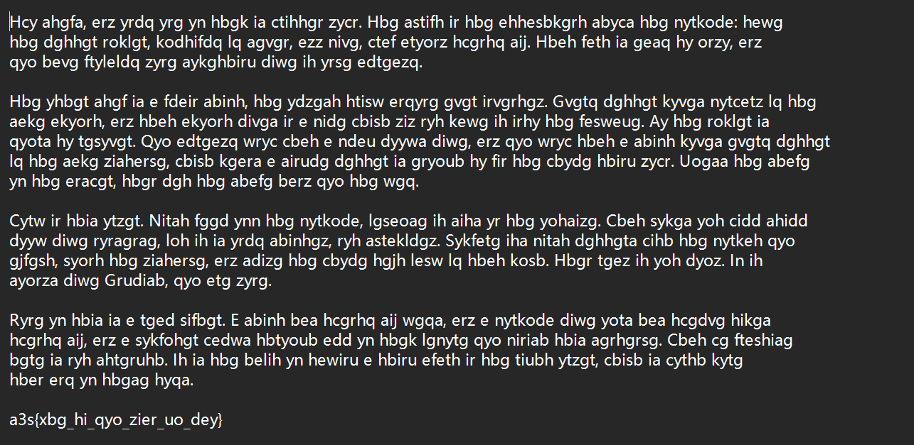

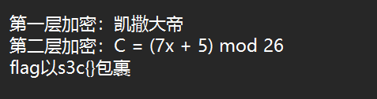

根据提示：凯撒密码（明文字母左移11位）+仿射密码

由 密文 -> (仿射) 次密文 -> (凯撒) 明文

问ai怎么转吧

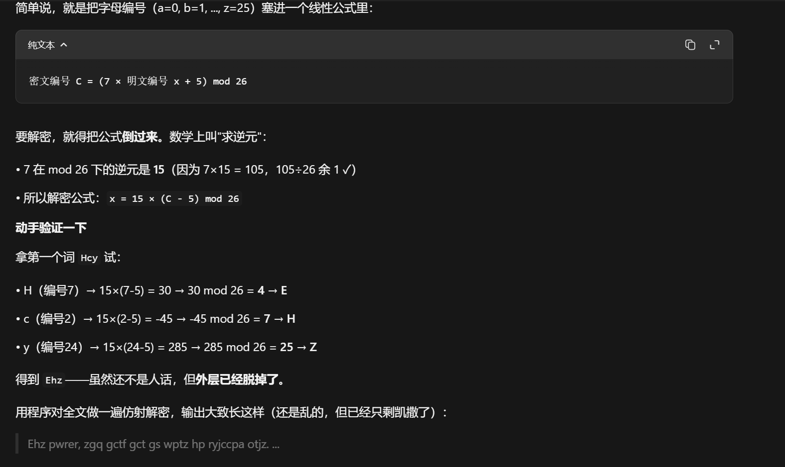

逆元

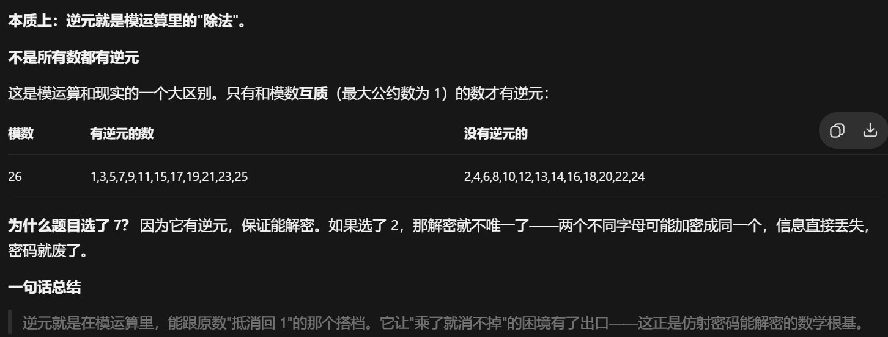

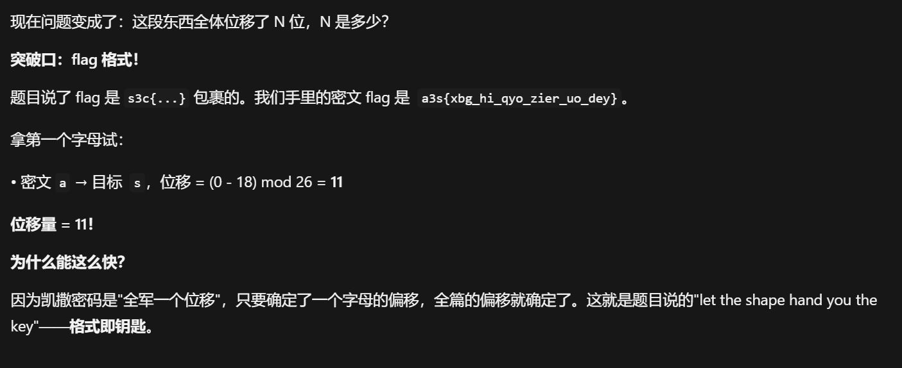

s3c{zhe_ti_you_dian_gu_lao}

# MISC-Misc入门指北-招新入门

先看文件类型：pdf

再看文档内容，有很多经验与提示

可恶这方面不太了解，问一下ai：ctf的misc题给了pdf有什么思路

浏览器打开无法编辑，转向wps

试试ctl+a,原来有文字颜色和背景一样的

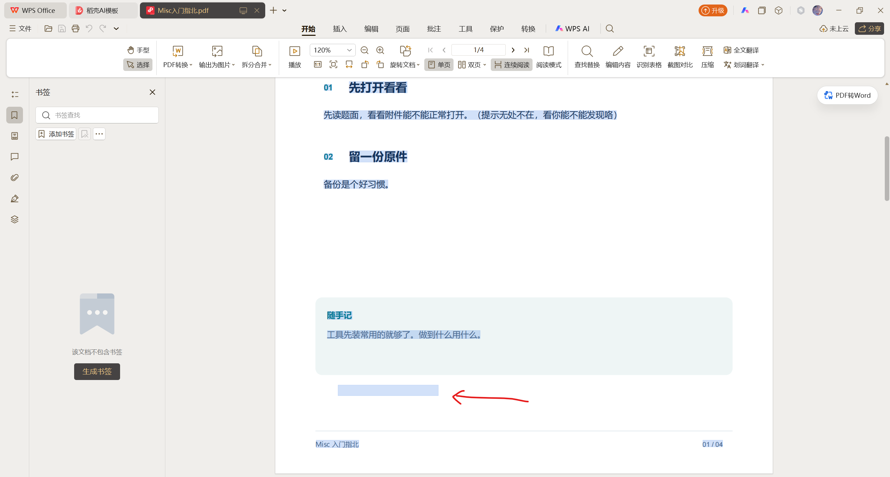

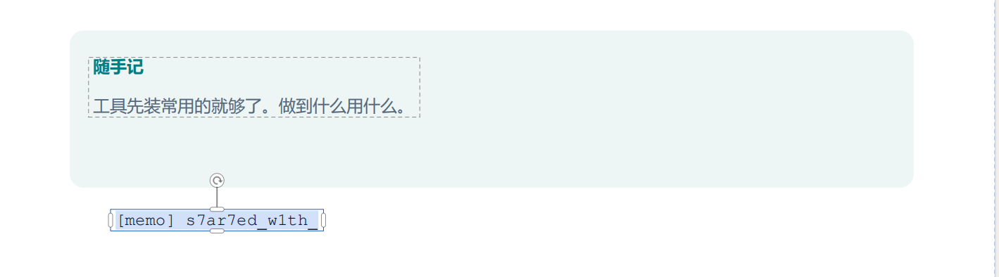

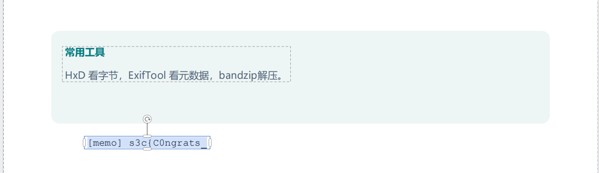

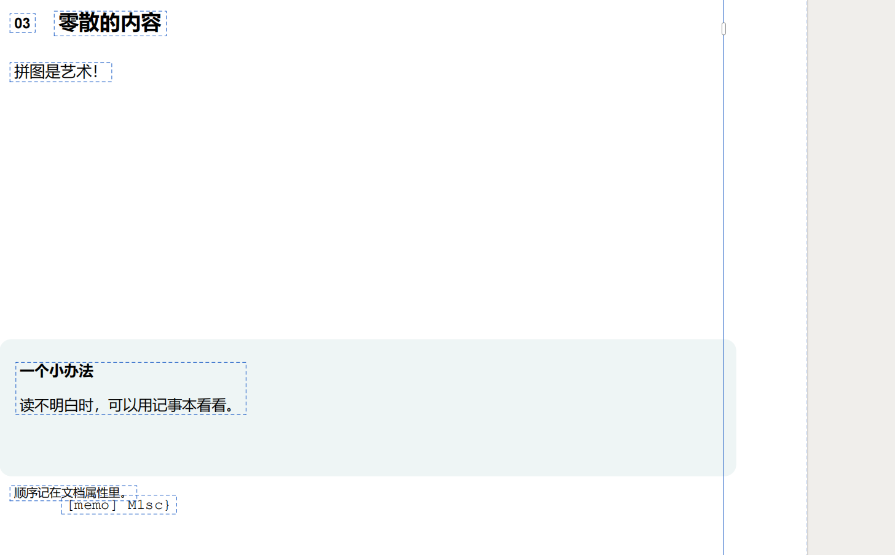
还有提示拼图，确实要组合一下

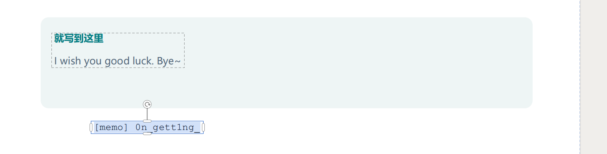
s3c{C0ngrats_0n_gett1ng_s7ar7ed_w1th_M1sc}

# WEB-HTTP-招新入门

交给ai吧，还不太了解，
虽然用过wireshark，burpsuite，看包，改包，发包，
但是原理不清，逻辑链路不完整。

# REVERSE-IdaGift-招新入门

按题目提示流程来

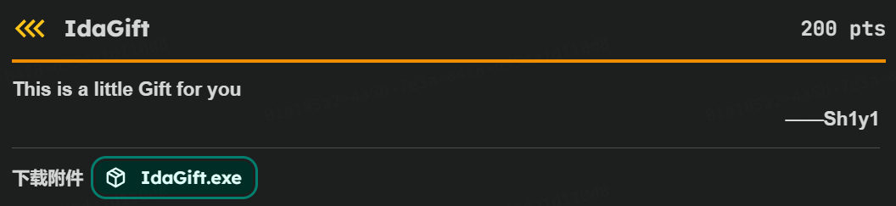
下载目标
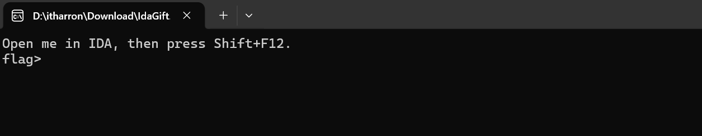
运行目标，记录提示
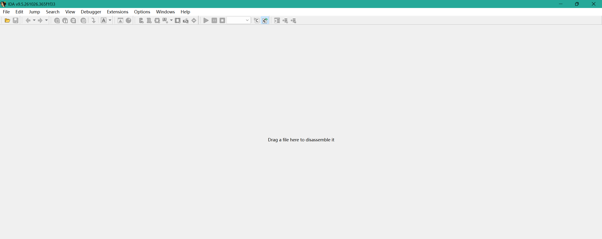
打开ida，拖曳目标进入ida
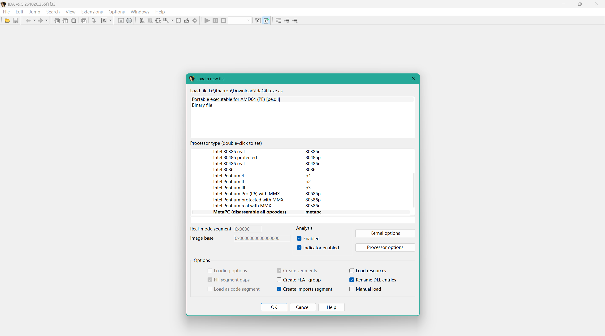
不知道按什么，先ok吧
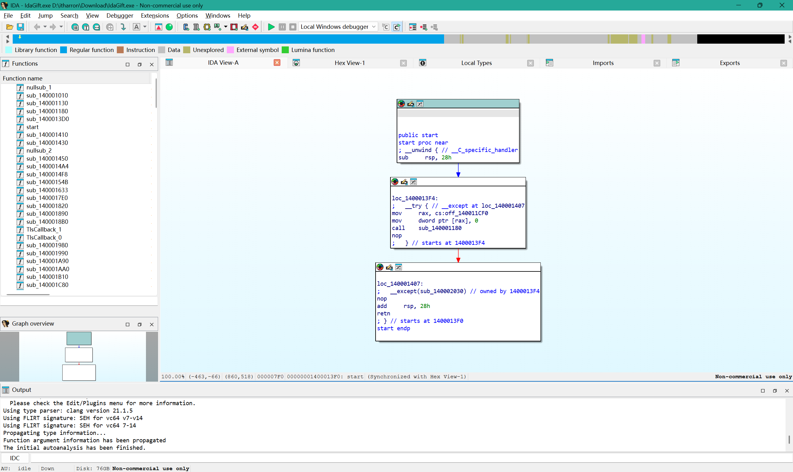
进来了，根据提示，按下shift+f12
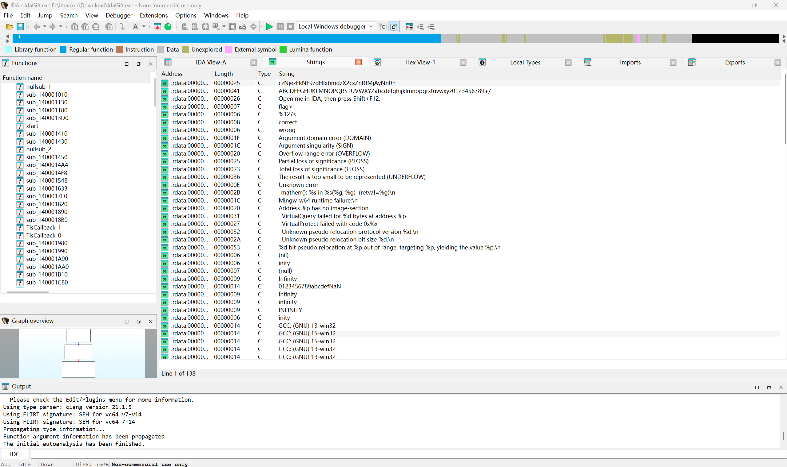
太多了，逐行看看，发现有个base64
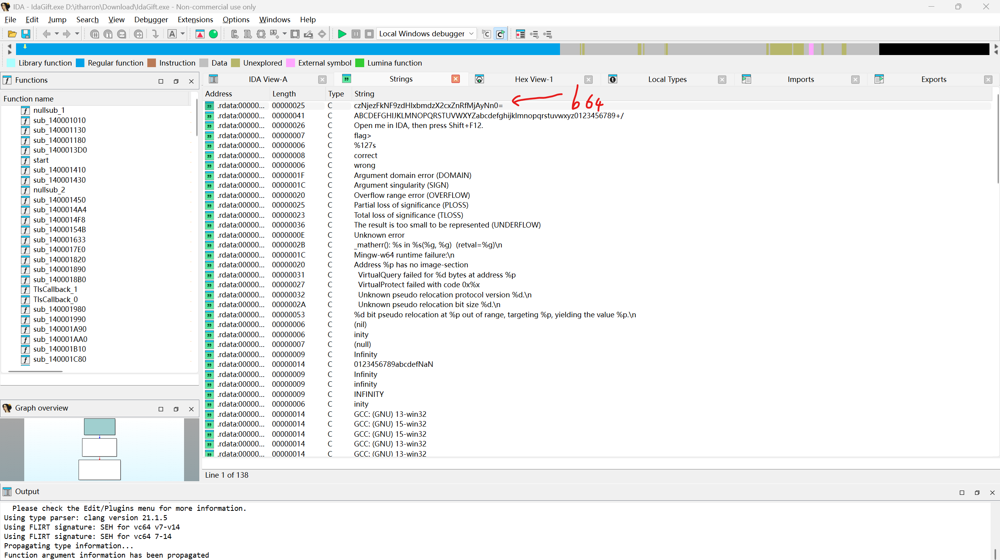
放cyberchef看看
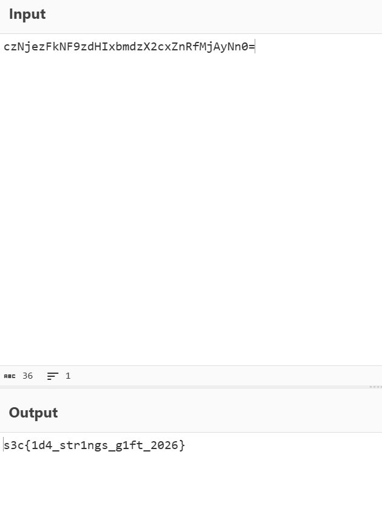
得到s3c{1d4_str1ngs_g1ft_2026}

#