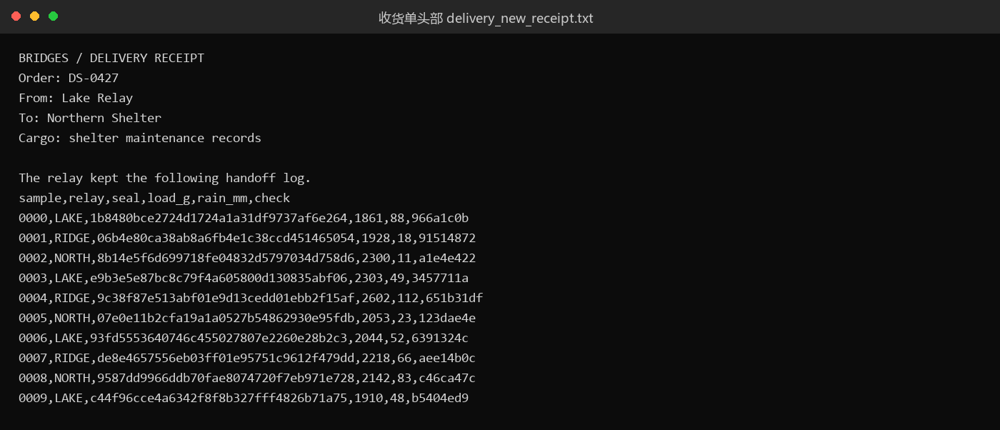
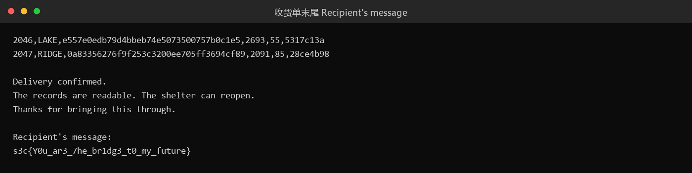
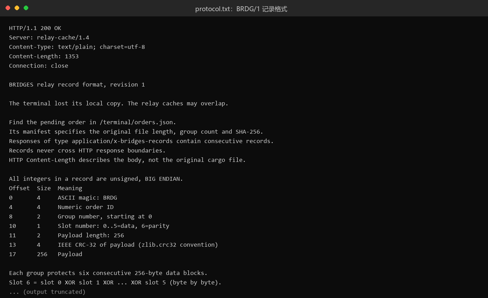

# 未记录 BRIDGES / Delivery Receipt · Forensics

- 分类：Forensics（Misc）｜ 分值：未记录 ｜ 状态：已解出（平台提交状态未记录）
- 从抓包里的 HTTP 流量中取出带 XOR 奇偶校验的分片记录，重组、gunzip 后得到收货单，flag 在收货单末尾。

## 题目

- 题号未记录，题名 BRIDGES / Delivery Receipt；附件为 `delivery_new.pcapng`（193,180 字节）。
- 收货单文本 132,999 字节、共 2063 行：表头是 `Order: DS-0427`，中间是 2048 行 `sample,relay,seal,load_g,rain_mm,check` 交接记录。
- 文件末尾 `Recipient's message:` 一行就是 flag。

## 思路

- pcapng 里全是明文 HTTP：客户端 UA `bridges-terminal/1.4`，服务端 `relay-cache/1.4`，目标 10.77.0.11。不用解密，直接读 body。
- 先看 `/terminal/orders.json`：列表里有 DS-0426（delivered）、DS-0427（pending，manifest 指向 `/terminal/orders/427.json`）、DS-0429。要处理的是 pending 那一单。
- 427 的清单给出了完整参数：文件名 `delivery-receipt.txt.gz`、原始长度 71997、`block_size` 256、`data_slots` 6、`parity_slot` 6、`group_count` 47、sha256。
- `/terminal/protocol.txt` 把记录格式写死了：17 字节头（magic `BRDG`、order id、group、slot、payload len、CRC-32）+ 256 字节负载，所有整数大端；每组 6 个数据块，slot 6 是前 6 个的逐字节 XOR，每组最多缺一个数据槽。
- 所以不需要猜测，按"定长切记录 → 校验 → 落槽 → 缺块用校验块异或还原"的流程走即可；最后用清单里的 sha256 和原始长度双重验证。
- pcap 顶部还有一段 "BRIDGES terminal cache" 的注释，里面是 `Archived order: DS-0426` 和 `s3c{Keep_0n_keeping_0n}`——那是另一单（DS-0426）的已送达回执，属于诱饵，不是本题答案。

## 关键步骤

1. 读 pcap：`GET /terminal/orders.json` 拿到订单列表，确认 DS-0427 状态 pending。
2. `GET /terminal/orders/427.json` 取清单，记下 71997 字节、47 组、256 字节块、sha256 前缀 `18834f2a…`。
3. `GET /terminal/protocol.txt` 取记录格式定义（BRDG/1、大端、CRC-32、6 数据 + 1 校验）。
4. 取 `/relay/records?batch=000` 到 `batch=014` 共 15 个响应体，按 17 + 256 = 273 字节定长切分，逐条校验 magic、order id、zlib CRC-32。
5. 记录写入 47×7 的槽位表；对每组缺失的数据槽，用 slot 6 与其余 5 个槽异或还原。
6. 按 group、slot 顺序拼出 gz 数据流（清单里的 71997 字节与 sha256 都是针对 gz 文件），gunzip 后得到 132,999 字节的收货单文本。
7. 收货单第 2063 行即 flag。

清单原文（pcap 中 `/terminal/orders/427.json` 的响应体）：

```json
{
  "order": "DS-0427",
  "order_id": 427,
  "filename": "delivery-receipt.txt.gz",
  "file_size": 71997,
  "sha256": "18834f2a99f7af26a33fc1c528cedafe8de203a6c39ed2efecebeddc8270c22c",
  "block_size": 256,
  "data_slots": 6,
  "parity_slot": 6,
  "group_count": 47,
  "record_format": "BRDG/1",
  "protocol": "/terminal/protocol.txt"
}
```







## Flag

```text
s3c{Y0u_ar3_7he_br1dg3_t0_my_future}
```

## 踩坑 / 备注

- pcap 里 `s3c{Keep_0n_keeping_0n}` 是 DS-0426 的归档回执，属于诱饵，不是本题 flag；判断依据是它挂在 `Archived order: DS-0426` 下，而 DS-0427 才是 pending。
- 记录头 17 字节里 group 和 slot 顺序容易搞反（group 在 offset 8，2 字节；slot 在 offset 10，1 字节），搞反会拼出乱序数据、CRC 也过不了。
- 重组脚本与 sha256 校验日志在赛后未留存，本地只留下解压后的收货单文本；因此这里只能按 protocol.txt 的格式说明复现流程，无法再回溯当时的校验输出。
