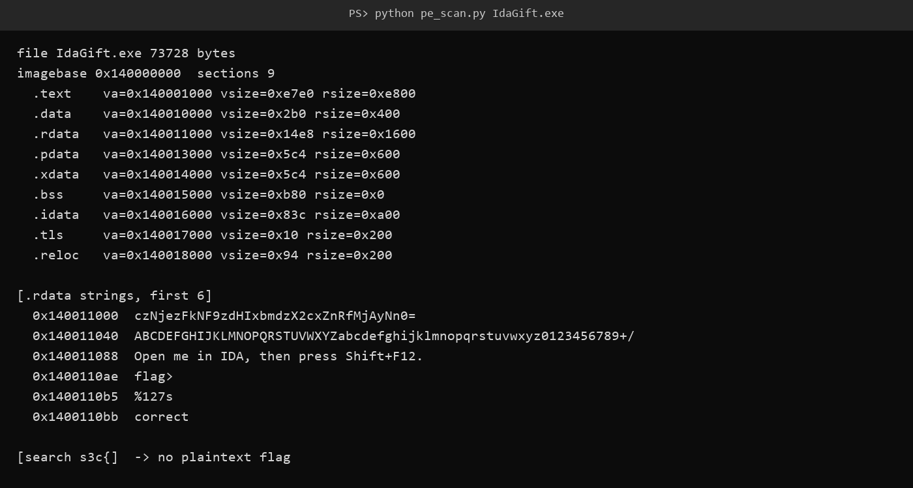
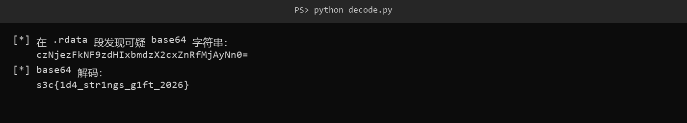

# 5 IdaGift · Reverse

- 分类：Reverse ｜ 分值：200 ｜ 状态：平台已解
- 一句话概括考点：PE 静态分析，在 `.rdata` 里找到被 base64 包了一层的 flag

## 题目

- 附件 `IdaGift.exe`，73,728 字节，MinGW-w64 编译的 x64 控制台程序。
- 题面原文未记录；程序里自带的提示语是 `Open me in IDA, then press Shift+F12.`。
- 运行后打印 `flag> `，用 `%127s` 读入，再输出 `correct` 或 `wrong`。

## 思路

- 提示语直接点名 `Shift+F12`（IDA 的字符串窗口），说明考点是「看字符串」，而不是动态爆破。
- 全文件搜 `s3c{` 没有任何命中，说明 flag 不是明文存放，需要找一层编码。
- `.rdata` 开头就是一条以 `=` 结尾的可疑串，同一节里还紧跟着标准 base64 字母表，两件事互相印证。

## 关键步骤

1. 双击 `IdaGift.exe` 先进 IDA（64 位），等自动分析跑完。控制台里那行提示语已经把操作写死了：`Open me in IDA, then press Shift+F12.`。

2. 按 `Shift+F12` 打开 Strings window，先扫一眼：`flag> `、`%127s`、`correct`、`wrong` 都在，说明程序逻辑很浅，flag 只可能是常量。

3. 字符串列表最上面那条不太对劲——`czNjezFkNF9zdHIxbmdzX2cxZnRfMjAyNn0=`，比普通文案长得多，还是 `=` 结尾。双击跳过去，可以看到它就躺在 `.rdata` 起始处，紧跟着一条 `ABCDEFGHIJKLMNOPQRSTUVWXYZabcdefghijklmnopqrstuvwxyz0123456789+/`，那是标准的 base64 字母表：

   

4. 顺手把整个文件搜一遍 `s3c{`，没有任何明文命中，进一步确认要解的就是这条串。

5. 把它复制到终端解码：

   ```bash
   echo 'czNjezFkNF9zdHIxbmdzX2cxZnRfMjAyNn0=' | base64 -d
   ```

   得到 26 字节明文 `s3c{1d4_str1ngs_g1ft_2026}`，形态和长度都对。

   

## Flag

```text
s3c{1d4_str1ngs_g1ft_2026}
```

## 踩坑 / 备注

- 直接搜 `s3c{` 是搜不到的，别因为第一眼没看到就以为附件是空的。
- `.rdata` 里同时存在 base64 字母表，是判断「这条串确实是 base64」的旁证，不是所有长串都值得解码。
- 解码时记得把末尾的 `=` 一起带上，少一个字符就报 `invalid input`。
