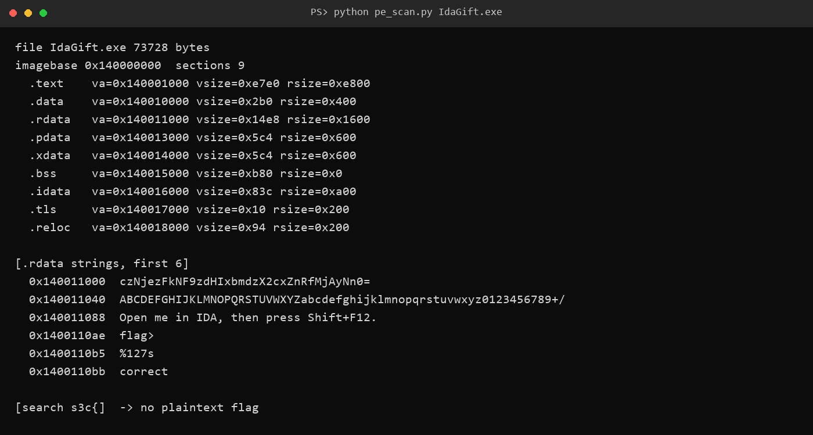
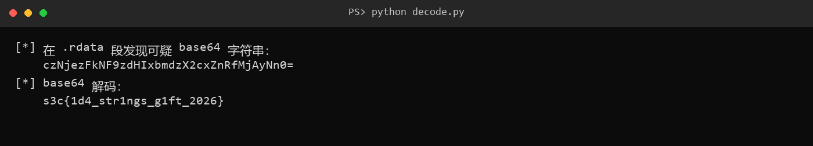

# 5 IdaGift

- 分类：Reverse ｜ 分值：200 ｜ 状态：平台已解
- 一句话概括考点：PE 静态分析，在 `.rdata` 里找到被 base64 包了一层的 flag

## 题目

- 附件 `IdaGift.exe`，73,728 字节，MinGW-w64 编译的 x64 控制台程序。
- 题面原文未记录；程序里自带的提示语是 `Open me in IDA, then press Shift+F12.`。
- 运行后打印 `flag> `，用 `%127s` 读入，再输出 `correct` 或 `wrong`。

## 思路

- 提示语直接点名 `Shift+F12`（IDA 的字符串窗口），说明考点是“看字符串”，而不是动态爆破。
- 先按 PE 结构把节表列出来：共 9 个节，`.rdata` 位于 `0x140011000`，是字符串最集中的地方。
- 全文件搜 `s3c{` 没有任何命中，说明 flag 不是明文存放，需要找一层编码。
- `.rdata` 开头就是一条以 `=` 结尾的可疑串，同一节里还紧跟着标准 base64 字母表，两件事互相印证。

## 关键步骤

1. 用脚本解析 PE 头与节表，确认镜像基址 `0x140000000`、`.rdata` 的 VA 与原始大小。



2. 在 `.rdata` 起始处读到 `czNjezFkNF9zdHIxbmdzX2cxZnRfMjAyNn0=`，后面依次是 base64 字母表、提示语 `Open me in IDA, then press Shift+F12.`、`flag> `、`%127s`。
3. 对该串做 base64 解码，得到 26 字节明文，形态正好是 `s3c{...}`。



4. 回看整个文件：`.rdata` 里同时有 `flag> `、`%127s`、`correct`、`wrong`，却没有任何明文 flag，进一步坐实答案只能来自那条 base64。

## Flag

```text
s3c{1d4_str1ngs_g1ft_2026}
```

## 踩坑 / 备注

- 直接搜 `s3c{` 是搜不到的，扫描结果明确给出 `no plaintext flag`；别因为第一眼没看到就以为附件是空的。
- `.rdata` 里同时存在 base64 字母表，是判断“这条串确实是 base64”的旁证，不是所有长串都值得解码。
