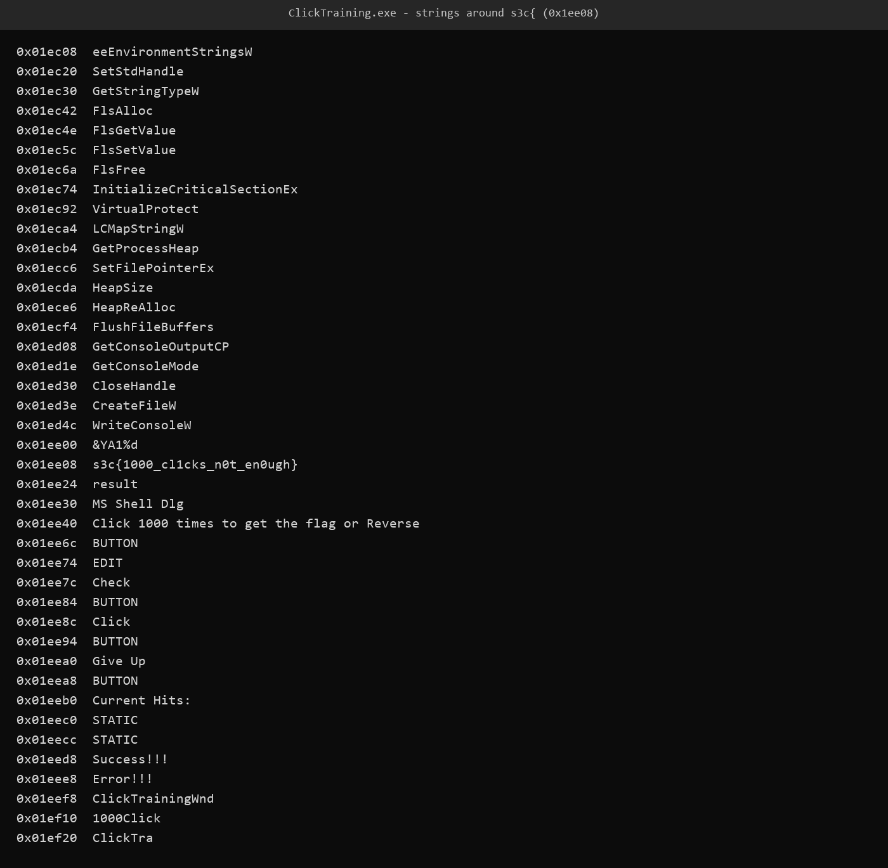
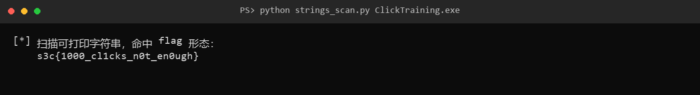

# 7 ClickTraining · Reverse

- 分类：Reverse ｜ 分值：290 ｜ 状态：平台已解
- 一句话概括考点：Win32 GUI 程序的静态字符串定位，不必真的点满 1000 次

## 题目

- 附件 `ClickTraining.exe`，137,728 字节，Win32 GUI 程序（USER32/GDI32，`CreateWindowExA`）。
- 界面文案：`Click 1000 times to get the flag or Reverse`，带有 `Click`、`Check`、`Give Up` 按钮和 `Current Hits:` 计数。
- 题面原文未记录。

## 思路

- 界面自己写了「点 1000 次或逆向」，说明 flag 必然在程序内部，点满次数只是把结果展示出来。
- 正常操作成本极高（1000 次点击），先走静态路线。
- 要在按钮回调里展示，flag 通常以明文常量或字符串资源存在；直接按 `s3c{...}` 的形态扫全文件最快。

## 关键步骤

1. 先双击跑一下程序，界面上就是 `Click 1000 times to get the flag or Reverse`，加一个计数器。确认这题不值得真点。

2. 打开终端，用 `strings` 把可打印字符串全导出来，直接搜 flag 形态：

   ```bash
   strings -a ClickTraining.exe | grep -o 's3c{[^}]*}'
   ```

   Windows 上没有 `strings` 的话，PowerShell 里同样可以：

   ```powershell
   Select-String -Path ClickTraining.exe -Pattern 's3c\{[^}]{1,80}\}' -AllMatches
   ```

   一次命中 `s3c{1000_cl1cks_n0t_en0ugh}`。

3. 打印命中位置附近的其他字符串做旁证：紧邻的是 `&YA1%d` 与 `result`，同一段里还有 `Check`、`Click`、`Give Up`、`Current Hits:`、`Success!!!`、`Error!!!`：

   

   控件文案和界面行为完全对得上，说明 flag 是回调里直接展示的常量，不是偶然拼出来的字节。

4. 全文件只有这一处 `s3c{...}` 命中，不存在同名诱饵，可以直接作为答案：

   

## Flag

```text
s3c{1000_cl1cks_n0t_en0ugh}
```

## 踩坑 / 备注

- 这是 GUI 程序，没法在命令行里「自动点 1000 次」完成校验；静态扫字符串是等价且更省事的路线。
- 段内字符串有明显的 UTF-16/资源混排噪声，先按连续可打印字节切分再筛 `s3c{`，比整段乱看可靠。
- 附件里的可打印字符串能直接读出，说明 flag 没有做字符串加密或压缩处理，纯静态即可收工。
