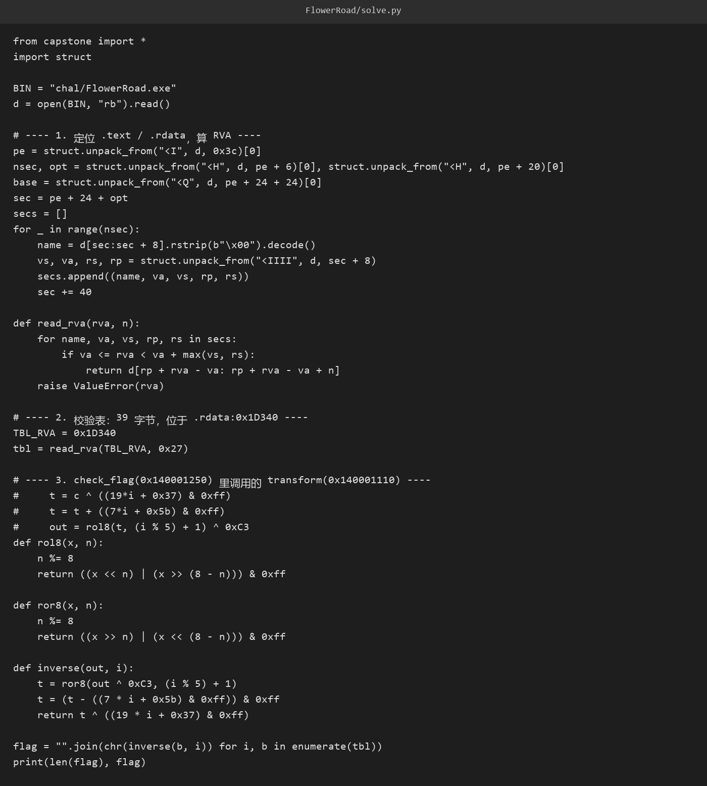
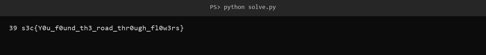

# 9 FlowerRoad · Reverse

- 分类：Reverse ｜ 分值：401 ｜ 状态：平台已解
- 一句话概括考点：披着 Misc 皮的纯静态逆向，识破三块假路牌后逆一个逐字节变换

## 题目

- 题面：**一路生花 ——Sh1y1**，附件 `FlowerRoad.exe`。
- 运行后打印 `The road is blooming.` 与 `flag> `，读入 `%127s`，只回 `correct` 或 `wrong`。
- 二进制里明晃晃躺着三个 `s3c{...}`，但都是诱饵。

## 思路

- 见到 `.exe` 先静态分析：正常 MSVC C++ 运行时，六段，没有加壳。
- 三块“flag”的文案本身就在自曝：`fake_flower_flag`、`r0s3s_4r3_n0t_th3_r04d`、`try_dynamic_debug_next_time`，正经 flag 不会这么写。
- 主函数里有个 `n(n+1) & 1 == 1` 的判断，`n(n+1)` 恒为偶数，该分支永远不成立，正是打印假 flag 的死代码。
- 真正干活的 `check_flag` 先卡 `strlen == 0x27`，再逐字节与 `.rdata` 的 39 字节表比对，因此核心是还原 `transform`。

## 关键步骤

1. 用 IDA 打开 `FlowerRoad.exe`，等分析完成后在 Functions window 里看到 `main`、`check_flag`、`transform` 三个函数，双击进 `main` 按 F5 反编译。

2. `main` 里那个 `n(n+1) & 1 == 1` 的分支直接跳过——`n(n+1)` 恒为偶数，这个条件永远不成立，它下面打印的就是假 flag。真正干活的是 `check_flag`，进去先看到 `strlen(input) == 0x27`，再拿 `.rdata` 里一张 39 字节的表逐字节比对。

3. 再进 `transform` 看逐字节变换。里面的恒假条件全是代数陷阱，化简之后只剩四步：

   ```text
   c ^= (19i + 0x37) & 0xff
   c += (7i + 0x5b) & 0xff
   c = rol8(c, (i % 5) + 1)
   c ^= 0xC3
   ```

4. 39 个字符逐个反推是批量活，手工算不动，这一步用脚本完成。把 `.rdata:0x1D340` 起始的 39 字节期望表从 IDA 里复制出来，写成列表喂给脚本，按上面的逆序（先异或 `0xC3`、再 `ror8`、再减、再异或）逐位还原：

   ```python
   tbl = [0x00, 0x00, ...]   # 从 IDA 复制的 39 字节
   out = []
   for i, y in enumerate(tbl):
       y ^= 0xC3
       y = ((y >> ((i % 5) + 1)) | (y << (8 - (i % 5) - 1))) & 0xff   # ror8
       y = (y - (7*i + 0x5b)) & 0xff
       y ^= (19*i + 0x37) & 0xff
       out.append(chr(y))
   print(''.join(out))
   ```



5. 脚本输出 39 字符，长度与 `0x27` 吻合：`s3c{Y0u_f0und_th3_road_thr0ugh_fl0w3rs}`。

6. 把它粘回程序运行，程序自己输出 `correct`，闭环。



## Flag

```text
s3c{Y0u_f0und_th3_road_thr0ugh_fl0w3rs}
```

## 踩坑 / 备注

- capstone 打印的 `[rip + 0x...]` 是位移不是绝对地址，必须自己加 `ins.address + ins.size`，否则一条 xref 都匹配不上。
- 循环移位那段看着像 `sar`（算术右移），但输入经 `movzx` 一定是 0..255 正数，等价于 `rol8`，别被符号扩展吓住。
- 一开始把 `.data` 的字符串按 `.rdata` 算了 RVA，找引用全部落空；重算节表后才定位到主函数。
