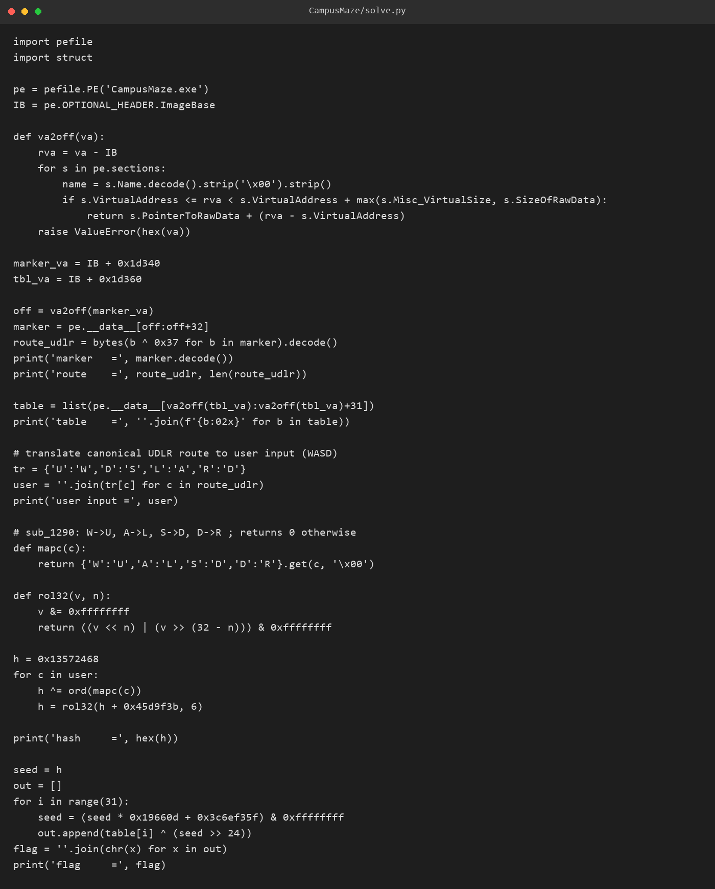
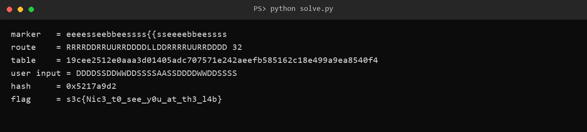

# 10 CampusMaze · Reverse

- 分类：Reverse ｜ 分值：500 ｜ 状态：本地解出（平台未提交）
- 一句话概括考点：用异或还原被“加密”的标准路线，再复算滚动哈希与 LCG 生成 flag

## 题目

- 题面：**不行打开缺德地图看看吧 ——Sh1y1**，附件 `CampusMaze.exe`（171,008 字节，PE32+ 控制台）。
- 运行后打印 `route> `，读入 `%127s`，校验失败只输出 `wrong`。
- `.rdata` 里有一串 `eeeesseebbeessss{{sseeeebbeessss`，紧跟 31 字节看似随机的数据。

## 思路

- 控制台程序 + `route>` 提示，说明“路线”是手敲进去的字符串，不是用鼠标走图形迷宫。
- marker 只由 `e/s/b/{/}` 组成，与 `U/D/L/R` 恰好相差 `0x37`（`e^0x37=R`、`s^0x37=D`、`b^0x37=U`、`{^0x37=L`），一眼看出是逐字节异或。
- 紧随 marker 的 31 字节长度正好等于一个 `s3c{...}`，判定它是加密后的 flag 表。
- 出现三个不同地址的 `wrong`，提示校验分三段：字符集、越界/撞墙、终点坐标。

## 关键步骤

1. 读 VA `0x14001d340` 的 32 字节 marker，逐字节 `^ 0x37`，得到 32 步标准路线 `RRRRDDRRUURRDDDDLLDDRRRRUURRDDDD`。
2. 程序只认 `W/A/S/D`，按 `U→W、D→S、L→A、R→D` 转成用户输入 `DDDDSSDDWWDDSSSSAASSDDDDWWDDSSSS`。
3. 建图 `11 行 × 15 列`，沿标准路线把走过的格子标为可走，起点 `S`、终点 `E`；输入偏离这条线就撞 `#`。
4. 复算滚动哈希：`h=0x13572468`，每字符 `h ^= U/L/D/R` 后 `h = rol32(h + 0x45d9f3b, 6)`，得到 `0x5217a9d2`。
5. 以该值为种子展开 LCG（`seed = seed*0x19660d + 0x3c6ef35f`），每次取高 8 位与 `0x14001d360` 的 31 字节表异或，拼出 flag。



6. 把用户输入回代给原程序，程序直接打印出 flag。



## Flag

```text
s3c{Nic3_t0_see_y0u_at_th3_l4b}
```

## 踩坑 / 备注

- 直接把 `RRRRDD...` 那串喂进去会立刻命中第一个 `wrong`：哈希前虽然会做 `R→D` 映射，但输入阶段只接受 `W/A/S/D`。
- 空输入时程序连 `wrong` 都不打印（`%127s` 读取失败直接返回），“没输出”本身就是读取失败的信号。
- 表长 31 是从 marker 后面那串随机字节的长度反推的，刚好对上 `s3c{...}`，属于数据自己会说话。
