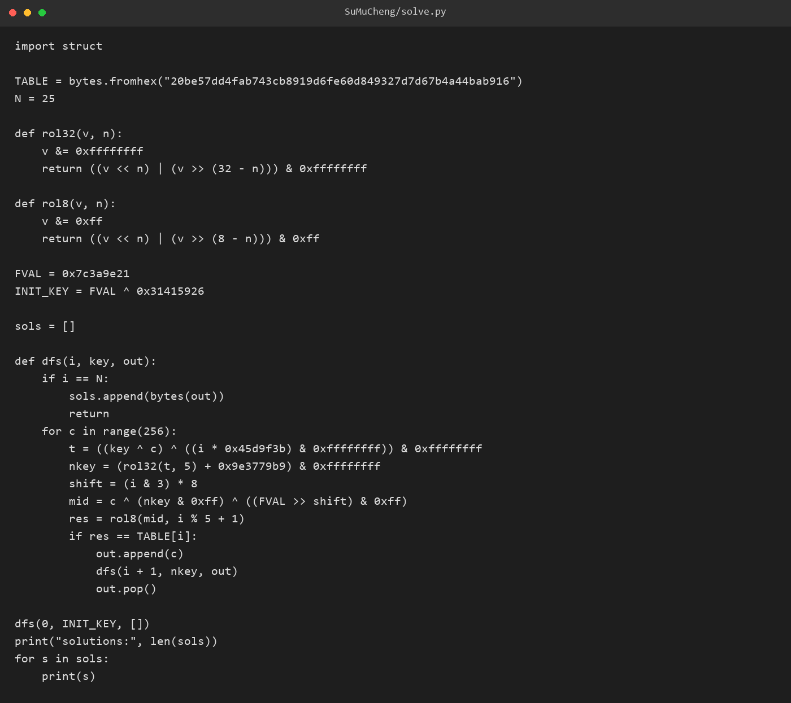
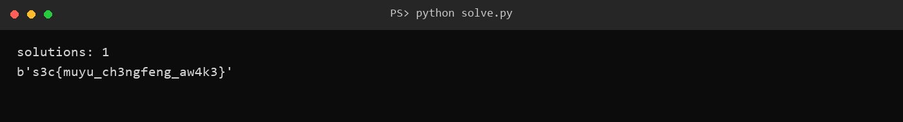

# 11 苏沐橙 · Reverse

- 分类：Reverse ｜ 分值：500 ｜ 状态：平台已解（一血）
- 一句话概括考点：两段式 SMC 自解密取常量，配合滚动 key 的逐字节校验做串行 DFS

## 题目

- 题面正文只有署名 ——Sh1y1；附件 `Smc.exe`，169,984 字节，x64 控制台程序。
- 运行后打印 `The bullet is sleeping.` 与 `flag> `，读入 `%127s`，输出 `correct` / `wrong`。
- `.data` 里有一条 `s3c{fake_sleeping_bullet}`，导入表里有 `VirtualProtect`。

## 思路

- `VirtualProtect` + `.data` 中两段 6 字节密文，是典型的 SMC：运行时改内存属性，再把解出来的字节当代码执行。
- 那个 `s3c{fake_sleeping_bullet}` 写在字符串区、不参与任何比较，是明摆的诱饵；“沉睡的子弹”呼应苏沐橙的招式，也暗示“要先把代码叫醒”。
- 校验函数先卡 `strlen == 0x19`（25），说明 flag 长度固定，逐字节比较可行。
- key 会随已确认的字节滚动，25 个位置不能独立爆破，必须按顺序搜索。

## 关键步骤

1. 入口 `0x140001754` → `__scrt_common_main_seh` → 业务 main `0x1400012f0`，其中调用校验函数 `0x1400011b0`。
2. 读 `0x140001140`：第一段密文在 `0x140028038`，key 为 `0x5A`，解出 `mov eax, 0x6D; ret`，返回 `0x6D`。
3. 第二段 key 由第一次返回值算出：`0x6D ^ 0xA7 = 0xCA`；`0x140028040` 解出 `mov eax, 0x7C3A9E21; ret`，故 `f() = 0x7C3A9E21`。
4. 初始 key 为 `0x7C3A9E21 ^ 0x31415926 = 0x4D7BC707`；每轮先算 `t=(key^c)^(i*0x45d9f3b)`，再 `nkey=rol32(t,5)+0x9e3779b9`。
5. 用期望表 `0x14001d340` 的 25 字节做 8 位 `rol8` 比对，按 i 递增做 DFS，只有唯一解。



6. 回代原程序：正确 flag 输出 `correct`，改动最后一个字符立刻变 `wrong`。



## Flag

```text
s3c{muyu_ch3ngfeng_aw4k3}
```

## 踩坑 / 备注

- 第二段 SMC 不能沿用 `0x5A`：key 是运行期由第一段返回值异或 `0xA7` 得到的，硬编码会解出乱码。
- 全文件 `strings` 会被反汇编字节噪声淹没，只扫 `.rdata` / `.data` / `.fptable` 才看得清真正的字符串。
- 爆破必须串行：判定第 i 字节依赖前面所有字节滚动出的 key，逐位独立爆破行不通；DFS 才是正解。
- 反汇编脚本命名成 `dis.py` 会和标准库 `dis` 冲突，导致 capstone 导入时报 `partially initialized module`。
