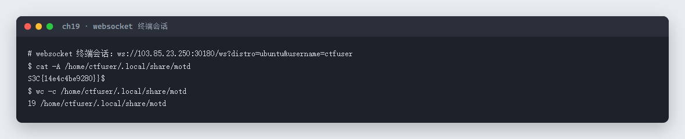
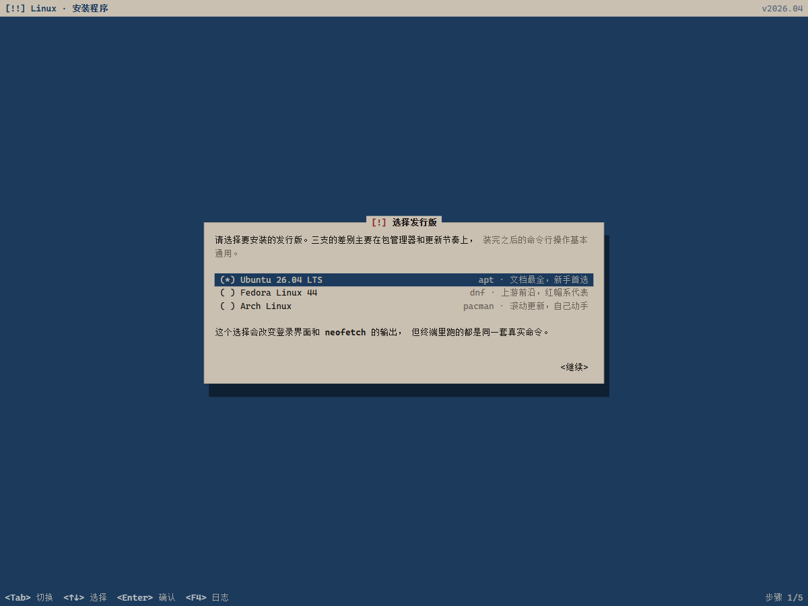

# 19 Linux · Web

- 分类：Web ｜ 分值：200 ｜ 状态：平台已解
- 页面是一个「安装 Linux 发行版」的假终端，装完在真实终端里按命令把 motd 读出来即可。

## 题目

- 题号 19，题名「Linux」，题面「学习一下命令(开启时间较长 耐心等待)」，出题人 chen。
- 动态容器，进入先走一个安装向导：选发行版（Ubuntu 24.04 LTS / Fedora / Arch）→ 继续，之后才是终端。

## 思路

- 前端是纯展示，真正干活的是 websocket：`ws://<host>/ws?distro=ubuntu&username=ctfuser`，发一条命令回一条 `{"type":"output","data":...}`。
- 题面说「学习一下命令」，那就按常规信息收集走：`ls`、`cat`、`find / -iname '*flag*'`，最后定位到 `/home/ctfuser/.local/share/motd`。
- 用 `cat -A` 看不可见字符、用 `wc -c` 核字节数，确认末尾那个多余的 `}` 是文件内容而不是显示问题。

## 关键步骤

1. 首次进入走安装向导，选 Ubuntu 24.04 LTS，`<继续>` 装完进入终端；向导只是前端选择，终端本身由 `?distro=ubuntu&username=ctfuser` 直接决定，所以复现时可以直接连 websocket。
2. 连 websocket，发 `cat -A /home/ctfuser/.local/share/motd`。
3. `cat -A` 把行尾显示成 `$`，所以 `S3C{14e4c4be9280}}$` 表示文件正文是 `S3C{14e4c4be9280}}`。
4. 再发 `wc -c` 得到 19 字节 = 18 字节正文 + 1 字节换行，与上一步一致。

```javascript
const ws = new WebSocket('ws://103.85.23.250:30180/ws?distro=ubuntu&username=ctfuser');
ws.onopen = () => {
  ws.send('cat -A /home/ctfuser/.local/share/motd');
  setTimeout(() => ws.send('wc -c /home/ctfuser/.local/share/motd'), 2000);
};
ws.onmessage = (e) => {
  const m = JSON.parse(e.data);
  if (m.type === 'output') console.log(m.data);
};
```

重新起容器后的实测会话回显：



安装向导第一屏（选发行版）：



## Flag

```text
S3C{14e4c4be9280}}
```

注意：文件正文确实带两个右花括号，`cat -A` 与 `wc -c` 双向核对过，不是多打了一个。

## 踩坑 / 备注

- 安装向导有进度动画，要等它跑完再去连 websocket，否则终端还没就绪。
- `cat` 直接看会把末尾的 `}` 和提示符连在一起，容易误判；用 `cat -A` 看行尾标记最稳。
