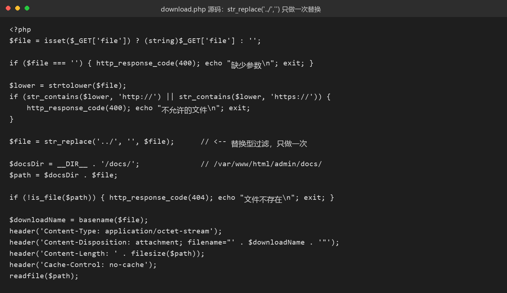

# 21 不太正常的博客

- 分类：Web ｜ 分值：500 ｜ 状态：本地解出（平台未提交）
- 一句话概括考点：`str_replace('../','')` 是"替换"而不是"拦截"，用 `....//` 即可还原出 `../`，路径穿越读 `/flag`。

## 题目

- 动态容器题，单端口实例，题面只有一句「出题人很懒 题目描述也不写 ---chen +_=（如果容器显示问题 记得刷新）」。
- 表面是一个 WordPress 风格的安全博客：前台 7 篇教程，后台有仪表盘、文章、评论、媒体、插件、设置等十来个页面。
- 响应头暴露 `Server: Apache/2.4.68 (Debian)`、`X-Powered-By: PHP/8.2.34`，且 `display_errors=on`。

## 思路

- 先按 WordPress 套路打：`xmlrpc.php`、`wp-json/wp/v2/users`、`wp-login.php`、`?author=1` 全部 404 或回首页，说明它只是"长得像 WP"。
- 目录扫描（自建字典 + SecLists `common.txt`，约 19000 条）只多出 `/inc/`、`/assets/`、`/admin/docs/` 三个 403 目录，真入口只能在已知文件里。
- `display_errors=on` 等于白送情报：任何"把数组当字符串"的代码都会把绝对路径和行号印在响应里。于是对每个页面、每个参数发 `param[]=1` 逼 Warning。
- 全站只有 `/admin/download.php` 命中 → 十个页面九个布景，它是唯一有服务端逻辑的文件。
- 判断过滤语义：若发现 `..` 就 `die`，四点斜杠无效；若是 `str_replace('../','')` 替换，`....//` 去掉中间那截正好还原成 `../`。用 `....//docs/handbook.txt` 能 200 就证明是后者。

## 关键步骤

1. 数组参数逼报错，定位唯一的真代码文件：

```bash
curl -s --path-as-is "http://103.85.23.250:32372/admin/download.php?file[]=1"
```

2. 用 `....//docs/handbook.txt` 验证过滤是"替换型"，再读 `download.php` 自身源码确认只有一行 `str_replace`。
3. 数层级：`$docsDir = __DIR__ . '/docs/'`，`__DIR__` 为 `/var/www/html/admin`，从 `docs/` 起共 5 段，所以退 5 层才到 `/`。
4. 读 `/etc/passwd` 验证任意文件读取，最后读 `/flag`。

![file[]=1 触发的 Warning，全站仅 download.php 命中；末尾为退 5 层读 flag](img/01-warning.png)



## Flag

```text
S3C{4a50cbded731}
```

## 踩坑 / 备注

- 第一次只退 4 层去读 `/etc/passwd`，全 404，误以为被 `open_basedir` 锁了；把 1–5 层全打一遍，k=5 才通。
- 两个实例的 23 个页面逐字节 diff 全 SAME，说明 flag 是按实例注入到 `/flag`，不会嵌在页面里。
- 登录框是纯前端假校验（`login.js` 里 `preventDefault` 后只显示"用户名或密码不正确"），后台 12 个页面全部免登录直接 200——门是开的。
