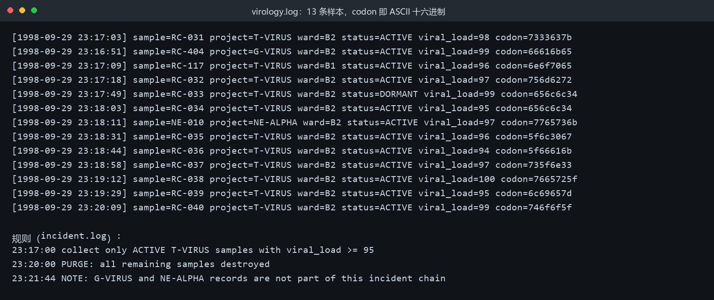
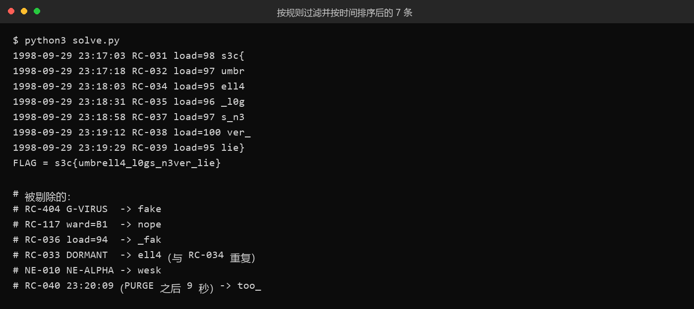

# 22 UmbrellaLog

- 分类：Misc ｜ 分值：500 ｜ 状态：平台已解
- 一句话概括考点：日志取证——按 `incident.log` 给出的规则做字段过滤、状态去重、时间排序，并剔除清场之后补写的伪造记录。

## 题目

- 附件 `logs.zip`（1198 字节，`StaticAttachment` 直链下载），内含 `incident.log`（439）、`security.log`（329）、`virology.log`（1342）。
- 题面：浣熊市地下实验室断电前，保护伞的监控系统留下了几份日志，你能找到真正进入电梯逃逸链的 T 病毒样本吗 ——Sh1y1。
- `virology.log` 里每条样本都带一个 8 位十六进制的 `codon=`，本质就是 ASCII 十六进制。
- 先做过"防藏东西"检查：zip 无注释、EOCD 后无附加字节、三个日志纯 ASCII、LF 统一、无零宽字符——没有隐写，纯考逻辑。

## 思路

- 关键规则全写在 `incident.log` 里，题面只是引子：

```
23:16:05 first confirmed escape trace from ward=B2
23:17:00 collect only ACTIVE T-VIRUS samples with viral_load >= 95
23:20:00 PURGE: all remaining samples destroyed
23:21:44 NOTE: G-VIRUS and NE-ALPHA records are not part of this incident chain
```

- 于是过滤条件是 `project=T-VIRUS` + `ward=B2` + `status=ACTIVE` + `viral_load>=95` 四者同时成立。
- 每个 `codon` 单独 `bytes.fromhex().decode()` 就是 flag 的一个片段（`7333637b` → `s3c{`），拼装顺序必须按时间戳，不能按文件行序。
- 时间线上还有一层陷阱：`PURGE` 是 23:20:00，之后的记录一定是伪造的。

## 关键步骤

1. 解包并通读三份日志，确认 `ELEVATOR-CAM` 指向 B2、规则出自 `incident.log`。



2. 按四个条件筛出 8 条，再砍掉 23:20:00 之后的那条，剩 7 条按时间排序拼 codon：

```python
sel = [r for r in rows
       if r[2] == 'T-VIRUS' and r[3] == 'B2'
       and r[4] == 'ACTIVE' and int(r[5]) >= 95]
sel = [r for r in sel if r[0] <= '1998-09-29 23:20:00']
sel.sort(key=lambda r: r[0])
```

3. 输出即完整 flag：`s3c{umbrell4_l0gs_n3ver_lie}`，`ell4`/`l0g`/`n3ver` 对应 "umbrella logs never lie"。



## Flag

```text
s3c{umbrell4_l0gs_n3ver_lie}
```

## 踩坑 / 备注

- `RC-033` 与 `RC-034` 的 codon 完全相同（都是 `ell4`），但前者 `status=DORMANT`，不看状态会拼出 `...umbrell4ell4...`。
- 干扰项都做成了梗：`RC-404 G-VIRUS`→`fake`、`RC-117 ward=B1`→`nope`、`RC-036 load=94`→`_fak`、`NE-010`→`wesk`。
- `RC-040`（23:20:09，PURGE 后 9 秒）→`too_`，且 `RC-039` 已给出闭合的 `lie}`，从结构上也不可能接在后面。
