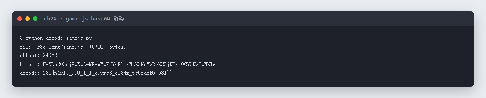
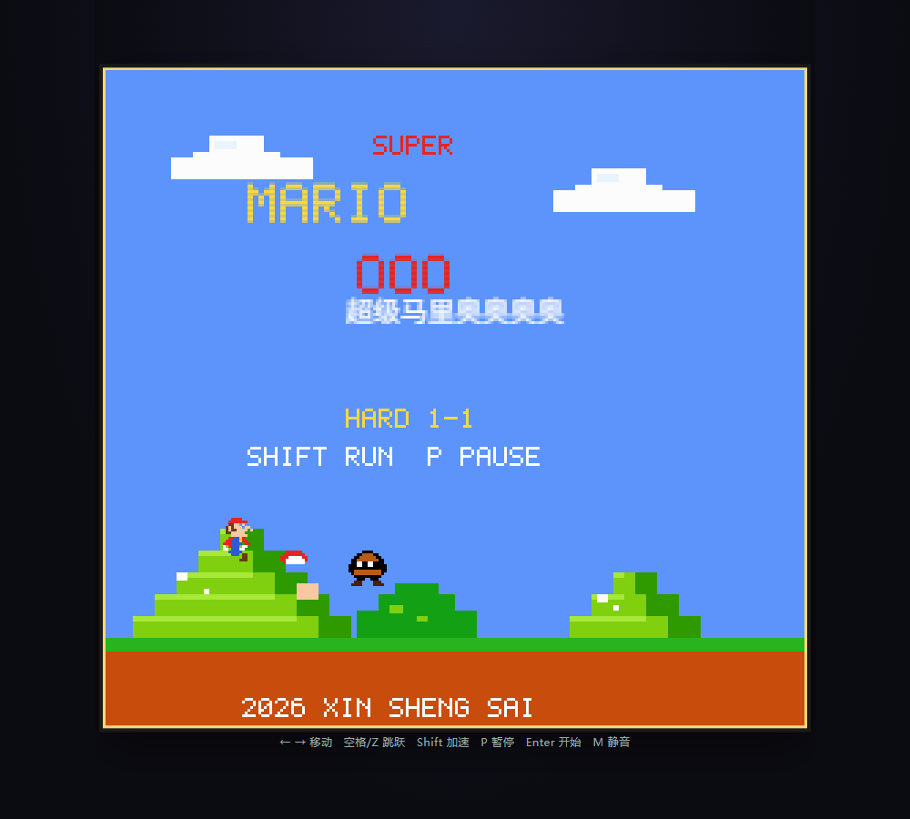

# 24 超级马里奥奥奥奥 · Web

- 分类：Web ｜ 分值：202 ｜ 状态：平台已解
- 马里奥小游戏只是个壳，`game.js` 里藏了一段 base64，解出来就是 flag。

## 题目

- 题号 24，题名「超级马里奥奥奥奥」，题面「来玩会儿马里奥吧 救出公主获得flag?」，出题人 chen。
- 动态容器，页面是一个 Canvas 版马里奥（标题画面 `MARIO 〇〇〇 / 超级马里奥奥奥奥`，`HARD 1-1`），操作提示 `← → 移动 空格/Z 跳跃 Shift 加速 P 暂停 Enter 开始`。

## 思路

- 先玩了一会儿，发现关卡是「Hard 1-1」，通关成本和收益不成比例，于是走前端路线：把页面加载的 `game.js`、`slots.css` 全下载下来看。
- `game.js` 共 57,567 字节，主体是压缩过的游戏逻辑；在偏移 24052 处有一串 60 字符的 base64，不在任何明显的加密函数里，直接解即可。
- base64 解出来是 `S3C{...}` 形式，末尾多一个 `}`，与 18/19 一样属于题目故意多给的括号。

## 关键步骤

1. 打开容器页面，开发者工具 Network 里抓到 `/game.js`、`/slots.css`，保存到本地。
2. 用正则扫 `[A-Za-z0-9+/]{40,}={0,2}`，逐个 base64 解码，筛出含 `S3C` 的那一条。
3. 解出 flag，提交。

```python
import re, base64

src = open('game.js', encoding='utf-8', errors='replace').read()
for m in re.finditer(r'[A-Za-z0-9+/]{40,}={0,2}', src):
    blob = m.group(0)
    try:
        dec = base64.b64decode(blob)
    except Exception:
        continue
    if b'S3C' in dec:
        print('offset:', m.start())
        print('blob  :', blob)
        print('decode:', dec.decode())
```

实测输出：



游戏页面本身（标题画面，HARD 1-1）：



## Flag

```text
S3C{m4r10_000_1_1_c0urs3_cl34r_fc58d8f67531}}
```

同样带两个右花括号，按原样记录。

## 踩坑 / 备注

- 不要一上来就硬玩：`HARD 1-1` 的坑位明显是给「玩到一半才想起来看源码」的人准备的。
- base64 串里混着 `+` `/` 和结尾的 `=`，正则要按标准字母表匹配；先试 `urlsafe` 反而会漏。
- 解码结果末尾的 `}` 是题目自带的，不是拼接错误。
