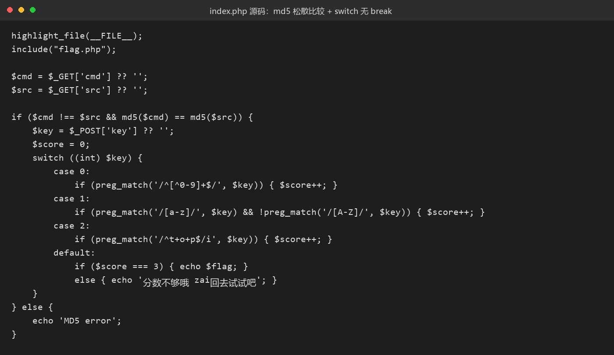
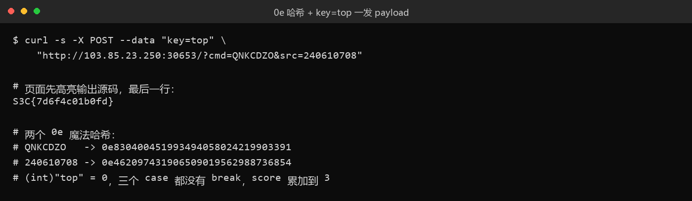

# 32 最好的语言.java · Web

- 分类：Web ｜ 分值：279 ｜ 状态：本地解出（平台未提交）
- 一句话概括考点：`md5()` 松散比较的 0e 魔法哈希 + `switch` 缺 `break` 造成贯穿，用一个 `top` 同时满足三条互斥判定。

## 题目

- 动态容器题，实例形如 `http://103.85.23.250:30653`；名字叫 java，实际响应头是 `Apache/2.4.68 (Debian)`、`PHP/8.2.34`。
- 首页就是 `highlight_file(__FILE__)` 高亮出的源码，等于把题面直接给了。
- 两关：`$cmd !== $src && md5($cmd) == md5($src)`，以及 `switch ((int)$key)` 下的三段累加判定。

## 思路

- 名字是烟雾弹（"世界上最好的语言"梗），先确认技术栈再动手，别看题名去猜 Spring。
- 第一关要"字符串不等但哈希相等"，经典解法是 0e 魔法哈希；数组绕 `md5(array)=NULL` 在 PHP 8 已失效。
- 第二关的关键不是构造正则，而是看出 `case 0/1/2` 全都没有 `break`：`(int)$key` 命中 case 0 后会一路贯穿到 `default`，三个 `if` 全部执行、`$score` 可累加到 3。
- 所以只需要找一个字符串同时满足三条：不含数字、含小写不含大写、匹配 `/^t+o+p$/i`。`(int)"top" = 0` 又刚好把它送进 case 0，`top` 是唯一最简解。

## 关键步骤

1. 读源码，确认两关的判定逻辑与"无 break"的贯穿结构。



2. 准备一对 0e 哈希：`QNKCDZO`（`0e830400451993494058024219903391`）与 `240610708`（`0e462097431906509019562988736854`），二者 `!==` 但 `==` 时都被当 0。
3. 一发 payload，`key=top` 让 `$score` 连加三次：

```bash
curl -s -X POST --data "key=top" \
  "http://103.85.23.250:30653/?cmd=QNKCDZO&src=240610708"
```



## Flag

```text
S3C{7d6f4c01b0fd}
```

## 踩坑 / 备注

- `cmd[]=1&src[]=2` 在 PHP 8.2 直接 500：`md5(): Argument #1 ($string) must be of type string, array given`，老套路失效。
- `key=0` 能进 case 0，但 `/^[^0-9]+$/` 对 `"0"` 不成立，最多 1 分；`key=top0` 带数字，第一条正则就挂。
- 创建实例时返回 400 不是题目坏了：这场比赛每队同时只允许 1 个容器，前一题实例没销毁。
