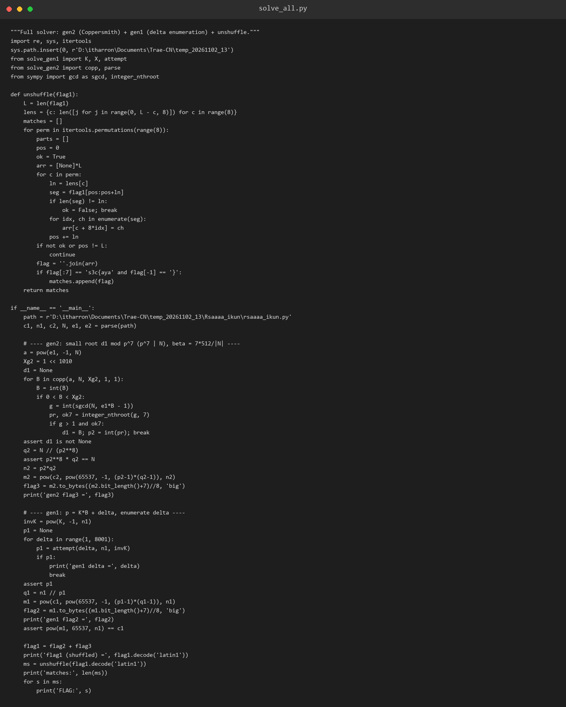
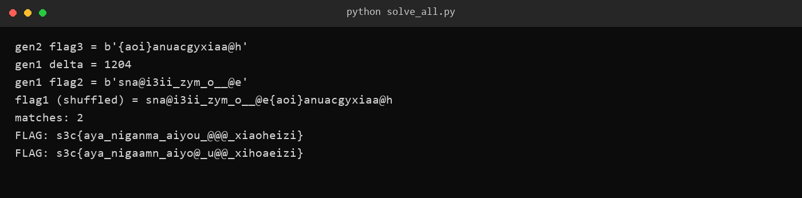

# 34 Rsaaaa_ikun · Crypto

- 分类：Crypto ｜ 分值：600 ｜ 状态：本地解出（平台未提交）
- 用「模未知除数 Coppersmith」打 `p^8·q` 这种非标准模数，再用重复字节块的低熵把第二个素数变成小根，最后爆破 8 列换位。

## 题目

题面只有一句「尽情使用ai吧孩子们」，出题人提示 `peipei`，附件 `Rsaaaa_ikun.zip` 里只有一个 `rsaaaa_ikun.py`。

脚本把 flag 用 8 列换位打乱，再切成前 18 字节、后 18 字节，分别丢给 `gen1`、`gen2` 两个加密器。跑过的脚本里明文被清空，但 `c`、`n`、`N`、`e1`、`e2` 这几个数都以注释形式留在文件末尾。

题名里那串 `aaaa` 不是手滑：`gen1` 写的是 `os.urandom(32) * 8`。

## 思路

- `gen2` 的模数不是常规 RSA：`N = p^8 * q`，而 `phi = p^7 * (p-1) * (q-1)`。φ 和 N 共享 `p^7`，且 `φ | e1·d1 - 1`，所以 `p^7 | e1·d1 - 1`——`d1` 就是模一个**未知除数** `p^7` 的小根。
- 第一反应是 Wiener：`d1` 只有 1000 bit，`N^{1/4}` 约 `2^1152`，看着够。但 `N - φ = p^7(p+q-1)` 是 4096 bit，误差量级 `2^-521`，而 Wiener 要求 `1/(2d1²) ≈ 2^-2001`，差一千多位。根因是常规推导假设 `φ ≈ N`，这里 `N-φ ≈ N^0.889`。
- `gen1` 的 `p = next_prime(bytes_to_long(os.urandom(32) * 8))`：32 字节块重复 8 次，p 只剩 256 bit 熵，题名 `Rsaaaa` 的四个 a 就是在说这个。
- 把它写成 `p = K·B + δ`（K 是已知常数，δ 是「到下一个素数的间隔」），猜中 δ 后 B 就是 `x ≡ -δ·K^{-1} (mod p)` 的小根，而 p 是 `n1` 的未知除数。
- 最后那层 8 列换位只有 36 字节，`8!` 全枚举即可，但格式约束只能锁死 8 个字符，需要一个「语义裁判」。

## 关键步骤

1. 用正则从脚本末尾的注释里抠出 `c1, n1, c2, N, e1, e2`，避免手抄出错。

2. `gen2`：取 `a = e1^{-1} mod N`、`f(x) = x - a`、`X = 2^1010`，二维格 `[[N,0], [-a,X]]` 走 LLL，最短向量还原出 1000 bit 的 `d1`。

3. `gcd(N, e1·d1 - 1) = p^7`，7 次开方得 512 bit 的 `p`，`q = N // p^8`，真模数 `n = pq`；解 `c2` 得 `flag3 = b'{aoi}anuacgyxiaa@h'`。



4. `gen1`：`K = (2^2048-1)/(2^256-1)`，对 `δ = 1,2,3,…` 取 `a = -δ·K^{-1} mod n1`，用 `(m=2,t=2)` 四维格求 B，再验 `n1 % (K·B+δ) == 0`；`δ = 1204` 命中，`flag2 = b'sna@i3ii_zym_o__@e'`。

5. 拼出 36 字节 `flag1` 后枚举 `8!` 种列顺序，按每列长度切段填回，用 `flag[:7] == 's3c{aya'` 且末位为 `}` 过滤，得到 2 个候选。

6. 两个候选里只有一个是通顺拼音（`aya / niganma / aiyou / xiaoheizi`），取它；再用置换 `(0,1,5,7,3,4,2,6)` 回代，能精确还原 `flag1` 且前后 18 字节分别等于两段明文，闭环。



## Flag

```text
s3c{aya_niganma_aiyou_@@@_xiaoheizi}
```

## 踩坑 / 备注

- 四维格一开始用 `sympy` 的 `Matrix.lll()`，8000 位整数要 9 秒/次，枚举几千个 δ 完全不可行；换 `python-flint` 的 `fmpz_mat.lll()` 后 6 毫秒/次。
- `e2` 从头到尾没用上：给两个指数、还让 `d2 = nextprime(d1 + getPrime(500))` 挨得极近，更像给 Wiener 爱好者准备的诱饵。
- 8! 里恰好有第二个「格式合法」的乱码候选，所以光靠格式校验不够，必须靠语义判断。
