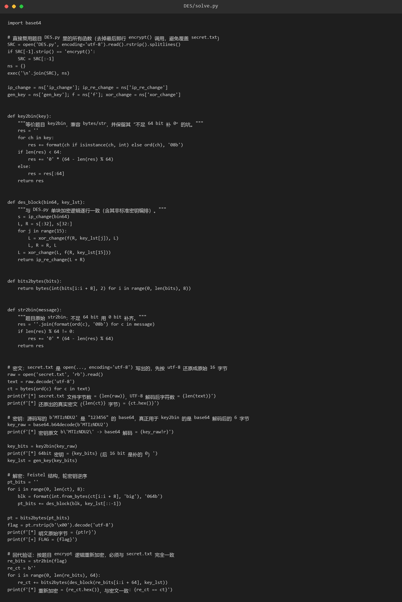
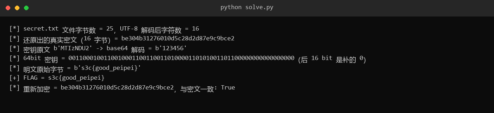

# 36 DES

- 分类：Crypto ｜ 分值：500 ｜ 状态：本地解出（平台未提交）
- 附件是一份手写 DES，三处「魔改」叠在一起：base64 密钥、非标准密钥编排、密文被 UTF-8 二次编码。

## 题目

题面「简单的DES加密，快来试试看」，出题人提示 `peipei`，附件 `DES.zip` 里两个文件：`DES.py`（6952 字节，箱表全在）和 `secret.txt`（25 字节）。

源码末尾硬编码明文模板 `str2bin('s3c{******}')`，密钥写成 `key2bin(b'MTIzNDU2')`，加密结果由 `bin2str` 转成字符串后以 `encoding="utf-8"` 写入 `secret.txt`。

## 思路

- `b'MTIzNDU2'` 是 `123456` 的 base64，不是 8 个 ASCII 字符；而 `key2bin` 在不足 64 bit 时补 0，所以真实密钥是 `"123456\x00\x00"`。
- 模板 12 字节补到 16 字节，密文应该是 16 字节，但 `secret.txt` 有 25 字节——`bin2str` 用 `chr()` 把 0~255 的字节变成字符，写盘时再按 UTF-8 编码，所有 ≥0x80 的字节都膨胀成两个字节。要先 `decode('utf-8')` 再 `ord` 才拿得回真密文。
- `gen_key` 每轮都用 `key_C0[i:] + key_C0[:i]`，即**每轮都从原始 C0/D0 重新位移**，而不是在上一轮结果上累加，所以标准 DES 库一定对不上，必须原样复用题目的函数。
- 不能 `import DES`（末尾有 `encrypt()`，一导入就会把 `secret.txt` 覆盖成模板密文），改成读源码、删掉最后一行再 `exec`。

## 关键步骤

1. 还原密文：`text = open('secret.txt','rb').read().decode('utf-8')`，再 `ct = bytes(ord(c) for c in text)`，得到 16 字节 `be304b31276010d5c28d2d87e9c9bce2`。

2. 密钥：`base64.b64decode(b'MTIzNDU2')` → `b'123456'`，走题目原版 `key2bin` 补 16 个 0，得 `0011000100110010001100110011010000110101001101100000000000000000`。

3. 复用题目 `ip_change`、`f`、`xor_change`、`gen_key`，写单块解密：15 轮 Feistel 后补最后一轮，轮密钥用 `key_lst[::-1]`。



4. 逐 8 字节分块解密，`rstrip(b'\x00')` 去填充，明文 `b's3c{good_peipei}'`。

5. 回代：按题目 `str2bin` + 同一 `key_lst` 重新加密，结果与 `be304b31276010d5c28d2d87e9c9bce2` 完全一致。



## Flag

```text
s3c{good_peipei}
```

## 踩坑 / 备注

- 第一版把 `b'MTIzNDU2'` 当 8 个 ASCII 字节喂进 `key2bin`，解出 `b'\x81\xd6\xcfE...'` 纯乱码；更坑的是这份乱码再加密回去仍等于 `secret.txt`——加解密是同一套 Feistel，自洽性检查发现不了密钥错，只能看明文是否可读。
- 题目这份 `key2bin` 在 Python 3 直接传 bytes 会 `TypeError`（迭代出 int，`ord(i)` 报错），说明出题人本地的流程是先 base64 解码再 `key2bin`，附件是简化过的版本。
- `str2bin` 用 0 bit 补齐，本题 16 字节正好两块，没有触发填充。
