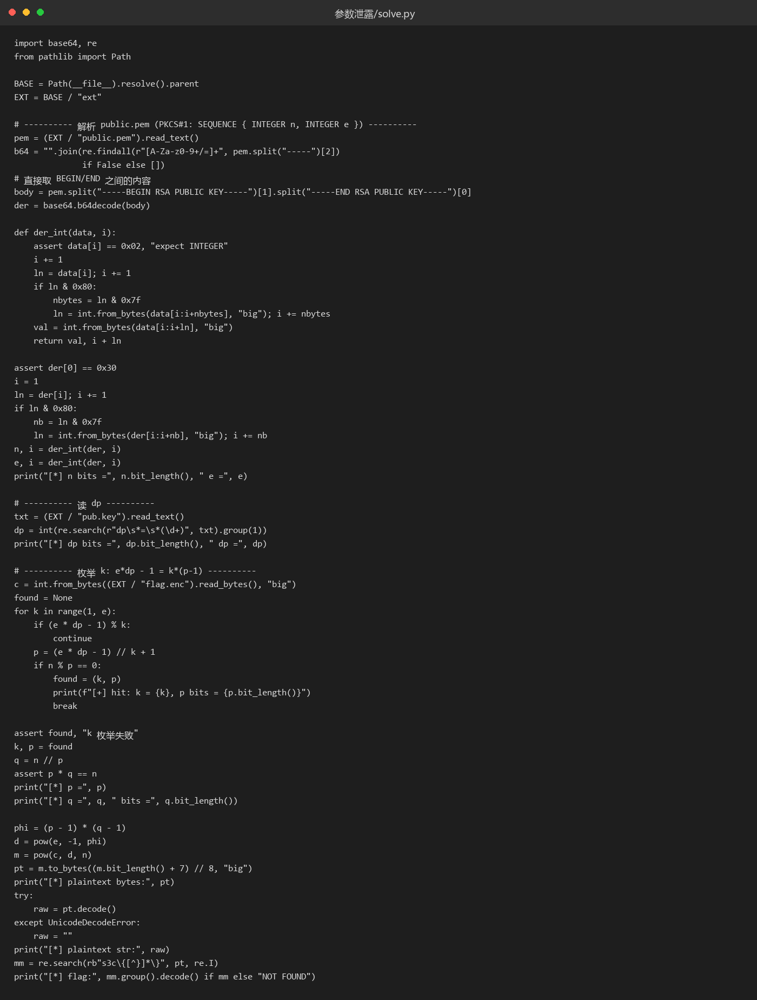
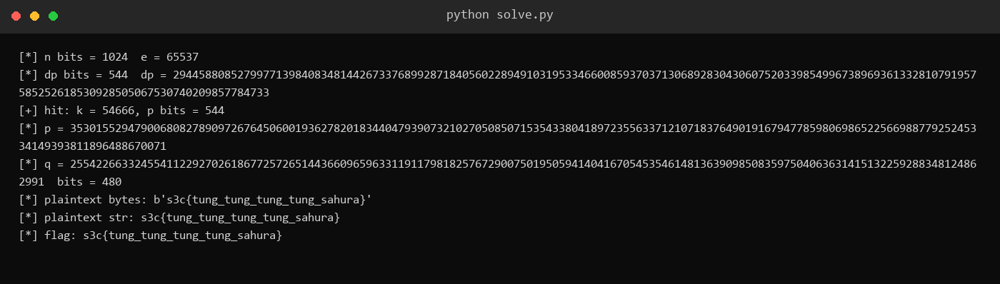

# 38 参数泄露 · Crypto

- 分类：Crypto ｜ 分值：445 ｜ 状态：本地解出（平台未提交）
- 泄露了一个 CRT 参数 `dp`，用它反推 `p = (e·dp-1)/k + 1` 并枚举 `k`，不必分解 `n`。

## 题目

附件 `参数泄露.zip` 只有 967 字节，解压出三个文件：`flag.enc`（128 字节）、`pub.key`（171 字节）、`public.pem`（251 字节）。

`public.pem` 是 PKCS#1 的 `RSA PUBLIC KEY`，里面只有 `n`（1024 bit）和 `e = 65537`；`pub.key` 打开是一行纯文本 `dp = 2944...4733`，544 bit。

`flag.enc` 是 128 字节裸二进制，正好一个 1024-bit 模数的密文块，不是 base64。

## 思路

- 题目名「参数泄露」加上 `pub.key` 里唯一的内容，泄露的就是 `dp`。
- `dp` 的定义是 `e·dp ≡ 1 (mod p-1)`，于是 `e·dp - 1 = k·(p-1)`，`p = (e·dp-1)/k + 1`，其中 `1 ≤ k < e`。
- `k` 最多 65536 个候选，每个只做一次大整数整除和一次取模，Python 里是秒级。
- `dp < p-1`，所以 `dp` 的位长本身就提示了 `p` 的规模是 544 bit 左右，别预设「p、q 都是 512 bit」。
- `flag.enc` 是裸字节，`int.from_bytes` 直接当 `c`。

## 关键步骤

1. 手写 DER 解析 `public.pem`：`SEQUENCE` → `INTEGER n` → `INTEGER e`，拿到 `n` 1024 bit、`e = 65537`。

2. 正则从 `pub.key` 取 `dp`，读 `flag.enc` 转成整数 `c`。

3. 枚举 `k = 1..e-1`，保留最严格的双重条件——`(e·dp-1) % k == 0` 且 `n % p == 0`。

4. `k = 54666` 命中，得到 544 bit 的 `p`；`q = n // p` 是 480 bit，`p·q == n` 成立。



5. 用 `phi = (p-1)(q-1)` 求 `d`，`m = pow(c, d, n)`，明文 `b's3c{tung_tung_tung_tung_sahura}'`。



## Flag

```text
s3c{tung_tung_tung_tung_sahura}
```

## 踩坑 / 备注

- 第一版脚本里写了 `assert q.bit_length() == 512`，命中后直接 `AssertionError`：`p` 是 544 bit、`q` 只有 480 bit，出题人没有用等长素数生成，`n` 仍是 1024 bit。断言删掉、只校验 `p·q == n` 即可。
- 另用 `sympy.isprime(p)` 确认 `p` 是素数，排除「恰好整除的非因子」这种巧合。
- 全程本地求解，未向平台提交。
