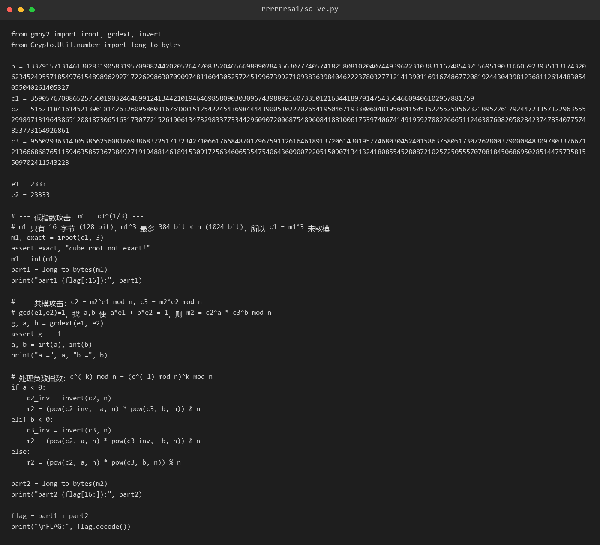
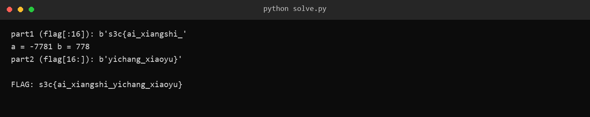

# 39 rrrrrrsa1

- 分类：Crypto ｜ 分值：未记录 ｜ 状态：本地解出（平台未提交）
- 一题两个经典 RSA 攻击：明文太短导致 `m^3 < n` 的低指数攻击，以及同模数不同指数的共模攻击。

## 题目

题面只有六个字：「共模，低指数攻击」，出题人提示 `peipei`，附件 `rrrrrrsa1.zip` 里只有一个 `rrrrrrsa1.py`。

源码把 flag 切成两段：前 16 字节做 `e = 3` 的 RSA，剩下部分用**同一个 n**、分别以 `e1 = 2333` 和 `e2 = 23333` 加密两次，给出 `c1`、`c2`、`c3`。

`n` 由两个 512 bit 素数相乘得到，1024 bit。

## 思路

- 前段 `m1 = flag[:16]`，即 128 bit，`m1^3` 最多 384 bit，远小于 1024 bit 的 `n`：**取模等于没取模**，`c1` 就是 `m1` 的三次方本身。
- 后段是典型的共模场景：同一个 `m2`、同一个 `n`、两个互素的指数。
- 先验证 `gcd(2333, 23333) = 1`（23333 = 2333×10 + 3，辗转相除最后得 1），贝祖定理保证存在 `a·e1 + b·e2 = 1`。
- 于是 `m2 = c2^a · c3^b mod n`；`a` 为负时先对 `c2` 求模逆，再取 `-a` 次幂。
- 题名里那五个 `r` 只是命名习惯，没有额外含义。

## 关键步骤

1. 低指数攻击：`iroot(c1, 3)` 返回 `(m1, exact)`，本题 `exact = True`，说明确实没发生过取模。

2. 共模攻击：`gcdext(2333, 23333)` 得 `g = 1, a = -7781, b = 778`。

3. 处理负指数：`c2_inv = invert(c2, n)`，`m2 = pow(c2_inv, -a, n) * pow(c3, b, n) % n`。

4. 两段拼接得到完整 flag。



5. 回代验证：`pow(m1,3,n) == c1`、`pow(m2,e1,n) == c2`、`pow(m2,e2,n) == c3` 三个全部匹配。



## Flag

```text
s3c{ai_xiangshi_yichang_xiaoyu}
```

## 踩坑 / 备注

- 前段的 `iroot` 一定要检查 `exact` 标志；不精确就说明明文比预期长、已经发生过取模，思路要换。
- 负数指数不能直接 `pow(c, -7781, n)` 了事，必须先求逆元，否则会得到错误结果而不是报错。
- 平台分值未记录（留存材料里没有对应记录）。
