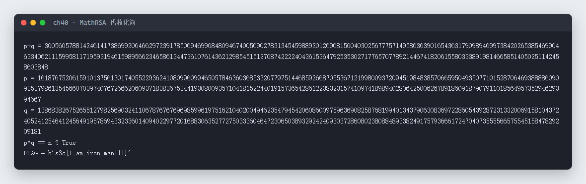

# 40 MathRSA · Crypto

- 分类：Crypto ｜ 分值：200 ｜ 状态：平台已解
- 给了 `x`、`y`、`n`、`c`，`x` 是 `p`、`q` 的齐次式，`y=2p+3q`，把 `x` 按 `y` 化简就能反解出 `p+q`。

## 题目

- 题号 40，题名「MathRSA」，附件 `MathRSA.zip`（内含 `MathRSA.py`）。
- 源码用 1024 位素数生成 `p,q`，`e=65537`，输出：

```python
x = 4*p**3 + 16*p**2*q + 21*p*q**2 + 9*q**3 - 2025*p - 2025*q + 2025*e
y = 2*p + 3*q
n = p * q
c = pow(m, e, n)
```

## 思路

- 前三项是三次齐次式，试一下能不能配成 `(2p+3q)` 的多项式：`(2p+3q)(2p²+5pq+3q²) = 4p³+16p²q+21pq²+9q³`，正好等于 `x` 的前四项。
- 而 `2p²+5pq+3q² = (2p+3q)(p+q) = y·(p+q)`，所以 `x = y²·(p+q) - 2025(p+q) + 2025e = (p+q)(y²-2025) + 2025e`。
- 于是 `p+q = (x - 2025e) / (y² - 2025)`，整除性一验即知。
- 有了 `s=p+q` 和 `y=2p+3q`：`3s - y = p`，`y - 2s = q`，直接解出两个素数，再常规 RSA 解密。

## 关键步骤

```python
from Crypto.Util.number import long_to_bytes, inverse

yr = y*y - 2025
s = (x - 2025*e) // yr
assert (x - 2025*e) % yr == 0

p = 3*s - y
q = y - 2*s
assert p*q == n

d = inverse(e, (p-1)*(q-1))
print(long_to_bytes(pow(c, d, n)))
```

实测输出（p、q 反解成功，`p*q == n` 为 True）：



## Flag

```text
s3c{I_am_iron_man!!!}
```

## 踩坑 / 备注

- 别急着上 sympy 解三次方程：`y=2p+3q` 就是为因式分解量身定做的，`x` 的常数项 `2025*e` 是唯一不能并入 `p+q` 的部分，先把它减掉。
- 注意本题是小写 `s3c{...}`，与本场多数题的 `S3C{}` 不同，按原样记录。
