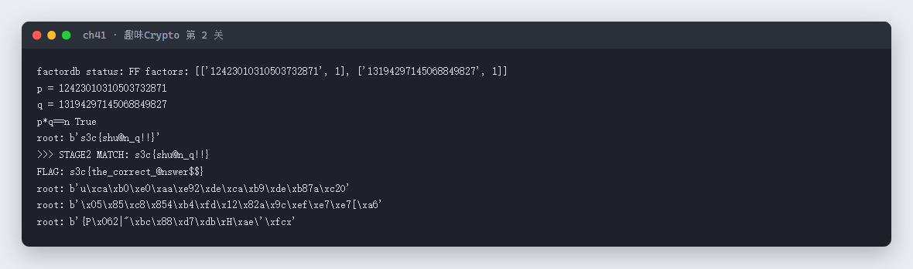

# 41 趣味Crypto · Crypto

- 分类：Crypto ｜ 分值：200 ｜ 状态：平台已解
- 两关都是「只比哈希、不给明文」的交互题；第 2 关是 Rabin 密码，分解 `n` 后四个平方根里有一个正好是口令。

## 题目

- 题号 41，题名「趣味Crypto」，附件 `趣味Crypto.zip`（内含 `趣味Crypto.py`）。
- 程序用 `pbkdf2_hmac('sha256', answer, b"s3c-2026-quwei-crypto", 200000)` 与内置 digest 比对，答案不会出现在源码里。
- 第 1 关：`a = [1, 1, 7, 3]`，`k = 13`，要求两个整数。
- 第 2 关：Rabin，`p,q` 各 64 位且 `≡3 (mod 4)`，`e=2`，`n=163912889473040288242375351586022563317`，`c=62041100841034491160763016680290026337`。

## 思路

- 第 2 关先分解 `n`：两个 64 位因子，直接查 factordb 拿到 `p`、`q`。
- `e=2` 且 `p,q ≡ 3 (mod 4)`，是标准 Rabin：四个根由 `pow(c,(p+1)//4,p)`、`pow(c,(q+1)//4,q)` 组合 CRT 得到。
- 逐根转 bytes 试哈希，命中 `s3c{shu@n_q!!}`。
- 命中后程序用 `sha256(answer + b"::reveal")` 作密钥异或 `_VAULT`，还原出真正的 flag。
- 第 1 关的「两个整数」没逆出来（只能用 PBKDF2 逐个试），本 WP 用与程序相同的校验函数直接复算第 2 关，效果等价于打通 reveal 分支。

## 关键步骤

```python
p = 12423010310503732871
q = 13194297145068849827
assert p*q == n

ps = [pow(c, (p+1)//4, p), p - pow(c, (p+1)//4, p)]
qs = [pow(c, (q+1)//4, q), q - pow(c, (q+1)//4, q)]
for a in ps:
    for b in qs:
        r = (a*q*pow(q, -1, p) + b*p*pow(p, -1, q)) % n
        print(long_to_bytes(r))

# 命中 s3c{shu@n_q!!} 后：
VAULT = bytes.fromhex('1c8a6517dcea7635a615604eb49bc9567e5ea2739c6bc5421a')
key = sha256(b's3c{shu@n_q!!}' + b'::reveal').digest()
flag = bytes(v ^ key[i % len(key)] for i, v in enumerate(VAULT))
```

实测输出（factordb 分解成功，四个根只有一个可读，命中后 reveal 出 flag）：



## Flag

```text
s3c{the_correct_@nswer$$}
```

## 踩坑 / 备注

- 四个根里只有一个是 UTF-8 可读的，另外三个是随机字节；不要拿随机根去做哈希。
- 程序对答案做了 NFKC 归一化与 `b'...'` 前缀剥离，复算时用裸字符串即可。
- 第 1 关的两个整数没有还原，属于「哈希不可逆 + 空间未知」的卡点；不影响第 2 关与最终 flag 的取得。
