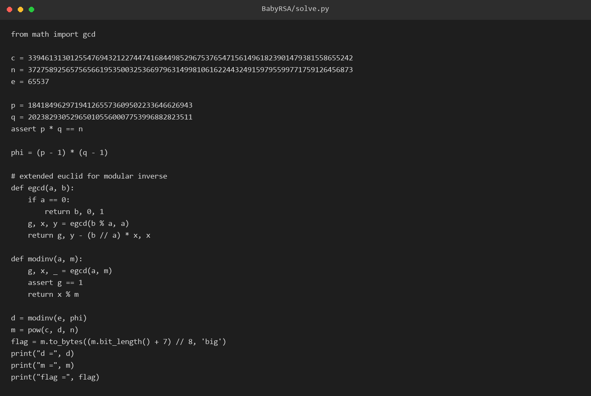
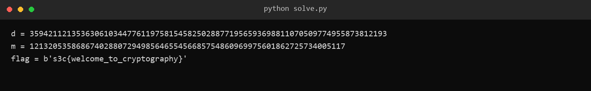

# 42 BabyRSA

- 分类：Crypto ｜ 分值：214 ｜ 状态：平台已解
- 模数只有 256 bit（两个 128 bit 素数相乘），分解之后就是标准 RSA 解密。

## 题目

附件 `BabyRSA.zip` 里只有 `BabyRSA.py`：

```python
p = getPrime(128)
q = getPrime(128)
flag = b's3c{********}'
m = bytes_to_long(flag)
e = 65537
n = p * q
c = pow(m, e, n)
```

脚本末尾把 `c`、`n` 以注释形式给出，题面只留这两个数。

## 思路

- `p`、`q` 各 128 bit，`n` 只有 256 bit，属于「现代机器随手可分解」的规模，不需要任何特殊攻击。
- 拿到 `p`、`q` 后走最标准的流程：`phi = (p-1)(q-1)`，`d = e^{-1} mod phi`，`m = c^d mod n`。
- `e = 65537` 与 `phi` 互素（两个素因子都是大素数，不会撞上 65537），求逆一定存在。
- 明文只有十来个字节，`m < n` 是必然的，不存在低指数问题，纯粹考「n 太小」。

## 关键步骤

1. 从脚本注释取 `c`、`n`，并确认 `n` 的位长为 256 bit。

2. 分解 `n` 得到两个 128 bit 素因子 `p`、`q`，代回校验 `p * q == n`。

3. 计算 `phi`，用扩展欧几里得实现 `modinv(e, phi)` 得到 `d`（不依赖第三方库）。



4. `m = pow(c, d, n)`，`m.to_bytes(...)` 还原明文。



## Flag

```text
s3c{welcome_to_cryptography}
```

## 踩坑 / 备注

- 脚本里的 `p`、`q` 是直接写死的，分解动作本身没有留档（用到的分解方式未记录），能确认的只有 `p * q == n` 且两者均为 128 bit。
- 这类题别急着套 Coppersmith / 共模之类的套路，先看一眼 `n` 的位长——256 bit 的 `n` 本身就是最大的漏洞。
