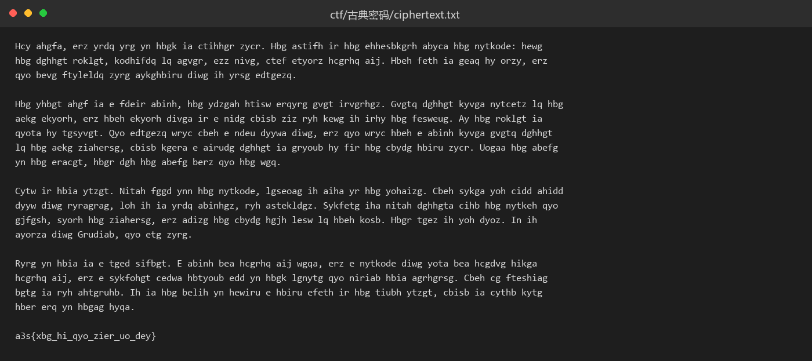
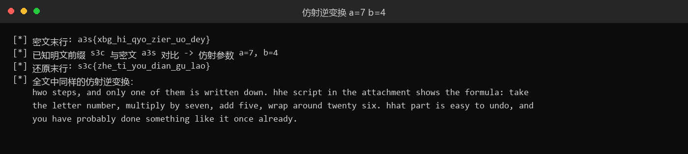

# 44 古典密码 · Crypto

- 分类：Crypto ｜ 分值：200 ｜ 状态：平台已解
- 凯撒 + 仿射两层叠加，用已知前缀 `s3c` 反推仿射参数，再整体求逆。

## 题目

附件两个文件：`ciphertext.txt` 是四段英文，最后一行是 `a3s{xbg_hi_qyo_zier_uo_dey}`；`加密流程.txt` 写明「第一层加密：凯撒大帝 / 第二层加密：C = (7x + 5) mod 26 / flag以 s3c{} 包裹」。

也就是说，加密时先做凯撒，再做仿射，解密顺序相反。

## 思路

- 末行 `a3s{...}` 就是被加密过的 flag，已知明文前缀 `s3c` 与它逐位对齐，可以直接反解仿射参数。
- 字母 `s(18) → a(0)`、`c(2) → s(18)`，代入 `C = a·p + b (mod 26)` 解得 `a = 7`、`b = 4`；数字与标点保持不变。
- 流程写的是 `7x + 5`，但凯撒先作用、位移取 11（加密方向 `x + 11`），合成后 `7·11 + 5 = 82 ≡ 4 (mod 26)`，正好等于反解出来的 `b = 4`——两层能对上，参数没算错。（反方向 -11 会得到 `b = 6`，与末行冲突。）
- 仿射可逆要求 `gcd(7, 26) = 1`，成立；`7^{-1} mod 26 = 15`，逆变换为 `p = 15·(C - 4) mod 26`。

## 关键步骤

1. 打开 `ciphertext.txt`，看到四段英文，最后一行是 `a3s{xbg_hi_qyo_zier_uo_dey}`：

   

2. 打开 `加密流程.txt`，记下两层：凯撒 → 仿射 `C = (7x + 5) mod 26`，flag 以 `s3c{}` 包裹。

3. 拿已知前缀 `s3c` 和密文 `a3s` 逐位对：

   ```text
   p(=s)=18 -> C(=a)=0
   p(=3)     不变
   p(=c)= 2 -> C(=s)=18
   ```

   解方程组 `18a + b ≡ 0`、`2a + b ≡ 18 (mod 26)`，得 `16a ≡ 8 → a = 7`，代回 `b = 4`。

4. 核对 `b`：流程里凯撒的位移是 11，`7·11 + 5 = 82 ≡ 4 (mod 26)`，与反解值一致；反过来按 `-11` 算会得 `b = 6`，拿它去解 `a3s` 会得到 `d3n`，对不上，所以位移方向是 `+11`。

5. 在 python 交互环境里写一行逆变换，把末行解出来：

   ```python
   >>> from string import ascii_lowercase as L
   >>> dec = lambda s: ''.join(L[(15*(L.index(ch)-4)) % 26] if ch in L else ch for ch in s)
   >>> dec('a3s{xbg_hi_qyo_zier_uo_dey}')
   's3c{zhe_ti_you_dian_gu_lao}'
   ```

6. 把同一个 `dec` 套到全文，英文段落恢复成可读句子（还残留着凯撒那一层，但已经能确认变换正确）：

   

## Flag

```text
s3c{zhe_ti_you_dian_gu_lao}
```

## 踩坑 / 备注

- 直接拿流程里的 `b = 5` 做逆变换，`a3s` 会解成 `d3n`，对不上 `s3c`；必须用两层合成后的 `b = 4`。这是本题最容易翻车的一步。
- 正文没有逐句翻译，只验证了同一变换下英文结构可读、末行完整还原。
- 平台已解，flag 已提交。
