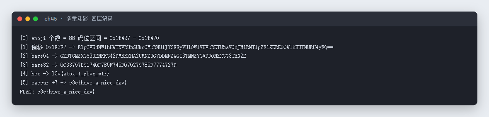

# 45 多重迷影 · Misc

- 分类：Misc ｜ 分值：200 ｜ 状态：平台已解
- 附件是一串 emoji，四层套娃：码位偏移 → base64 → base32 → hex → 凯撒。

## 题目

- 题号 45，题名「多重迷影」，题面「不识庐山真面目，只缘身在此山中」，出题人 peipei。
- 附件 `多重迷影.zip`，解压得到 `多重迷影.txt`，内容 88 个 emoji。

## 思路

- 先统计：88 个字符全部落在 `U+1F427`–`U+1F470` 区间，说明是按码位偏移编码的可打印字符。
- 试偏移：`cp - 0x1F3F7` 得到的字节恰好全是 ASCII，是一段以 `==` 结尾的 base64。
- 依次解 base64 → base32 → hex，得到 `l3v{atox_t_gbvx_wtr}`，看着像 `s3c{...}` 但整体错位 7 位，凯撒右移 7 即还原。

## 关键步骤

1. 解压后打开 `多重迷影.txt`，满屏 emoji，没有别的提示。88 个字符的码位批量偏移手工做不到，这一步用一行 python 完成：

   ```bash
   python -c "print(''.join(chr(ord(c)-0x1F3F7) for c in open('多重迷影.txt',encoding='utf-8').read() if ord(c)>0x2000))" > l1.txt
   cat l1.txt
   ```

   偏移量 `0x1F3F7` 是试出来的：先打印几个码位，再用「减完要落在可打印 ASCII」这个条件反推，一次就对齐了。`l1.txt` 里是一串以 `==` 结尾的标准 base64。

2. 第二层，直接交给 `base64`：

   ```bash
   base64 -d l1.txt > l2.txt
   cat l2.txt
   ```

   结果只含 `A-Z2-7` 和大写字母，末尾是 `=`，典型的 base32。

3. 第三层：

   ```bash
   base32 -d l2.txt > l3.txt
   cat l3.txt
   ```

   得到一串十六进制。

4. 第四层，十六进制转回字节：

   ```bash
   xxd -r -p l3.txt
   ```

   输出 `l3v{atox_t_gbvx_wtr}`，形状已经是 flag，只是每个字母整体偏了 7 位。

5. 凯撒回推 7 位：

   ```bash
   echo 'l3v{atox_t_gbvx_wtr}' | tr 'a-z' 'h-za-g'
   ```

   得到 `s3c{have_a_nice_day}`，四层走完。

   四层解码的完整输出记录：

   

## Flag

```text
s3c{have_a_nice_day}
```

## 踩坑 / 备注

- 偏移值不是常见的 `0x1F000` 一类整数，`0x1F3F7` 是通过「让首字节落在可打印 ASCII」反推出来的，可以写个小循环暴力试 0x1000 个偏移。
- 每一层都要求「解出来仍是可打印文本」再继续，否则很容易在错的分支上越走越远。
- 凯撒的方向别看反：`l → s` 是加 7，`tr 'a-z' 'h-za-g'` 就是加 7 的写法。
