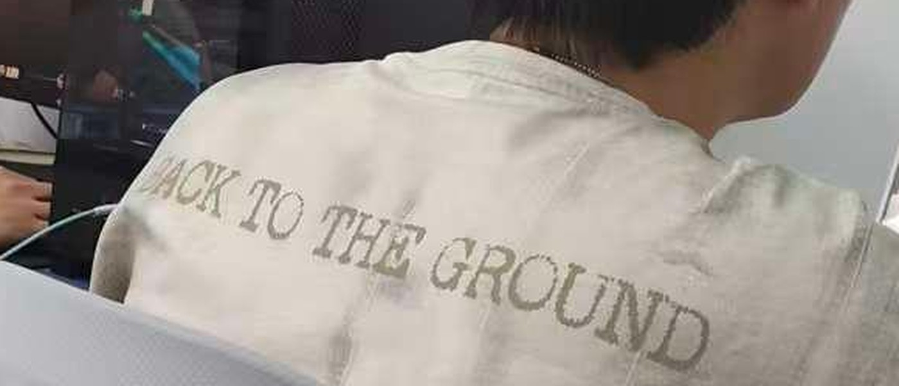
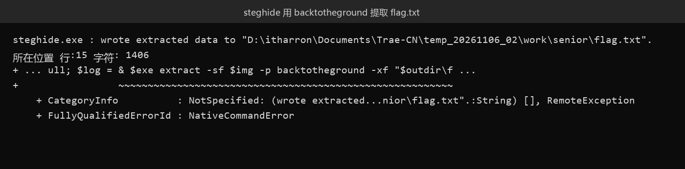

# 48 帅气学长 · Misc

- 分类：Misc ｜ 分值：401 ｜ 状态：平台已解
- 一句话概括考点：JPEG 里的 steghide 隐写，口令藏在画面最显眼的地方——学长 T 恤背面的英文。

## 题目

- 题面：好帅的背影 ——Sh1y1；附件 `神秘学长.zip`（81013 字节，注意附件名与题名"帅气学长"对不上）。
- 包内只有一个 `神秘学长.jpg`（87709 字节，JPEG 1034x1279），无 EXIF、无 GPS、无缩略图，只有一段 JFIF APP0。
- 平台显示全平台 3 队解出。

## 思路

- 先把"常规全铺一遍"：zip 条目 flags 为 `0x0000` 无伪加密、无密码无注释、extra 只有标准 `up` 字段；raw inflate 后 `eof=True`、`unused_data=0`，deflate 流后面没塞东西。
- JPEG 结构层也干净：`FFE0 -> FFDB -> FFC0 -> FFC4 -> FFDA`，1 个 SOS、1 个 EOI，EOI 之后 0 字节，DQT/DHT 是 libjpeg 标准表——很"干净"的一次重编码。
- 视觉层翻遍：自动对比度、直方图均衡、反色、镜像、旋转、ELA、RGB 通道差、YCbCr、噪声残差、块均值、FFT 幅度谱，加上缩略图逐级查看、QR/条码扫描，都没有可读文字。
- LSB 与 DCT 系数也空：R/G/B bit0~bit3 多种顺序、多种字节序直接搜 `s3c{` 位模式；自写 baseline 解码器按 JSteg 玩法搜量化后 DCT 系数，全空。
- 所有"明文可搜"的路都堵死 → 不是裸 LSB，而是**带口令的隐写**；JPEG 上带口令的经典工具就 steghide / outguess / F5 / jphide。此时回头看图里唯一有信息量的东西：T 恤背面的 **BACK TO THE GROUND**，就是口令提示。



## 关键步骤

1. 解压，确认包内只有一个 JPEG，排除双层包/伪加密/尾部附加数据。
2. 按 T 恤文字取口令 `backtotheground`（去掉空格、全小写），试 steghide：

```powershell
steghide extract -sf extract/神秘学长.jpg -p backtotheground -xf flag.txt -f
type flag.txt
# s3c{gyx_1s_a_sc0p1ng_d0g}
```

3. `steghide info` 复核载体信息：`embedded file "flag.txt"`，25 字节，`encrypted: rijndael-128, cbc`，`compressed: yes`——确实是把数据嵌进了 DCT 系数。



## Flag

```text
s3c{gyx_1s_a_sc0p1ng_d0g}
```

## 踩坑 / 备注

- 一开始被三件事带偏：92% 的压缩率（其实是一片白墙太平）、附件名与题名不一致、1034x1279 这种奇怪尺寸，都以为是双层包或改高宽。
- 口令试过 `s3c`、`Sh1y1`、`123456`、`s3ctf`、`背影`、`神秘学长` 等，全部报 `could not extract any data with that passphrase`。
- zip 的 SHA256 与平台资源 URL 里的哈希一致，只是平台按文件哈希存盘，不是线索。
