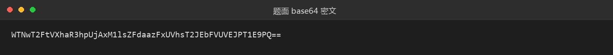
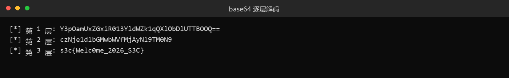

# 49 签个到吧 · Misc

- 分类：Misc ｜ 分值：50 ｜ 状态：平台已解
- 白给签到题：一串 base64 套了三层，逐层解码就出 flag。

## 题目

题面给出一串字符，环境里没有别的附件：

```
WTNwT2FtVXhaR3hpUjAxM1lsZFdaazFxUVhsT2JEbFVUVEJPT1E9PQ==
```

要求从中取出 flag（题目名就叫「签个到吧」，属于给新手熟悉工具的送分题）。

## 思路

- 字符集只有 `A-Za-z0-9+/`，末尾补了 `==`，是标准 base64 的形态。
- 第一层解出来的结果仍然只含 base64 字符，长度也还在同一量级，说明是套娃而不是最终明文。
- 每解一层长度都会缩短，第三层直接出现 `s3c{`，没有必要再往下解。
- 判断「该停」的信号是明文格式：一旦看到 `s3c{...}` 就结束。

## 关键步骤

1. 把题面那串字符复制到终端，第一层：

   ```bash
   echo 'WTNwT2FtVXhaR3hpUjAxM1lsZFdaazFxUVhsT2JEbFVUVEJPT1E9PQ==' | base64 -d
   ```

   得到 `Y3pOamUxZGxiR013YldWZk1qQXlObDlUTTBOOQ==`，还是一串 base64。

2. 第二层，把上一步的结果再喂给 `base64 -d`：

   ```bash
   echo 'Y3pOamUxZGxiR013YldWZk1qQXlObDlUTTBOOQ==' | base64 -d
   ```

   得到 `czNje1dlbGMwbWVfMjAyNl9TM0N9`，仍然是 base64 字符集。

3. 第三层：

   ```bash
   echo 'czNje1dlbGMwbWVfMjAyNl9TM0N9' | base64 -d
   ```

   输出 `s3c{Welc0me_2026_S3C}`，出现花括号，到此为止。

   

   

## Flag

```text
s3c{Welc0me_2026_S3C}
```

## 踩坑 / 备注

- 只解一层会得到另一串 base64，很容易误以为「解出来是乱码」，注意输出的字符集和末尾的 `=`。
- `base64 -d` 在 macOS 上是 `base64 -D`，Windows 的 PowerShell 里用 `[Text.Encoding]::UTF8.GetString([Convert]::FromBase64String('...'))`。
- 手工抄写时 `0/O`、`1/l/I` 极易看错，用工具直接复制原串最稳。
- 平台已解，flag 已提交。
