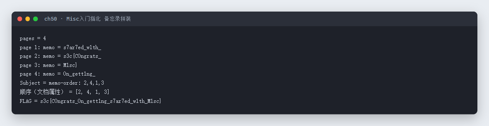
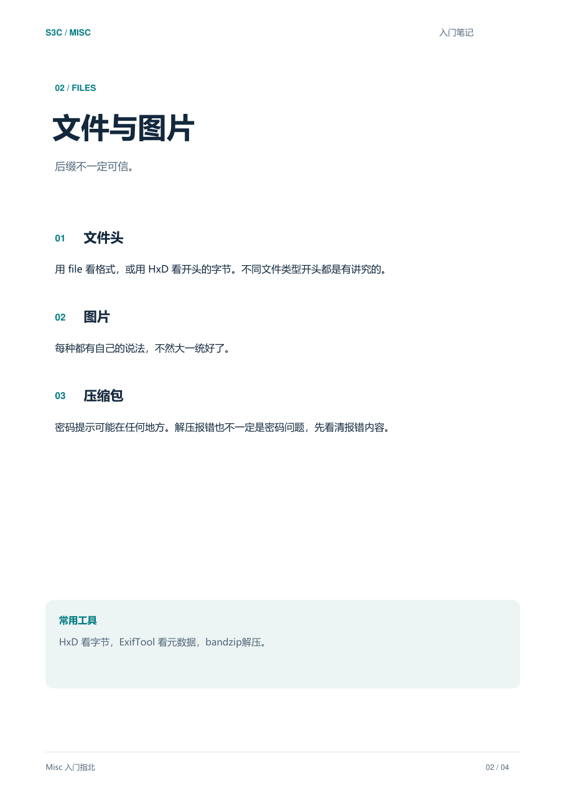
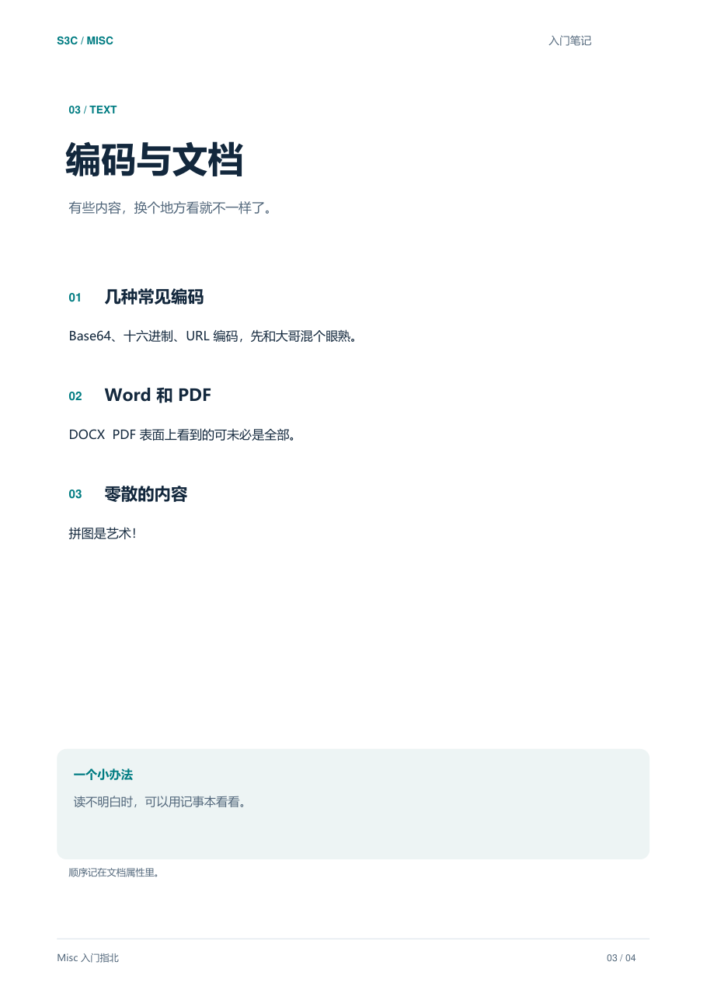

# 50 Misc入门指北 · Misc

- 分类：Misc ｜ 分值：200 ｜ 状态：平台已解
- 一份 4 页的 PDF，每页藏一段 flag 碎片，拼装顺序写在文档属性的 `Subject` 里。

## 题目

- 题号 50，题名「Misc入门指北」，题面「听说看完这个可以成为Misc大手子 ——Sh1y1」。
- 附件 `Misc入门指北.pdf`，4 页，内容确实是 Misc 入门教学。

## 思路

- 纯文本提取每页，正文是正常教程，但每页最后一行都有个 `[memo]` 开头的小尾巴——四段碎片。
- 碎片本身是乱序的：`s7ar7ed_w1th_`、`s3c{C0ngrats_`、`M1sc}`、`0n_gett1ng_`，直接拼不成话。
- 第 3 页正文里写了「顺序记在文档属性里」，去读 PDF 元数据，`Subject = memo-order: 2,4,1,3`。
- 按 2→4→1→3 拼起来就是完整 flag。

## 关键步骤

```python
from pypdf import PdfReader

r = PdfReader('Misc入门指北.pdf')
parts = {}
for i, page in enumerate(r.pages, 1):
    lines = [x.strip() for x in (page.extract_text() or '').splitlines() if x.strip()]
    memo = [x for x in lines if x.startswith('[memo]')]
    if memo:
        parts[i] = memo[-1].replace('[memo]', '').strip()

print(r.metadata['/Subject'])          # memo-order: 2,4,1,3
order = [int(x) for x in r.metadata['/Subject'].split(':')[1].split(',')]
print(''.join(parts[i] for i in order))
```

实测输出：



第 2 页（碎片 `s3c{C0ngrats_`）：



第 3 页（明示「顺序记在文档属性里」）：



## Flag

```text
s3c{C0ngrats_0n_gett1ng_s7ar7ed_w1th_M1sc}
```

## 踩坑 / 备注

- 四段碎片直接按页序拼是 `s7ar7ed_w1th_s3c{C0ngrats_M1sc}0n_gett1ng_`，一眼假；顺序线索只在元数据里。
- `pypdf` 提取时每个字符可能单独成行（PDF 无空格分词），判定 `[memo]` 行要用 `startswith` 而不是整行等值匹配。
