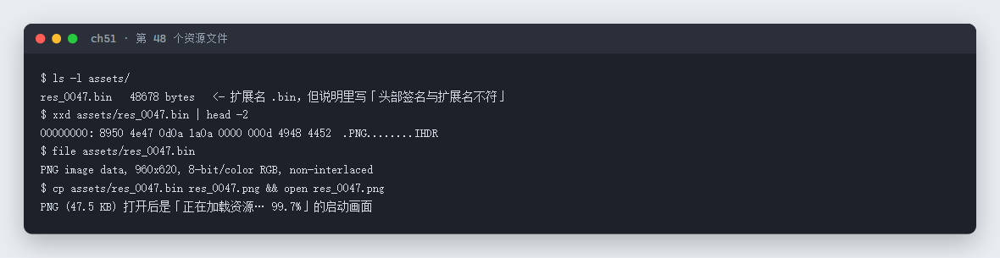

# 51 原神启动！ · Misc

- 分类：Misc ｜ 分值：214 ｜ 状态：平台已解
- 附件名为 `.exe`，实际是 ZIP；里面第 48 个资源 `res_0047.bin` 其实是 PNG，打开就是 flag。

## 题目

- 题号 51，题名「原神启动！」，出题人 peipei，无题面文字。
- 附件 `原神启动.exe`（138,044 字节）。

## 思路

- `file` 一看魔数就是 `PK\x03\x04`，不是 PE——改后缀成 zip 直接解。
- 解出 `启动游戏.html`、`说明.txt`、`assets/logo.png`、`assets/res_0047.bin`。说明里写「如果进度条卡在 99%，别刷新页面 —— 那不是网速问题」。
- 打开 HTML，日志里写得很清楚：
  - `校验资源清单 ............ 47 / 48`
  - `assets/res_0047.bin 头部签名与扩展名不符`
  - `建议：自己看看第 48 个资源到底是个什么东西`
- 看 `res_0047.bin` 前 8 字节是 `89 50 4E 47 0D 0A 1A 0A`，标准 PNG 签名，改成 `.png` 打开即可。

## 关键步骤

```bash
mv 原神启动.exe 原神启动.zip && unzip 原神启动.zip
xxd assets/res_0047.bin | head -2
# 00000000: 8950 4e47 0d0a 1a0a 0000 000d 4948 4452  .PNG........IHDR
cp assets/res_0047.bin res_0047.png
```

实测：



伪装成 `.bin` 的 PNG，画面上就是 flag：


## Flag

```text
s3c{nizhen_de_yiwei_zhe_jiu_shi_da_an_ma}
```

## 踩坑 / 备注

- 双击 `.exe` 会提示「不是有效的 Win32 应用程序」，别在这上面浪费时间；Misc 里「后缀不可信」是常规考点（PDF 里也这么写）。
- flag 是小写 `s3c{}`，画面里 `s3c` 后面跟的是正文，不要自行补大写。
