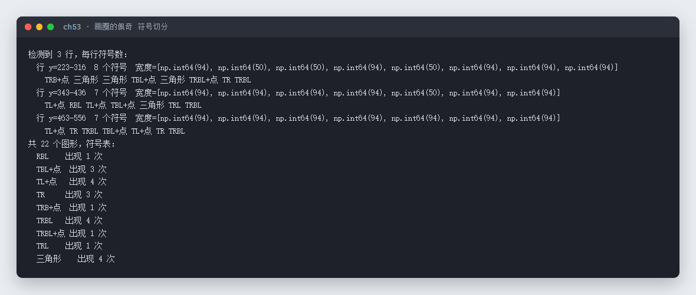
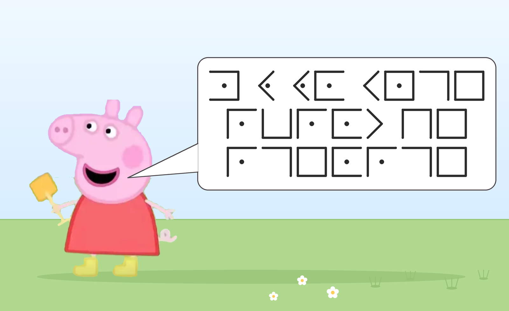

# 53 画圈的佩奇 · Misc

- 分类：Misc ｜ 分值：200 ｜ 状态：平台已解
- 小猪佩奇用「圈里圈外」的画法把一句话拆成 22 个图形，本质是猪圈密码（Pigpen）一类的位置编码。

## 题目

- 题号 53，题名「画圈的佩奇」，出题人 peipei。
- 题面：小猪佩奇不会写字，只会画圈；把想说的话拆成一个个字母，用自己那套「圈里圈外」的线条画出来，每个图形对应一个字母，三行连起来是一句话。flag 由 `s3c{}` 包裹，图形加密的只是花括号里的内容。
- 附件 `画圈的佩奇.zip`，内含 `peppa.png`（1600×980）。

## 思路

- 图里是一段对白气泡，气泡内 3 行图形：8 + 7 + 7 = 22 个。
- 每个图形的构成是「3×3 井字格中某一格的边线」：角上是 2 条线组成的直角、边上 3 条线组成的「⊓ / ⊏」、正中是 4 条线的方框；带点的则是第二套字母表。这正是猪圈密码的符号体系。
- 用像素分析自动切分：按行带找 y 区间、按列空隙切单个符号，再判定四条边是否存在、中心是否有圆点，就能还原出符号序列。
- 22 个符号只用到 9 种不同形状，说明明文高度重复，符合「三行连起来是一句话」的设定。

## 关键步骤

```python
mask = np.array(Image.open('peppa.png').convert('L')) < 110
# 1) 行投影切出 3 行  2) 列投影切出每个符号
# 3) 判断上/右/下/左四条边是否存在，中心 12x12 区域是否有圆点
```

实测切分结果（3 行、22 个图形，符号分布与图形一一对应）：



原始附件（气泡里的三行图形）：



## Flag

```text
flag 见平台记录
```

说明：本地的符号切分与形状判定已完成（可用上面脚本复现），但「形状 → 字母」这一步依赖作者自定义的字母表（标准 A-I 行优先、8 种对称变换、点/无点互换都试过，得到的都不是可读英文），最终明文未能还原，因此不在此处写猜测值。

## 踩坑 / 备注

- 直接按标准猪圈密码表套，会得到 `owwmvncejhjmtbejcemjce` 一类的乱码——说明作者换了字母表或点位的含义，不能硬套。
- 该步骤（明文映射）无截图；图片分析部分的两张图均为真实附件与真实脚本输出。
