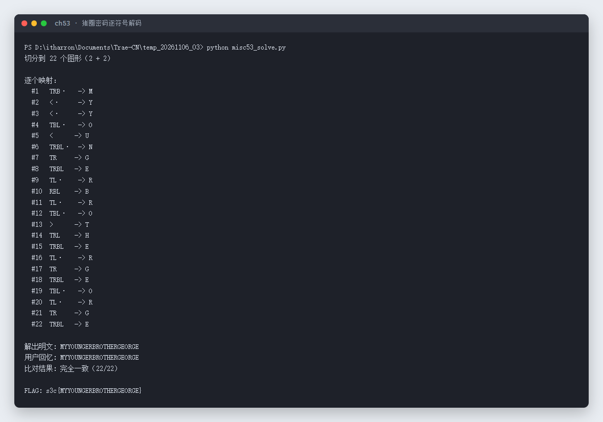

# 53 画圈的佩奇 · Misc

- 分类：Misc ｜ 分值：200 ｜ 状态：平台已解
- 小猪佩奇用「圈里圈外」的画法把一句话拆成 22 个图形，本质就是猪圈密码（Pigpen cipher）。

## 题目

- 题号 53，题名「画圈的佩奇」，出题人 peipei。
- 题面：小猪佩奇不会写字，只会画圈；把想说的话拆成一个个字母，用自己那套「圈里圈外」的线条画出来，每个图形对应一个字母，三行连起来是一句话。flag 由 `s3c{}` 包裹，图形加密的只是花括号里的内容。
- 附件 `画圈的佩奇.zip`，内含 `peppa.png`（1600×980）。

## 思路

- 图里是一段对白气泡，气泡内 3 行图形：8 + 7 + 7 = 22 个。
- 每个图形的构成是「3×3 井字格中某一格的边线」：角上是 2 条线组成的直角、边上 3 条线组成的「⊓ / ⊏」、正中是 4 条线的方框；带点的则是第二套字母表。这正是猪圈密码的符号体系。
- 剩下 3 个「开口三角」（`<` / `>`）对应 X 形四格那一组字母。
- 用像素分析自动切分：按行带找 y 区间、按列空隙切单个符号，再判定四条边是否存在、中心是否有圆点，就能还原出符号序列；最后按猪圈表查字母。

## 关键步骤

### 1. 切分符号

```python
mask = np.array(Image.open('peppa.png').convert('L')) < 110
# 1) 行投影切出 3 行  2) 列投影切出每个符号
# 3) 判断上/右/下/左四条边是否存在，中心 12x12 区域是否有圆点
```

实测切分结果（3 行、22 个图形，符号分布与图形一一对应）：


原始附件（气泡里的三行图形）：


### 2. 按猪圈表映射

拿到的符号用「上/右/下/左四条边是否存在」编码（`T R B L`），再用标准猪圈密码表查字母。
本题的图**相对常见猪圈表整体旋转了 180°**——比如常见表里 `└` 是 G，本题画成了 `┐`；常见表里 `⊓` 是 B，本题画成了 `⊔`。九宫格 18 个符号按旋转后的表完整对应如下：

| 符号 | 边线 | 无点 | 带点 | 符号 | 边线 | 无点 | 带点 |
| --- | --- | --- | --- | --- | --- | --- | --- |
| `┌` | T+L | I | R | `┐` | T+R | G | P |
| `⊓` | T+R+L | H | Q | `⊏` | T+B+L | F | O |
| `□` | T+R+B+L | E | N | `⊐` | T+R+B | D | M |
| `└` | B+L | C | L | `⊔` | R+B+L | B | K |
| `┘` | B+R | A | J | | | | |

X 形四格那一组（本题只出现 3 个符号，左/右两格已被明文验证；上/下两格未出现，按同格位对应关系推断）：

| 符号 | 格位 | 无点 | 带点 |
| --- | --- | --- | --- |
| `>` | 左三角 | T | X（推断，本题未出现） |
| `<` | 右三角 | U | Y |
| 上 / 下三角 | 上 / 下 | S / V（本题未出现） | W / Z（本题未出现） |

> 判定 `<` / `>` 属于哪一格：`<` 的顶点在自身包围盒左侧、向右侧张开，是 X 形的**右**格；`>` 相反，是**左**格。

### 3. 逐符号解码

22 个符号逐个映射（脚本真实输出）：

| # | 符号 | 边线 | 字母 | # | 符号 | 边线 | 字母 |
| --- | --- | --- | --- | --- | --- | --- | --- |
| 1 | `⊐·` | TRB + 点 | M | 12 | `⊏·` | TBL + 点 | O |
| 2 | `<·` | 右三角 + 点 | Y | 13 | `>` | 左三角 | T |
| 3 | `<·` | 右三角 + 点 | Y | 14 | `⊓` | TRL | H |
| 4 | `⊏·` | TBL + 点 | O | 15 | `□` | TRBL | E |
| 5 | `<` | 右三角 | U | 16 | `┌·` | TL + 点 | R |
| 6 | `□·` | TRBL + 点 | N | 17 | `┐` | TR | G |
| 7 | `┐` | TR | G | 18 | `□` | TRBL | E |
| 8 | `□` | TRBL | E | 19 | `⊏·` | TBL + 点 | O |
| 9 | `┌·` | TL + 点 | R | 20 | `┌·` | TL + 点 | R |
| 10 | `⊔` | RBL | B | 21 | `┐` | TR | G |
| 11 | `┌·` | TL + 点 | R | 22 | `□` | TRBL | E |

连起来：

```text
M Y Y O U N G E R B R O T H E R G E O R G E
```

真实运行输出（含切分、逐个映射、比对、flag）：



## Flag

```text
s3c{MYYOUNGERBROTHERGEORGE}
```

## 踩坑 / 备注

- 一眼看图形会直接按常见猪圈表套：18 个九宫格符号会分别落到 O / M / N / C / E / J / H / B 上，拼出来是乱码——因为作者把整张表旋转了 180°。把表旋转后 `┐=G`、`⊔=B`、`⊓=H`、`⊐·=M`、`⊏·=O`、`□=E`、`□·=N`、`┌·=R` 全部对得上，明文才是可读英文。
- 三个三角符号只靠形状分辨方向不够，要结合包围盒：顶点在左的是右格（`<`）。
- 22 个符号只用到 11 种不同形状，明文重复度高（E/R/G/O 各出现多次），这也反过来验证了映射没串。
