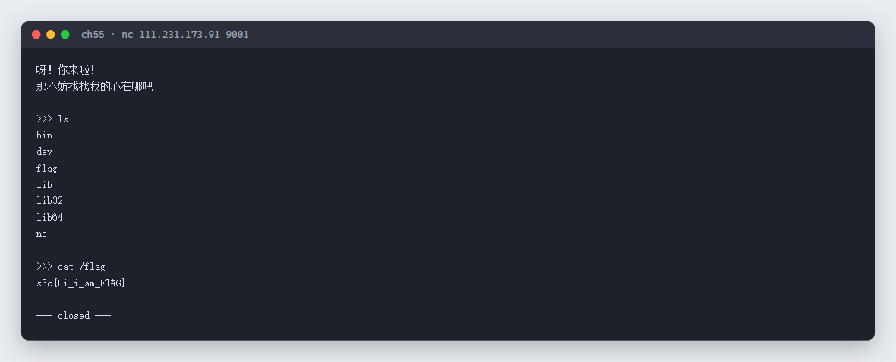

# 55 NC进你的心. · Pwn

- 分类：Pwn ｜ 分值：200 ｜ 状态：平台已解
- 题目给的是一个裸 `nc` 地址，连上去不是二进制交互，而是一个「只有 nc 的迷你文件系统」，flag 就摆在根目录。

## 题目

- 题号 55，题名「NC进你的心.」，题面只有一句「N C」。
- 静态附件题，附件里给的是一行地址：`nc 111.231.173.91 9001`。

## 思路

- 先按题面直接连：`nc 111.231.173.91 9001`，回两行中文：「呀！你来啦！那不妨找找我的心在哪吧」，然后给一个 `>>>` 提示符。
- 这不是 ELF 交互，而是一个伪装成 shell 的服务：能执行 `ls`、`cat` 这类命令，但环境里只有 `bin dev flag lib lib32 lib64 nc`。
- 「我的心」= 根目录下那个 `flag` 文件，直接读即可。

## 关键步骤

```bash
$ nc 111.231.173.91 9001
呀！你来啦！
那不妨找找我的心在哪吧

>>> ls
bin
dev
flag
lib
lib32
lib64
nc

>>> cat /flag
s3c{Hi_i_am_Fl#G}
```

实测会话：



## Flag

```text
s3c{Hi_i_am_Fl#G}
```

注意：本题 flag 是小写 `s3c{}`，正文里带 `#`，按原样提交。

## 踩坑 / 备注

- 别一上来就按常规 Pwn 思路找栈溢出：题目叫「NC进你的心」，考点就是「连上去看看它给了你什么」。
- 环境里的 `nc` 是 busybox 版本，`cat`、`ls` 可用但不是完整 shell，`/bin/sh` 不一定能起；目标只是读文件，不需要提权。
