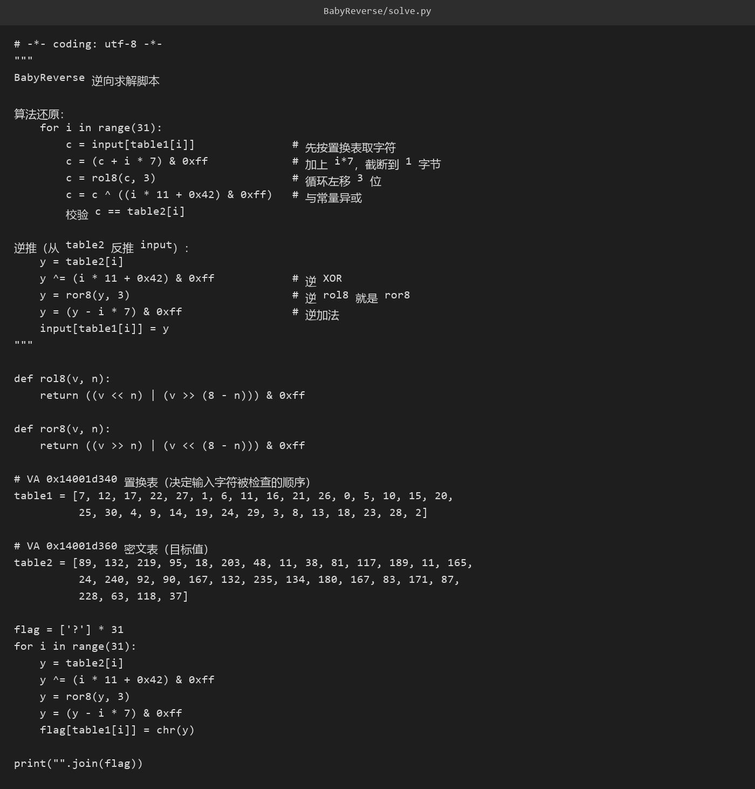
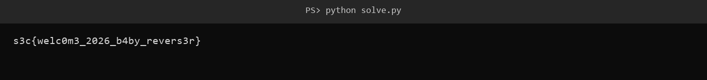

# 56 BabyReverse · Reverse

- 分类：Reverse ｜ 分值：290 ｜ 状态：平台已解
- 一句话概括考点：置换表打乱顺序后，对每字节做加常数、循环移位、异或，全部可逆

## 题目

- 附件 `BabyReverse.exe`，169,984 字节；题面原文未记录。
- 程序对输入的 31 个字符做校验，两张表分别位于 VA `0x14001d340`（置换表）和 VA `0x14001d360`（目标值表）。
- 校验通过即输出 flag 形态的 31 字符串。

## 思路

- 整个变换只有 `+ i*7`、`rol8(c, 3)`、`^ (i*11+0x42)` 三种操作，每一步都有唯一逆运算，不需要爆破。
- `table1` 决定检查顺序：第 i 次校验的是 `input[table1[i]]`，说明写回时也必须按同一映射落位。
- 逆向顺序与正向严格相反：先逆异或，再逆循环左移（`ror8`），最后逆加法。

## 关键步骤

1. 用 IDA 打开 `BabyReverse.exe`，在 `main` 里看到读入 31 个字符后先过一张置换表，再进校验函数。

2. 校验循环里两步：`input[table1[i]]` 取字符，跟 `table2[i]` 比。两张表都在 `0x14001d340` 和 `0x14001d360`，双击跳过去，按 `d` 把数据定义成字节，选中 31 字节复制出来。

3. 逆推 31 个字节是批量活，手算容易错，这一步用脚本完成。逆运算顺序与正向严格相反：

```text
y = table2[i]
y ^= (i * 11 + 0x42) & 0xff
y = ror8(y, 3)
y = (y - i * 7) & 0xff
flag[table1[i]] = chr(y)
```

4. 按 `table1[i]` 的位置写回字符数组，拼出 31 字符明文。



5. 运行脚本，输出完整 flag：

```bash
python solve.py
```



## Flag

```text
s3c{welc0m3_2026_b4by_revers3r}
```

## 踩坑 / 备注

- 逆运算顺序不能乱：必须先逆异或，再 `ror8`，最后减 `i*7`，顺序错一位就是乱码。
- `table1` 是“取哪个下标的字符来校验”，不是输出顺序；直接按 i 顺序写回会得到打乱的字符串。
- 本题源记录只保留了脚本与结果，运行过程未留其他日志，踩坑细节未记录。
