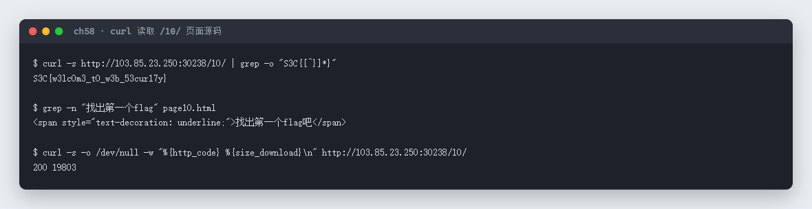
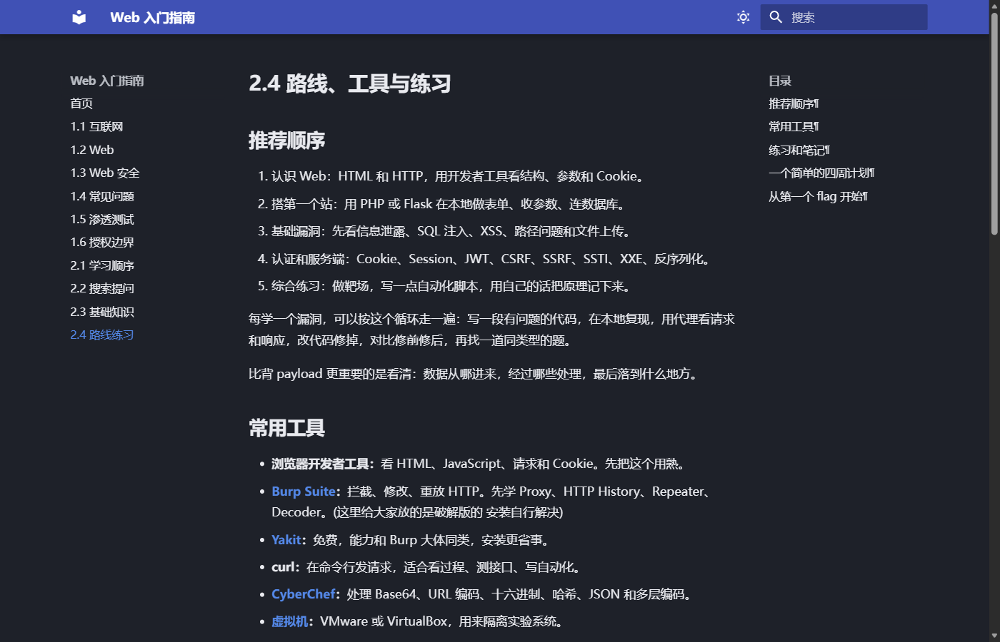

# 58 Web入门指南 · Web

- 分类：Web ｜ 分值：202 ｜ 状态：平台已解
- 一个 MkDocs 写的《Web 入门指南》站点，flag 藏在最后一章页面的 HTML 注释里。

## 题目

- 题号 58，题名「Web入门指南」，题面只有「不好意思啦 同学们」，无提示。
- 静态容器，站点是 Material for MkDocs 生成的十章教程（互联网 / Web / Web 安全 / 常见问题 / 渗透测试 / 授权边界 / 学习顺序 / 搜索提问 / 基础知识 / 路线练习）。

## 思路

- 这类「教程站」没有交互，flag 只会藏在两种地方：页面可见文本，或者源码里的注释/隐藏元素。
- 用 `curl` 顺着目录一页页翻没意义，直接看页面源码最快——MkDocs 的正文在 `<article>` 里，注释会原样保留。
- 第 10 章「2.4 路线练习」页尾有一句带下划线的「找出第一个flag吧」，紧接着就是注释形式的 flag。

## 关键步骤

1. 打开站点首页，拿到目录：`/01/` 到 `/10/`。
2. `curl -s http://<host>/10/ -o page10.html`，把最后一章存到本地。
3. 在源码里搜 `S3C{`，命中 `<!--S3C{...} -->`。

```bash
curl -s http://103.85.23.250:30238/10/ -o page10.html
grep -n "找出第一个flag" page10.html
grep -o "S3C{[^}]*}" page10.html
```

实测输出：



页面本身是普通的教程正文，flag 在源码注释里，页面上看不见：



## Flag

```text
S3C{w3lc0m3_t0_w3b_53cur17y}
```

## 踩坑 / 备注

- 只翻页面文字会一无所获：flag 是 `<!-- -->` 注释，浏览器不渲染，必须看源码。
- 站点是 MkDocs，路径规则 `/NN/` 对应第 NN 章；题目提示「找出第一个flag」，直接翻到最后一章比从第 1 章顺序看快得多。
