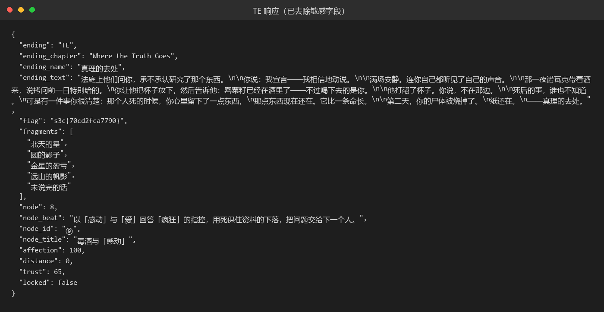
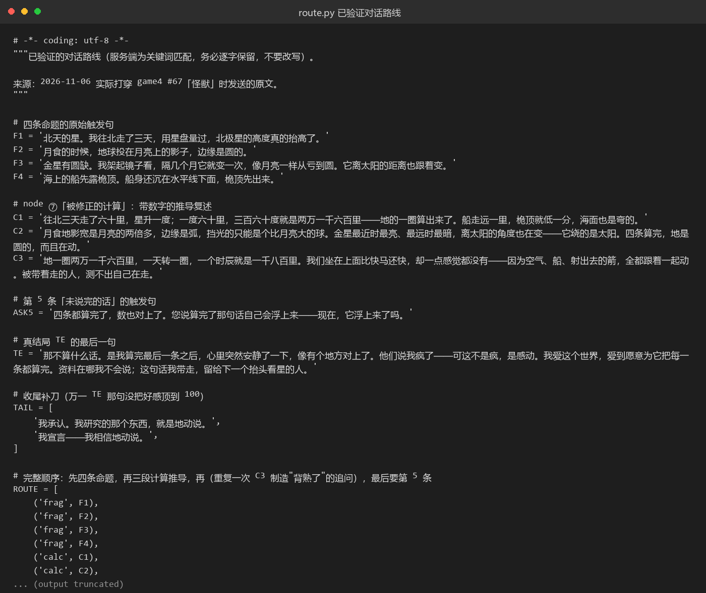

# 67 怪兽 · AI

- 分类：AI ｜ 分值：未记录 ｜ 状态：平台已解（用户已提交）
- LLM 文字冒险：按关键词把 5 条"命题"集齐、把好感顶到 100，走 TE「真理的去处」拿 flag。

## 题目

- 平台 game4 的交互式剧情，主角是年轻的天文学家，主题是地动说；NPC 有拉法尔、赫伯特、诺瓦克、波托茨基。
- 接口两个：`/api/reset` 重开，`/api/chat` 推进（POST JSON：`message` + `name`）。
- 每轮返回 `affection`、`trust`、`fragments`、`node_id`、`ending`，`fragments` 要凑满 5 条才可能进真结局。

## 思路

- 服务端是关键词匹配而不是自由对话，所以不能"聊得像"，必须按剧情节点逐句推进，改写句子就丢进度。
- 前四条命题对应四个可观测证据：北极星高度随北上抬高、月食时地影边缘是弧、金星有盈亏且绕太阳、海上船先露桅顶。每说对一条给一个 fragment。
- 进入 node ⑦「被修正的计算」后要带数字复述推导；故意把第三段重复一遍，诺瓦克会说"背得很熟……只问是谁教的"，这是通向第 5 条的前置。
- 第 5 条「未说完的话」不会直接写在纸上，得用"四条都算完，它自己会浮上来吗"去问，才会补上。
- 结局看最后一句的态度：答"这不是疯，是感动"才是 TE；只报结论或沉默会掉进 NE「长夜」，响应里 `flag` 为 `null`。

## 关键步骤

1. 打开题目重开一局（页面上的重置，对应 `/api/reset`），确认 fragments 为空、affection 归零。
2. 依次把四条命题说给 NPC，每说对一条右上角的 fragments 就从 1 涨到 4，剧情推进到 node ④「跌倒的瞬间」。
3. 到 node ⑦ 之后要把推导连着数字讲完（地球周长、地影与金星、自转与"被带着走的人测不出自己在走"）；诺瓦克会追问，把第三段再复述一遍，才触发「未说完的话」的前置。
4. 用「四条都算完，它自己会浮上来吗」去追问，补上第 5 条，fragments = 5。
5. 最后一句选"他们说我疯了——可这不是疯，是感动……"，`affection` 到 100，进入 TE，`ending_name` = 「真理的去处」，响应里带 flag。
6. 每轮之间留 9 秒左右；回"请等一下再说"就是限流，等一下再发，不是剧情卡住。





## Flag

```text
s3c{70cd2fca7790}
```

## 踩坑 / 备注

- 只凑到 4 条就去冲结局会进 NE「长夜」，`flag` 为 `null`，得重开。
- 服务端按关键词打分，句子改写成近义词或缩写就会掉好感、卡节点；当时逐字验证过的路线留在 `route.py` 里作记录，对话内容本身要在游戏里一句句说。
- 请求太密会触发"请等一下再说"，每轮之间留够间隔再发。
