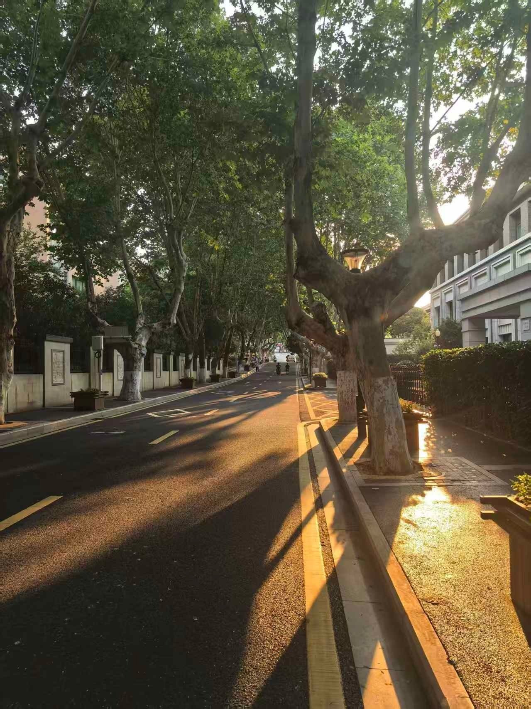
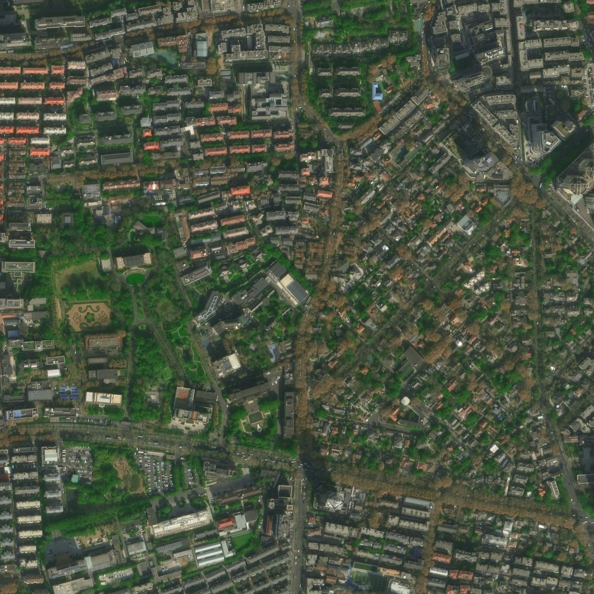

# 69 真~寻找学长 · OSINT

- 分类：OSINT ｜ 分值：500 ｜ 状态：平台已解
- 附件照片 metadata 被清空、反搜全灭，只能靠"法桐 + 米黄文化围墙 + 苏式挑檐方柱楼 + 丁字路口"这组特征组合定位到南京市鼓楼区马鞍山路。

## 题目

- 附件 `challenge.photo.jpg`，397,019 字节，1279×1706 竖拍街景。
- 提交格式：`S3C{城市_区_街道_经度_纬度}`，经纬度各保留 1 位小数。

## 思路

- 先扒 metadata：EXIF / XMP / IPTC / 缩略图段 / JPEG COM / 文件尾部全空，DQT 是标准 PIL 量化表（质量约 75），说明原图被重编码过——这题只能靠画面。
- 整图加多处裁剪（右侧建筑、左侧围墙、远处路口）分别反搜：百度识图只有 4 张视觉相似、搜狗/360 无结果、TinEye 超时、Yandex 被验证码拦住、Google Lens 不通。唯一像的上海武康路，框是横的，方向就不对。
- 左侧是米黄实墙 + 等距竖长方形白框展示板，这是政府大院/高校边界围墙宣传栏；右侧是厚重水平混凝土挑檐压着大方柱，典型 1950 年代苏式办公楼。两个特征单看都常见，叠起来范围就很窄。
- 照片是沿街竖拍，马鞍山路本身是东西走向，镜头顺着路的东西轴向看过去；阳光从画面右侧斜射、树影拉得很长，只能说明是上午或午后的斜射光，不能单独用来定方位。远处是丁字路口。城市基本锁定南京（S3C = 三江学院在南京），马鞍山路就贴着河海大学。
- 把南京有法桐的东西向小路列出来筛：颐和路是民国黄墙别墅、宁海路与江苏路是南北向、汉口西路两侧是密集居民楼没有苏式办公楼，只有马鞍山路同时命中东西走向、文化围墙、苏式楼和丁字路口。
- 马鞍山路全线在鼓楼区，最后用卫星瓦片核对道路走向（东西向）与建筑布局，再按题目精度取 1 位小数。

## 关键步骤

1. 图片取证：EXIF / XMP / IPTC / 缩略图 / COM / 尾部数据全为空，排除隐写与拼接，确认是"干净"图。
2. 反搜无精确命中，只得到"法桐 + 围墙带框"的相似场景线索，转而做特征推理。
3. 特征拆解后按"城市 → 街道 → 区"逐层收敛，候选表里只有马鞍山路全部匹配。
4. 用高德卫星瓦片 z18 拼接马鞍山路片区，中心瓦片 (217553, 106400) 反算出 118.7643°E、32.0634°N；卫星图上马鞍山路为东西走向，与南北向的西康路相交，路口东侧就是河海大学校园。
5. 题目只要 1 位小数：经度 118.8、纬度 32.1；拼音 `nanjingshi_gulouqu_maanshanlu`，按 城市_区_街道_经度_纬度 拼装。





## Flag

```text
S3C{nanjingshi_gulouqu_maanshanlu_118.8_32.1}
```

## 踩坑 / 备注

- metadata 被抹干净是常态，别在 EXIF 上耗时间，重点看画面内容。
- 反搜只能给"相似场景"提示（比如上海武康路那张），不能直接给答案。
- 环境里的背景信息（浏览器开着的河海大学相关视频）只能当辅助佐证，主证据还是建筑与道路特征。
