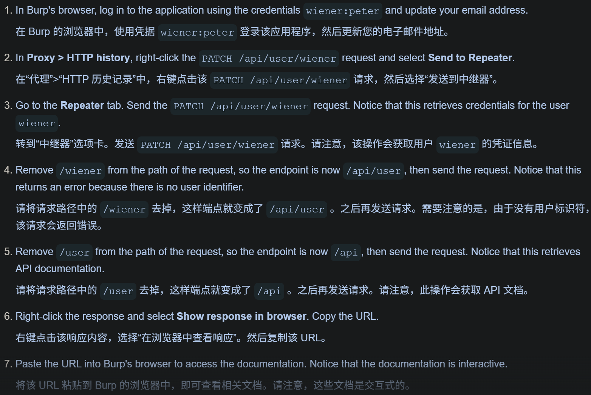
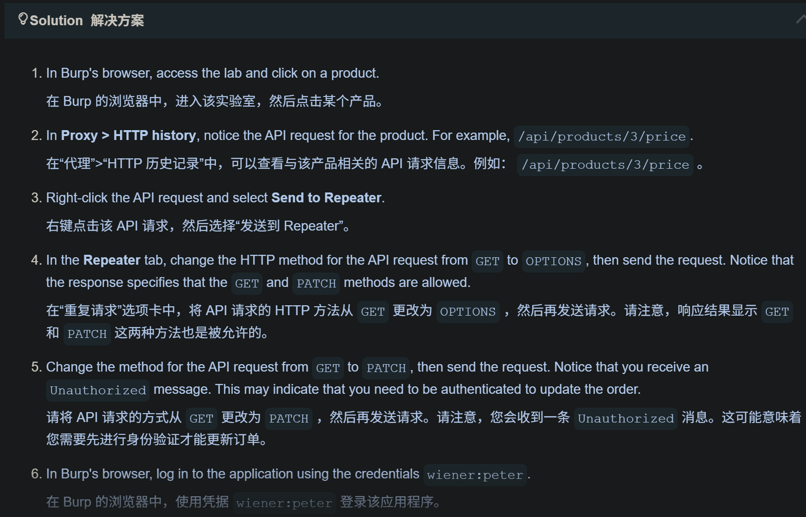
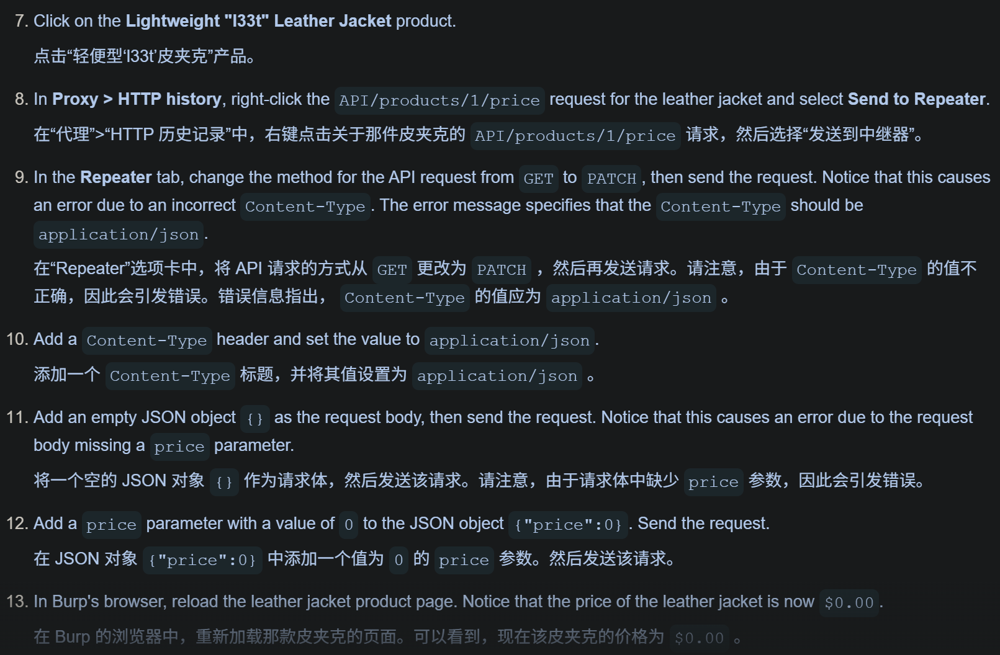
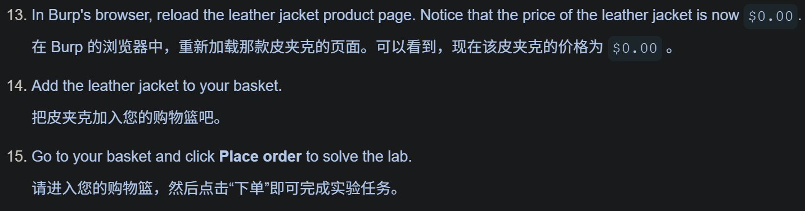

# web

## burp suite 
https://portswigger.net/web-security/learning-paths/api-testing/api-testing-api-documentation/api-testing/lab-exploiting-api-endpoint-using-documentation

 
API测试

Lab: Finding and exploiting an unused API endpoint
实验：寻找并利用那些未被使用的 API 接口

